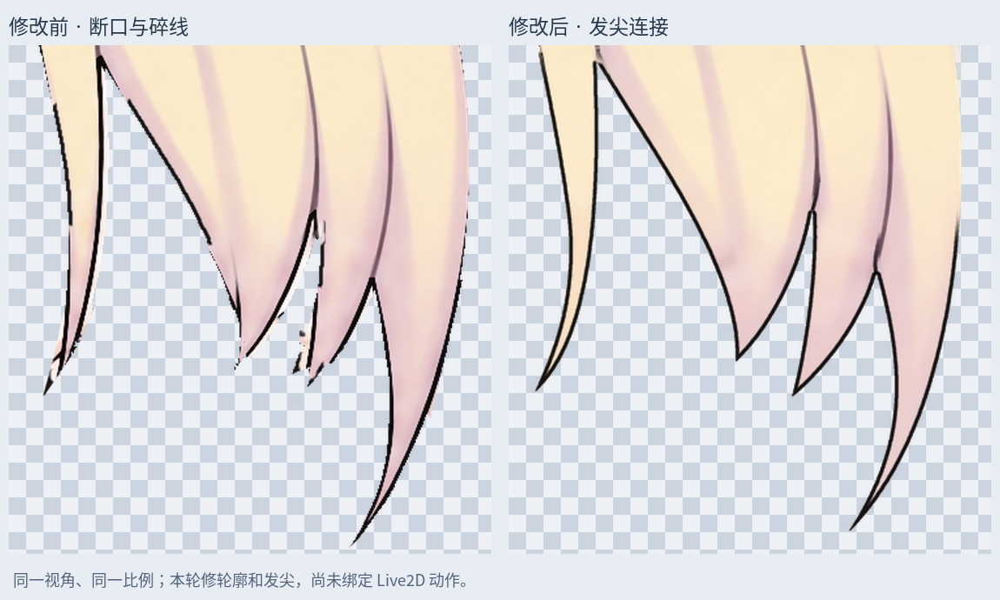
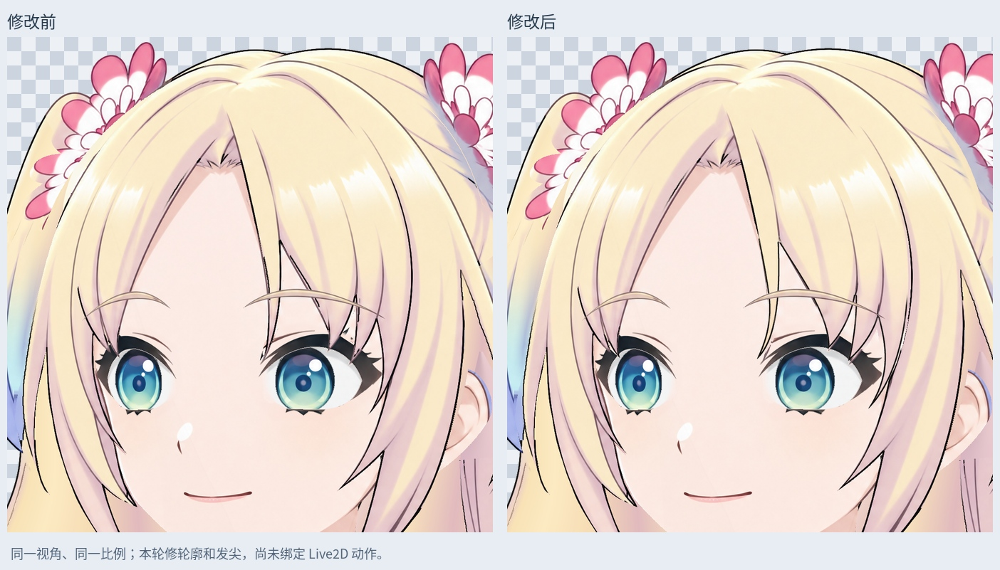
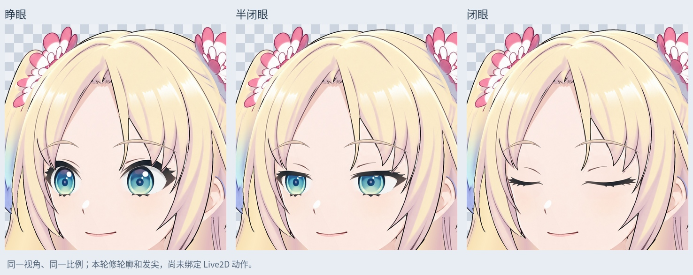

# 刘海轮廓与发根修正

上一版仅增加独立黑线，刘海颜色层和透明轮廓保持不变，因此发尖断口、锯齿和旧黑线残片仍然存在。本轮直接修正当前左视图刘海的中间 / 右侧发尖轮廓，并同步替换眼前刘海副本。随后继续接回两处内部发流线，补齐右花饰下的发根凹口。

主文件：`Rurino_Bangs_Contour_Repaired_v034.psd`，3456 × 2816，55 个像素层。

## 已修改

- 顺着现有发流重建不等长发尖的曲线，保持中间刘海连续，没有新增矩形切片。
- 清理旧轮廓附近的黑线残片，局部颜色从相邻头发推断补齐，再生成独立 `Ink_Crown` 线层。
- 对左上连接处的小缺口补回原画中的头发像素。
- 接回两处内部阴影线与分叉尖端的连接，避免线条悬空。
- 右侧发根按弧线补全花饰下的缺口，清除沿花瓣切口遗留的黑线。隐藏区域采用局部金色 / 粉色补画，原有可见发根保留在原图层；新增 `Crown_ConcealedRoot_Underlap_LOCAL` 放在侧发下面，补全区域不会压住侧发的可见线条。
- 同步更新 `Left_Fringe_EyeOverlap_SOURCE`、`RightFringe_ForegroundTips_SOURCE` 及对应黑线；眼睛上方使用同一轮廓。
- 新增 `Fringe_Edge_Skin_Underlap_LOCAL` 局部肤色补底。原脸部按旧发边裁切，改发尖后需要窄幅补底；该层在眼睛层下方，不覆盖眼睛，也不重新绘制脸型。

6 个已有像素层修改，新增 2 个局部补底；其余 47 个图层的 RGBA、位置、混合、透明度、可见性与剪贴属性逐项保持一致，包含全部五官与独立眉毛。

## 检查与边界

- 保存回读的 8 个输出层与 PNG 一致，PSD 默认合成与预览一致。
- 刘海保持一个主要连通区域，无封闭针孔。
- 检查睁眼、半闭眼、闭眼三种静态合成；修边没有新增透明露底缝隙。
- 边缘颜色与肤色补底含局部推断，并非恢复不可见原画。原视频用于造型参考，本轮没有生成新角色图。
- 本轮修正下部发尖、两处内部线条连接，以及右花饰下的发根轮廓。共用发根仍保持原图层归属，隐藏补画尚未经过动态露底检查，不能当作全部转头视角已完成。
- 这是当前左视图的静态 PSD 材料；尚未新增 Cubism 网格、转头、抬低头、身体侧摆或头发物理。运行模型仍为旧稿。

输入 SHA256：`c65494958a7b3059252d5d530547fb040e2c3d1a58fd69d6a73dc06c1253a65c`

输出 SHA256：`8cc7afed55ebd88bd417d76726ccdf82ed78d38ec81dc468164590ea2134bbe4`

## 使用与重建

直接打开主 PSD 即可编辑。默认显示 `02_Open`，其余眼型组仅单独开启其中之一。头发颜色层与 `Ink_` 线层仍可分别调整。

包内保留上一版 PSD、原画取色参考、重建脚本和所需预览。安装 `production/requirements-materials-v034.txt` 后，先运行 `python production/repair_bangs_contours_v34.py`，再运行 `python production/repair_bangs_contours_v34.py --build`。预览字体使用 Linux Noto CJK，其他系统可修改 `outline_hair_layers_v34.py` 内的 `FONT` 路径。

