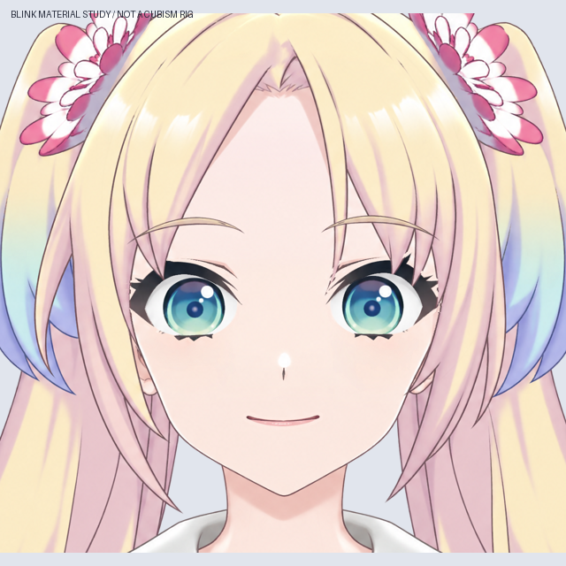

# v0.3.4 眨眼素材关键形（尚未绑定）

主文件：`Rurino_Head_Blink_Materials_v034.psd`。本稿在 29 层面部素材上增加半闭眼、闭眼两个状态，共 39 个像素层。默认显示睁眼，另外两个眼睛状态组隐藏。

## 本轮完成

- 使用 LibTV Lib Image 2.5 Pro 生成一张自然闭眼补画，只提取闭眼睫毛，未使用生成图替换整张脸。原始提示词、任务、节点和交付记录保存在 `sources/`。
- 将闭眼睫毛两端对齐原睫毛的横向范围，保持眼距；生成图里额外的眼褶不重复叠加。上眼褶由原素材小幅下移得到。
- 眼白开口逐渐收拢，虹膜贴图保持原尺寸与位置。上睫毛做轮廓过渡，下睫毛收拢到闭合处，不压缩整只眼球。
- 中间态改用轮廓插值，并延伸睫毛实色到抗锯齿边缘下方，避免外眼角出现两层灰色睫毛。
- 仅对两处刘海做局部修补：左侧刘海边缘捕获的睫毛碎点、右侧细发尖的小断口。侧发与眼角交界尚有细边需收整。
- 保存 1、0.75、0.5、0.25、0 五个开合度的全尺寸合成 PNG；PSD 内保留睁眼、半闭眼、闭眼三组可编辑图层。

## 如何查看

看效果：`qa/blink-material-check.png` 是无损 APNG 动图，静态对照为 `qa/blink-keyforms.jpg`。

PSD 中 `02_Eyes_Open_DEFAULT`、`03_Eyes_Half_ENABLE_ONLY_ONE_EYE_GROUP`、`04_Eyes_Closed_ENABLE_ONLY_ONE_EYE_GROUP` 每次只显示其中一组；同时显示会重叠。PSD 是素材与关键形参考，尚未设定 Cubism 参数，不能直接当作桌宠模型运行。

## 验证与限制

`qa/checks.json` 保存本地合成与重新打开 PSD 的验证：

- 五个开合度中，眼区以外最大像素变化为 0，透明度轮廓保持一致。
- 原中性图只在上述两处发丝修补区域发生变化；眼距、瞳孔、嘴和脸型未移动。
- 虹膜源贴图不变；全闭眼时眼白开口 alpha 总和为 0，下眼线合并后不留第二条线。
- APNG 按实际帧时长解码后，与渲染序列逐像素一致，没有使用 GIF 调色板。
- PSD 与独立合成的可见 RGB 最大差：睁眼 6、半闭眼 9、闭眼 1；alpha 最大差 1。半闭眼仅 2 个抗锯齿边缘像素的 RGB 差超过 7，未宣称两种合成器完全一致。

这只是栅格素材动作研究。尚未创建 Cubism 网格、EyeOpen 参数、运动文件或新的 Windows 运行模型。中间态外眼角和眼发交界仍需最终线条收整，然后才能将关键形做成连续网格变形。口腔、唇形、头部透视和发根物理仍待制作。

复现：先按源码包 README 重建上一阶段，再运行 `python production/build_blink_materials_v34.py`。仅读取本地已保存素材，不再次请求 LibTV。

