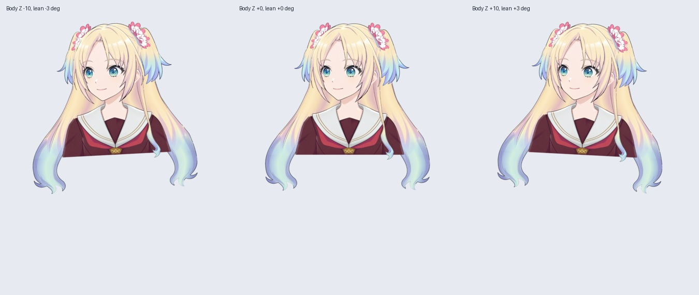
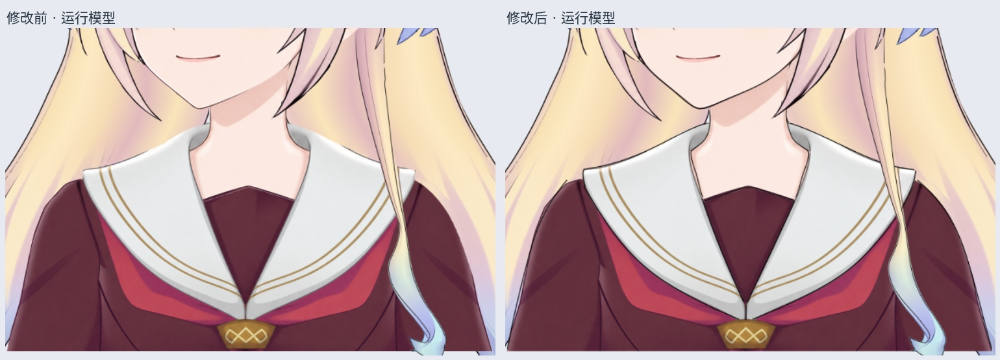

# 轮廓修复、四马尾与身体侧摆 v0.3.4

本轮先修脸颊、脖子及衣服黑线，再完成四条马尾的独立弯曲、腰部侧摆和头发物理跟随。当前仍是左视图半身工作稿，不能当作整套桌宠已经完工。

## Windows 直接查看

下载 `Rurino_Body_Hair_Runtime_v0.3.4.zip` 并完整解压。在已有 Windows 桌宠的模型选择界面，选择 `runtime-desktop/Rurino_Body_Hair_v034.model3.json`。保留同目录的 moc3、纹理、physics3.json 和 motions 文件夹。无需打开 Cubism；模型带八秒侧摆待机，现有桌宠会在动作结束后重新播放。

只有 PSD / cmo3 无法直接运行。运行包不包含 Python、桌宠程序或语音模型；已有桌宠启动方式仍是 `desktop/Start-Windows.cmd`。

## 本轮制作

- 新增独立的下颌、脖子、衣服线稿层，清理脸颊白边、脖子旧暗边；沿领口、翻领与肩部重新理顺黑线。金色装饰和原有阴影保留。PSD 为 60 层，54 个旧层像素/偏移/可见性未变，3 个旧层局部清边，新增 3 个线稿层。
- 两侧小马尾固定上部控制点，根部与发梢分开控制。两侧大马尾新建共享颜色与黑线的 5×9 网格、2×4 Bezier 变形器，上部固定，逐段增加下部摆幅。四条马尾可独立控制，黑线不会单独滑走。
- 新增腰部根旋转变形器，`ParamBodyAngleZ=-10/0/10` 对应画面侧倾约 `-3/0/3°`。这是整个半身以腰部为支点的小幅侧倾，头部与五官保持刚性；不是转头，也不是身体前后仰。
- Cubism 工程内含四组物理。小马尾的响应较快，大马尾的响应较慢，身体侧倾时产生相对弯曲并逐渐回稳。刘海、头顶、鬓发与细长发尚无独立物理。
- 运行包附程序编写的八秒待机 motion3，实际侧倾约 ±1.8°。它只驱动身体参数，头发由物理系统计算，未写入固定的发丝摆动曲线。可编辑模型及物理保存在 cmo3；此待机曲线由 `package_body_hair_runtime_v34.py` 生成，没有对应 can3 动画工程。

## 文件

- `Rurino_Body_Hair_v034.cmo3`：最新工程，Cubism Editor 5.3.04 FREE，SDK4.2 导出。
- `runtime-body/`：编辑器原始导出，50 个可见部件、29 个参数、一张 2048 纹理，含物理。
- `runtime-desktop/`：在上述导出上增加待机动作引用，可直接供桌宠加载。
- `materials/Rurino_Skin_Clothing_Ink_v034.psd`：60 层完整材料，不需重复导入最新工程。
- `qa-body/body-hair-physics.mp4`：实际 SDK 渲染，身体摆动两轮后停止，展示头发回稳。无配音；视频使用 30fps、16 秒，不使用 GIF 调色板。
- `qa-ink/runtime-ink-before-after.jpg`：黑线修复前后的实际运行对照。
- `checkpoints/`：线稿整合及四马尾阶段的可编辑回退工程。

## 验证与限制

1. 四马尾 105 组单侧及组合参数检查通过：根部顶部 10% 最大位移约 0.0012 原图像素、颜色与黑线共有顶点位移误差小于 0.01 像素、无三角形翻面。
2. 身体和头发 51 组组合检查通过。每个组合与原头发姿态之间可用单一刚性旋转拟合，最大残差小于 0.01 原图像素，没有通过拉伸脸型制造侧摆。
3. 960 帧、60fps 物理检查通过。最后一秒四条马尾参数的最大残余绝对值小于 0.0023；20 秒待机检查通过，动作持续重播且头发参数不超范围。
4. 工程保存、关闭、重开后导出：moc3、模型 JSON、显示 JSON 与纹理逐字节一致；物理与调试输入 JSON 内容一致（排版不同），交付采用编辑器重新导出的物理文件。
5. 本地 Linux 隔离显示环境中的现有桌宠冒烟检查通过：透明渲染、加载/重载、拖动、大小、置顶、设置与静音。此次没有 Windows 实机验证，也没有新做 Ollama / 语音服务联调；音量包络检查不代表当前模型已有嘴型。
6. 线稿新增时贴图集重新排布，修复区外有轻微纹理重采样，平均最大通道差约 0.3703/255。四马尾改绑后的中立网格差异小于 0.001 原图像素，渲染仅 3 个像素变化超过 3/255。

## 尚未完成

当前新工程尚无连续眨眼、嘴型、眼球追踪、真实左右转头、抬低头、组合角度和身体前后仰。头顶 / 刘海 / 鬓发 / 细长发仍需局部变形与物理；身体仍是腰部截断半身。下一步先做眼睑、虹膜裁切和嘴型，再推进头部透视、身体前后仰及其余头发联动。不能把旧 v0.3.3 的功能当作本工程已有功能。

修复和检查脚本位于 `production/`。素材修复脚本依赖工作区历史输入路径；当前 ZIP 提供成品 PSD，不重复包含全部历史生成素材。QA 需要 live2d-py、PyQt5、Pillow、numpy 和 OpenGL；视频输出还需要 FFmpeg（可用 FFMPEG 环境变量指定路径）。

