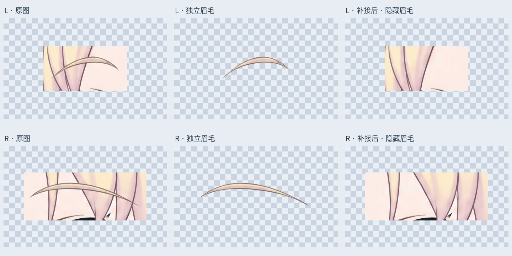
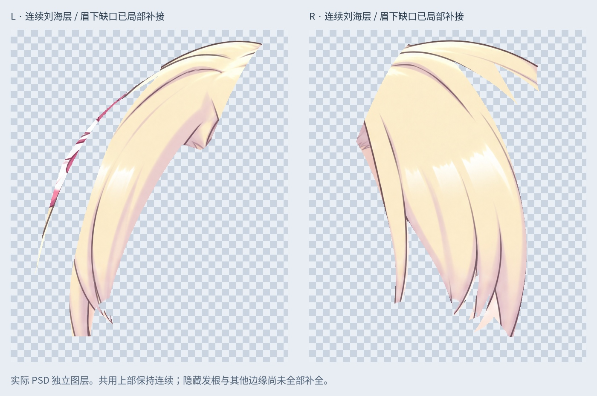

# 完整眉毛独立分层，开始修补头发

按用户最新要求：中间刘海无需继续细拆，上一轮 C/D 可见下段候选不采纳；先将眉毛单独分开，再补全各块头发。此顺序覆盖此前“先全部拆完再修”的安排。

## 本轮实际结果

- 当前使用 `Rurino_Brows_Separated_Fringe_Repaired_v034.psd`，共 71 个像素层。沿用 66 层输入，不使用 69 层 C/D 拆分稿。
- 左右完整眉毛分别独立为 `Eyebrow_L_Full_LOCAL_CLEANUP`、`Eyebrow_R_Full_LOCAL_CLEANUP`。眉形和颜色取自原图，将交叉处夹带的短发线和背景边缘作局部清理；不是带着周围头发的矩形或宽带覆盖区，也不是逐像素原样抠取。
- 左右连续的头顶/刘海共用层恢复原有连贯结构，眉下缺口沿原发流局部补接。同步清理眉毛在脸皮及其他来源层上的部分，避免移动眉毛后原处残留眉线。
- 补接仅在眉毛附近的 11328 个像素遮罩内进行：沿观察到的纵向描边插补颜色，并修复局部像素归属。不是整头重绘，也没有拉伸原脸或原刘海。
- 原 66 层像素和属性保留作备份，替代层隐藏。新增图层保存回读与透明 PNG 一致。

## 验证

PSD 回读后检查睁眼、半闭眼、闭眼：眉周修补遮罩以外整图 RGBA 与输入完全一致；遮罩内因为补画和眉缘清理允许变化，不宣称整图完全一致。

`qa/brow-repair-review.jpg` 展示原图、独立透明眉毛以及实际保存的 PSD 隐藏眉毛后效果。`qa/fringe-repaired-full-alpha.jpg` 展示保存回读的完整独立刘海层；没有拿合成局部截图冒充独立发束。

## 后续补全清单

| 结构 | 本轮状态 | 待补内容 |
| --- | --- | --- |
| 头顶/刘海 | 保持连续；先补左右眉下缺口 | 共用根部、完整隐藏面、贴脸边缘及原层混入的花饰/肤色残留 |
| 小双马尾一对 | 沿用已有可见组件 | 扎点后的完整根部、组件交界和摆动余量 |
| 大双马尾一对 | 沿用已有可见组件 | 被身体遮住的部分、根部连续结构；画布外发梢尚无依据 |
| 鬓边及胸前细发 | 沿用已有层 | 确认归属后补遮挡段，清除皮肤/附件残留 |

本轮只覆盖当前左转视角工作稿。其他视角、全头发隐藏区域、网格、物理和身体联动尚未完成。

## 方法及交付

本轮为本地位图编辑。LibTV 连接及项目回读可用，但此前受商业限制的 R02 节点仍无产物，不能据此宣称生成恢复；没有再提交生成任务。内置 image_gen 未提供，此次没有使用需要另行授权和 OPENAI_API_KEY 的 API 回退。

`Rurino_Brows_Fringe_Repair_v0.3.4_ADDON.zip` 包含本轮输出、66 层输入、脚本、透明图层、遮罩和核验记录。安装 `production/requirements-materials-v034.txt` 后执行 `python production/separate_brows_restore_fringe_v34.py` 可复现。字体默认 Linux Noto CJK，其他平台可调整 FONT；直接打开 PSD 无需执行脚本。

