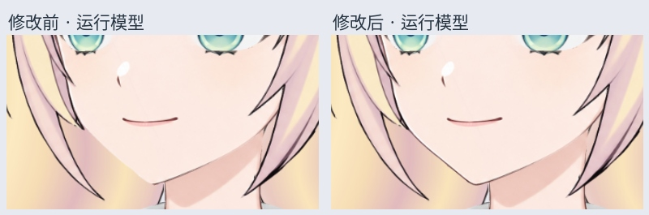

# 脸颊轮廓恢复 v0.3.4

2026-10-29：修复画面左侧脸颊到下巴的轮廓线缺失。原始皮肤参考图中线条完整，但旧脸部拆层的裁切边界向内偏移，把细线和窄皮肤边缘一起切掉了。本轮沿原图恢复这一段，没有拉伸脸型或移动五官。

## 文件与打开方式

- `Rurino_Cheek_Contour_v034.cmo3`：Cubism Editor 5.3.04 FREE 中保存的最新工程，继承左右小马尾独立三点关键形。
- `runtime-cheek/Rurino_Cheek_Contour_v034.model3.json`：SDK4.2 运行入口，保留同目录所有模型和纹理文件。
- `materials/Rurino_Cheek_Contour_Recovered_v034.psd`：57 层完整材料，原有 55 层像素和位置保留。
- `materials/Rurino_Cheek_Contour_ADDON_v034.psd`：只有本次新增的两个图层，供单独查看；新 cmo3 已接入，无须再次导入。
- `CheekEdge_Skin_Recovery` 为窄皮肤补边，`Ink_FaceContour` 为独立深色轮廓，均取自原始皮肤参考，线色与现有下巴轮廓衔接。
- `qa-cheek/runtime-cheek-before-after.jpg` 是实际导出模型的局部对照；`qa-smalltails/smalltails-runtime-sway.gif` 是修复后模型的双侧小马尾参数演示。

## 检查结果

- 47 个可见部件、29 个参数，一张 2048 贴图。新增补边放入原有脸部 Part，位于脸部皮肤及前景头发之后、后发之前。
- 旧模型 45 个部件在中立、左负右正、左正右负三个姿态下，顶点坐标与新模型逐项一致；参数列表也一致。
- 1600×1304 的同条件 SDK 渲染对照中，超过 3/255 的像素变化共 651 个，全部位于脸颊局部区域。
- 33 组小马尾单侧及组合参数检查通过：无新增三角形翻面，底色/黑线共有顶点位移一致，只有对应的小马尾移动。
- 工程保存后关闭、重新打开，再次导出的四个文件（模型、两种 JSON、贴图）与被检查版本逐字节一致。
- 复核记录保存在 `qa-cheek/`、`qa-smalltails/` 与 `materials/qa/recovery-report.json`。

## 当前边界与下一步

这是现有左视图半身工作稿的局部修复，不是已完成全部功能的桌宠。两侧小马尾保留试绑动作；右侧根部仍有约 3–5 原图像素位移。转头、抬低头、身体侧摆/前后仰、大马尾及头发物理仍待制作，当前新工程也没有眨眼和嘴型绑定。

下一步收稳右侧小马尾根部，再推进大马尾分段弯曲与肩部遮挡。不要把旧 v0.3.3 模型的动作当作本工作稿已经完成的功能。

修复脚本在 `production/`。材料修复脚本按工作区历史目录读取上轮 55 层 PSD 和左视图 Context_Skin_Reference.png；ZIP 提供修复结果，不重复打包全部历史输入。运行检查脚本使用 Python、live2d-py、PyQt5、Pillow、numpy 和支持 OpenGL 的显示环境。

