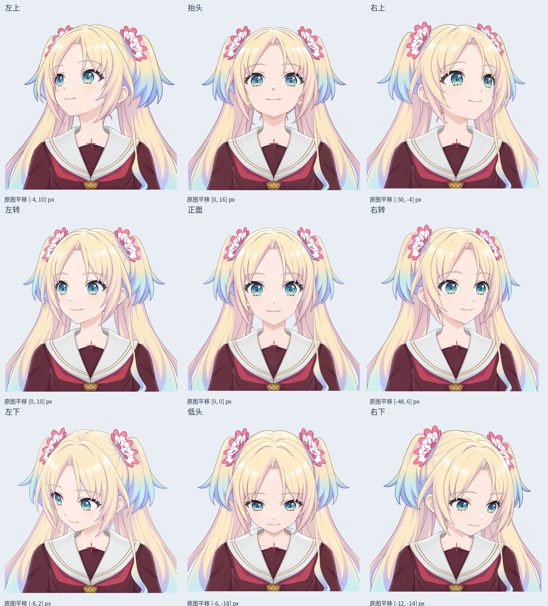

# v0.3.4 九方向领口锚点平移对照

文件：`Rurino_Nine_Direction_Collar_Translation_REFERENCE_v034.psd`，位于源码包 `rebuild_v3_4/turn_redraw/head_registration/`。

把服装内领上方的红色尖端作为统一参考点。右转、右上原图的这一点分别比正面偏右 48、50 原图像素。通过整数平移使九张参考的这个服装标记重合；头部和五官不作任何缩放、拉伸、镜像或重采样。

PSD 为 2176×2176，四周预留 64 像素；9 个完整原图层中默认仅正面可见。重新打开 PSD，9 张源图的全部 RGBA、2048×2048 尺寸和指定偏移均逐像素核对通过，无裁掉内容。

## 原图平移量（像素）

| 方向 | X | Y |
| --- | ---: | ---: |
| 左上 | -4 | 10 |
| 上 | 0 | 16 |
| 右上 | -50 | -4 |
| 左 | 0 | 10 |
| 正面 | 0 | 0 |
| 右 | -48 | 6 |
| 左下 | -8 | 2 |
| 下 | -6 | -18 |
| 右下 | -12 | -14 |

该点是服装图案，**不是颈部解剖转轴**；它本身也随生成绘画有差异。测量使用 1024 预览，原图估计误差约 ±6 像素。头部大小、下巴到颈根的关系和身体画法差异仍待校准，不以眼宽缩放头部。

九张整图仅为编辑参考，不用于切图或淡入淡出冒充 Live2D 动画。`registration.json` 记录原图 SHA256、锚点、偏移及限制。

