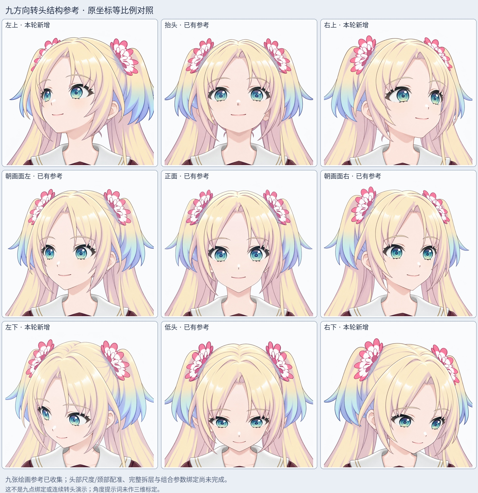
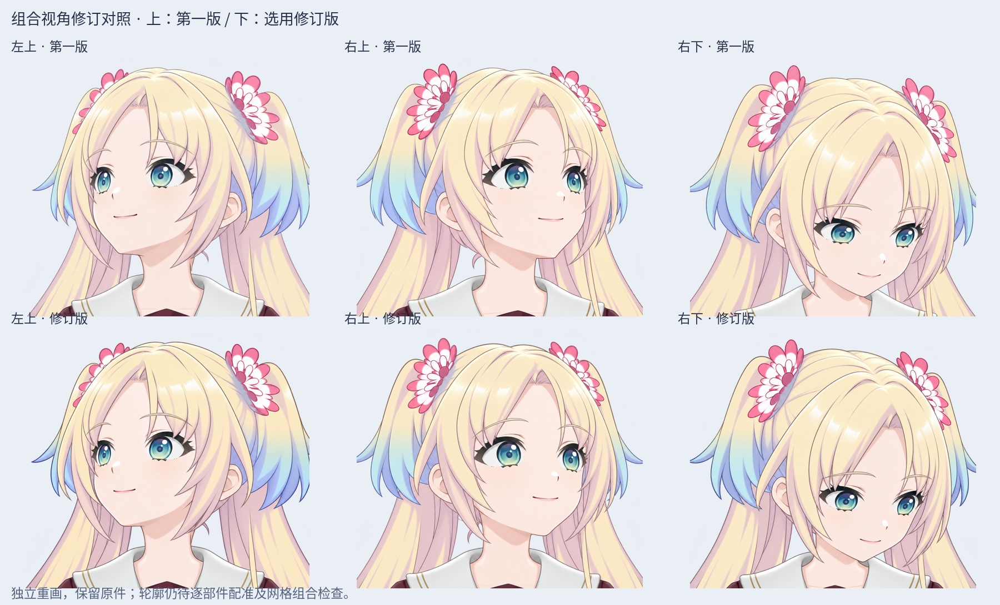

# v0.3.4 四角组合视角与九方向参考（未拆层、未绑定）

本轮在 LibTV 独立补画左上、右上、左下、右下四个组合视角，连同已有左/正/右/上/下，形成九方向结构参考。生成同时引用正面身份、已校正眼距的对应侧脸、对应上下视角；左右不镜像，不对正面整图拉伸。已校正的侧脸原件重新上传为独立画布节点，来源文件哈希与挂图回执保存在 `sources/reference-inputs.json` 和附件记录中。

当前优先任务仍是完整转头结构与部件对应，不把局部眼角精修当成转头已完成。

## 选用文件

以下路径均相对于源码包的 `rebuild_v3_4/turn_redraw/corner_redraw/`：

|方向|选用文件|静态审阅结论|
|---|---|---|
|左上|`sources/corner-left-up-v2-source.png`|第二版削弱方直下颌，保留左转抬头；远眼偏窄，须继续结合遮挡与网格检查。|
|右上|`sources/corner-right-up-v2-source.png`|第二版下颌较柔和、脸型更紧凑；颈部仍待配准。|
|左下|`sources/corner-left-down-source.png`|保留第一版，组合俯仰与侧转可见；仍需隐藏结构补绘。|
|右下|`sources/corner-right-down-v2-source.png`|第二版头部/颈根更接近正面构图、肩领倾斜减轻；身体像素并未锁定。|

每张为 2048×2048 透明 PNG。共生成 7 张，选用其中 4 张作为初步绘画参考；3 张第一版保留为未采纳候选。模型为 Lib Image 2.5 Pro，每次 count=1。全部提示词、参数、任务、资源和交付记录保留在 `sources/`。

## 查看与验证

- `qa/nine-direction-review.jpg`：九方向等比例对照。
- `qa/corner-face-detail.jpg`：四角眼睛、鼻嘴、下巴和颈部细节。
- `qa/corner-revision-comparison.jpg`：三处第一版与修订版对照。
- `qa/source-verification.json`：7 个生成原件均回读成功终态，核对资源 ID、实际下载大小、PNG 解码和 SHA256；已有五方向的来源哈希与上一阶段一致。

所有对照图使用相同裁切范围和等比显示缩放，未对某一方向额外变形来掩盖比例差异。生成时要求的侧转和俯仰角度仅是创作目标，不是经三维标定的角度。眼睛可见宽度同时受视线、眼睑与头发遮挡影响，不能硬套固定远近眼比或眼距比。

另提供 `Rurino_Nine_Direction_References_v0.3.4.zip`，只含 9 张选用原图、预览、选用记录与说明，便于 Windows 下载查看。完整源码包继续保留 PSD、未采纳候选、生成记录和脚本。

## 未完成与下一步

九张绘画参考不等于九点参数绑定完成。本轮没有新增完整部件 PSD、cmo3/moc3、连续转头动画或 Windows 运行模型。头部尺度、颈根与身体并未精确配准，现有静态稿仍需继续审校。

下一步先建立九方向的部件与遮挡对应，锁定颈根和头部尺度，再拆分完整脸皮、耳朵、刘海、后发及各视角眼部并补齐被遮挡部分。随后在 Cubism 中建立各部件关键形，检查转头与眨眼、视线、张嘴的组合，验证脸型和五官动作幅度一致。不能用这些整图切换或交叉淡化冒充连续 Live2D。

