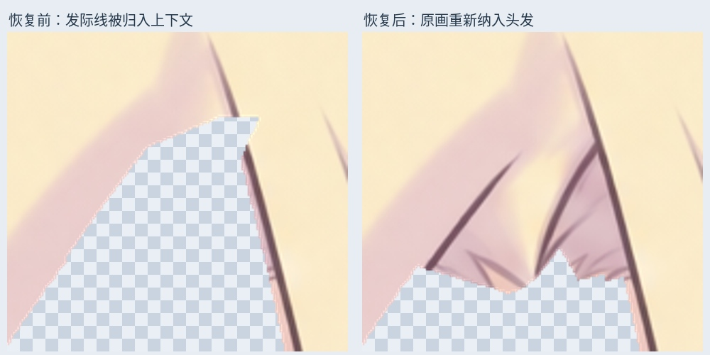
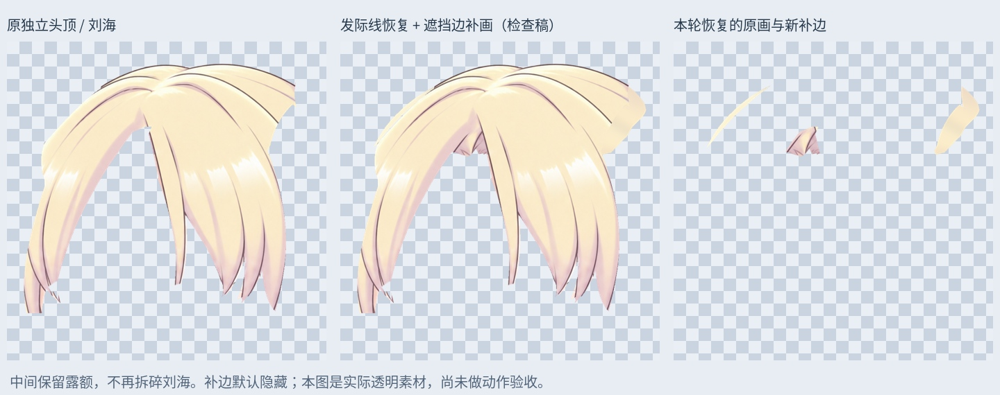

# 头顶 / 连续刘海：发际线恢复与两侧遮挡边补画

本轮从 101 层隐藏发面工作稿继续。检查真实透明素材时发现，上一阶段将额头上方一段发际线误归入 `NonHairContext`。合成头部看起来不缺，但独立头发材料在根部有断口。本轮修复材料归属，再补花饰附近两侧的小范围遮挡连接。

## 已做的修改

- 左侧恢复 3962 个原画发际线像素，右侧恢复 892 个。来自原有上下文图层，不是新生成的发际线。右侧下缘少量投在皮肤上的阴影继续留在上下文层。
- 两份原上下文层保留并关闭，分别替换为不重叠的 `Crown_Hairline_*_Recovered_SOURCE` 与 `Fringe_*_Context_AfterHairlineRecovery`。新分配的默认显示层拼回原图完全一致。
- 生成连续的头顶 / 刘海检查素材，保留中间露额，保持刘海整体，不恢复之前废弃的 C/D 拆分。
- 左花饰旁补 2564 个像素，右花饰旁补 9382 个像素。曲线按现有发面边缘向遮挡区域延续，颜色从本侧材料局部平滑取样；只作为连接余量，不是新发束。
- 左下端尝试补尖后发现横向接缝仍明显，已撤下该尝试，未放入本包。原左下平切口仍待配合贴脸发归属修整。

## PSD 使用

`Rurino_Crown_Roots_v034.psd` 有 106 个像素层。原 101 层的像素、偏移、透明度、混合及裁切属性保留；仅两份已替换的旧上下文层关闭。独立眉毛和既有其他头发材料保留。

`08_Crown_ContinuousMaterial_REVIEW_OFF` 默认关闭，其中 `CrownFringe_Continuous_Completed_LOCAL_REVIEW` 是本轮连续头顶 / 刘海检查稿。检查此层时单独显示它，避免同时叠加原刘海；它还不能直接当作可用的动态模型。新两侧补边只进入此隐藏检查稿，没有加入默认头部合成。

`layers/Crown_hairline_restored.png` 是恢复发际线后的真实透明头发，`Crown_complete_REVIEW.png` 另含遮挡补边，`Crown_concealed.png` 只有补画。`Hairline_*_source.png` 是从旧上下文找回的原像素，`Context_*_remaining.png` 是剩余内容。对照图来自这些实际独立素材，三列使用相同比例和视口。

## 验证

保存回读 PSD 后，新图层与交付 PNG 完全一致。睁眼、半闭眼、闭眼三种默认合成与输入 PSD 的 RGBA **逐像素完全一致**，变化像素均为 0；因此不会因这轮材料归属修正改变脸色或眼色。这只验证保存和静态重组，并不证明造型或动态遮挡已通过验收。

输入 SHA256：`dc440c01b7ef506ee57c9cb7cf80583cb433c0704dad35d8c46d55d00de4313e`

输出 SHA256：`ba361d17da06a852c50dd55dc7fc83277c7cef7136ef56381fe4441a910ae356`

## 仍待继续

这仍是当前左侧视角素材，未变成正面或新的角度关键形。头顶与刘海共用面尚未完全分成独立运动结构，左下切口、两侧花饰连接处的流线、长马尾肩后接缝与画布外发梢仍要修。身体左右侧摆、前后仰、头发物理与 Cubism 网格/参数尚未新增。

本轮是本地位图编辑。没有新的 LibTV 生成任务，也没有证据表明此前的 COMMERCIAL_BLOCKED 已解除。

## 包内容与复现

`Rurino_Crown_Roots_v0.3.4_ADDON.zip` 含本轮输入/输出 PSD、透明 PNG、遮罩、检查图、验证记录和脚本依赖。安装 `production/requirements-materials-v034.txt`，运行 `production/complete_crown_roots_v34.py`。可先加 `--prepare-only` 检查 PNG；字体默认 Linux Noto CJK，其他系统需调整 FONT。打开 PSD 无需运行脚本。本包不更新桌宠可运行模型。

