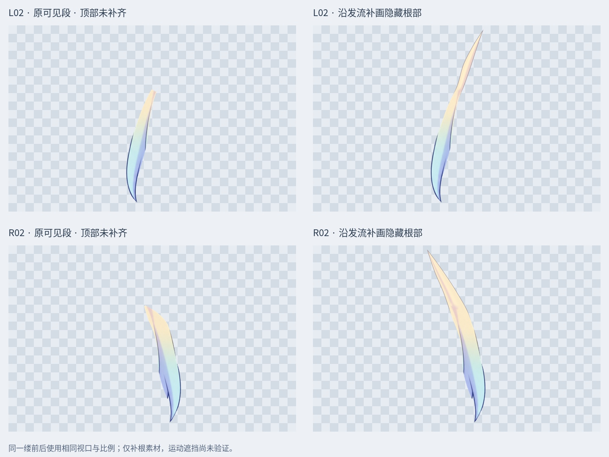
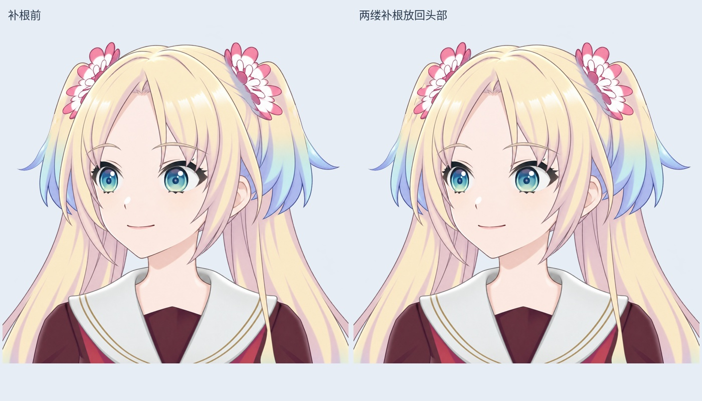

# v0.3.4 下垂短发 L02 / R02：沿发流补根

本轮处理两侧下垂短发原可见段的顶部断口。左右分别沿自身弯曲方向补画金色隐藏根部，使用各自发束内部颜色衔接，保留原蓝色发梢。属于现有位图的局部补画，不是新的 LibTV 整缕重绘。

## 当前材料

- 最新检查稿：`Rurino_Left_Head_Drop_Roots_v034.psd`，51 个像素层，4 个眼部裁切标志。
- 原 49 层的像素、偏移、透明度、混合方式和裁切标志均保留；仅隐藏 L02/R02 两个被替代的可见段。新层在原父组及原叠放位置加入。
- `layers/L02_RootExtended.png`、`R02_RootExtended.png` 为补根后独立透明发束；`PaintedHiddenRoot` 是分别保存的补画区域。
- `qa/drop-root-alpha-comparison.jpg` 展示实际独立透明轮廓，前后采用相同视口和比例，矩形棋盘格是展示背景。
- `qa/drop-root-head-comparison.jpg` 为放回头部的静态对照。

## 已检查与仍待修整

保存 PSD 后回读：原发束完全不透明像素保留，y=611 及以下 RGBA 逐像素相同；合成变化只发生于补根支持区域，原头部轮廓以外新增像素为 0。睁眼、半闭眼、闭眼三个状态的中央不透明脸部最大 RGBA 差为 0。这些检查只证明保存与中立姿态的局部一致性。

R02 内侧仍有相邻发束归属及小尖边待细修；根部锚点、发束弯曲时的遮挡余量、身体侧摆和前后仰组合尚未验证。根部绘画较简化，仍为隐藏结构素材。未增加 Cubism 网格、物理或可运行模型。

此前 R01/L01 是两缕完整 LibTV 重绘。本轮 L02/R02 是另外两缕的局部补根，不能合计成“四缕完整重绘”。其余发束仍逐缕处理。

## LibTV 实际状态

2026-10-28 检查服务、账户和原 R02 节点后，在同一节点 `i-UcpjWnGYq3` 尝试恢复一次；返回 `generation_rejected / COMMERCIAL_BLOCKED`，`task_id=null`，没有新图片。未新建替代节点，也未继续重试或发起 L02。账户会员信息不能说明具体限制原因。请求与回执保存在 `sources/r02-resume.json`。

## 交付

`Rurino_Drop_Hair_Roots_v0.3.4_ADDON.zip` 是本阶段增量包，包含输入的 49 层 PSD、输出的 51 层 PSD、独立 PNG、预览、脚本、来源回执和校验记录。此前完整源码 ZIP 和接缝修整增量包保留为历史阶段，不表示已包含本轮修改。

安装 `production/requirements-materials-v034.txt` 后，在解压根目录运行 `python production/extend_drop_hair_roots_v34.py` 可复现本地补画。预览字体默认使用 Linux Noto CJK 路径，其他系统应调整脚本 FONT。打开现成 PSD/PNG 不需要运行脚本。

