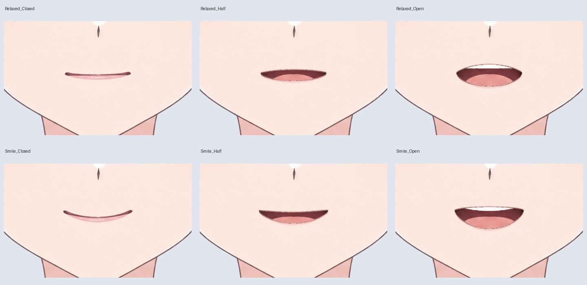

# v0.3.4 嘴角表情素材（76 层，未绑定）

主文件：`Rurino_Head_Expression_Materials_v034.psd`。继承上一轮 54 层眼嘴素材，增加放松、微笑两种嘴角形态；各含闭嘴、半张嘴、张嘴三个状态，共新增 22 层，总计 76 层。

## 做了什么

沿用此前 LibTV 补画和已拆好的口腔、牙齿、舌头、上下唇。本轮没有重新生成或替换脸部身份。默认仍显示原闭嘴笑容，新增状态默认隐藏。

嘴角相对中心的纵向变化上限为 6 个原图像素，横向比例为 0.975～1.025。相同形变同时应用于唇线、口腔与内部结构，避免嘴角偏斜或内部贴图脱离。中性闭嘴素材不变。

## 查看与验证

`qa/mouth-form-keyforms.jpg` 对照两种表情的闭嘴、半张嘴与张嘴状态；`keyforms/` 保存全尺寸合成图。

PSD 中所有以 `05_` 开头的嘴部分组，每次只能显示一个。原默认组为 `05_Neutral_Mouth`；新增组为 `05_MouthForm_Relaxed_…` 和 `05_MouthForm_Smile_…`。这些是可切换的素材关键形，尚未变成 Cubism 参数。

重新打开保存的 PSD，核对默认状态与六种新增表情。可见 RGB 对比独立合成最大误差为 1～2，alpha 最大误差 1；嘴部区域外像素完全一致。实际图层树共 76 个独立命名像素层、18 个裁切层。详见 `qa/checks.json`。

## 限制与复现

只有克制的放松/微笑嘴角变化，不是完整情绪库或 A/I/U/E/O 发音口型。没有新增 Cubism 网格、参数绑定、语音对齐、cmo3/moc3 或 Windows 运行程序。

在完成上一轮嘴部素材之后运行：`python production/build_expression_materials_v34.py`。使用已有本地素材，不调用 LibTV。

同期小角度头部变形研究见 `../head_motion_study/STATUS.md`；本 PSD 本身仍是正面分层稿，不能将转头 PNG 误认为已绑定的侧脸分层。

完整 PSD、PNG 与控制网格在 v0.3.4 GitHub 草稿源码 ZIP 内。
