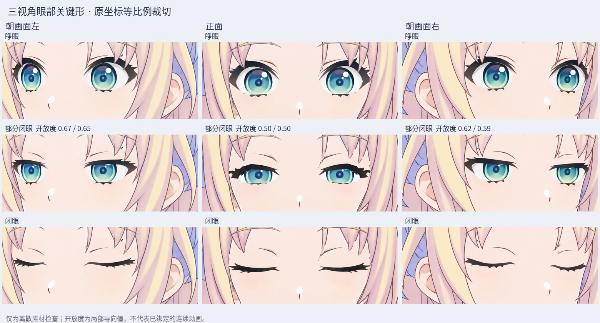
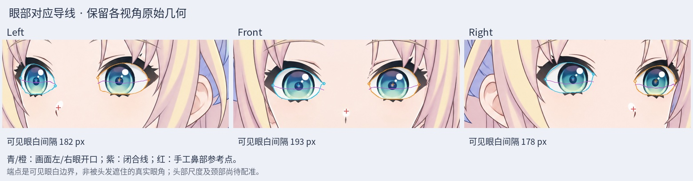

# v0.3.4 三视角眼部对应与组装素材（未绑定）

本轮将已有正面、朝画面左、朝画面右的眼部素材放进同一份可编辑 PSD，统一名称并建立眨眼导线对应；原图没有平移、缩放、镜像或整体变形。三视角头部尺度、颈部和完整部件的几何配准尚未完成。

## 打开文件

源码包内 `rebuild_v3_4/turn_redraw/eye_registration/Rurino_Three_View_Eye_Assembly_v034.psd`，包含 116 个原始美术像素层及 3 个默认隐藏的导线层，共 119 层、26 个裁切关系。默认只显示 Front；每次只显示一个 `View_*_SHOW_ONE_VIEW_ONLY` 组，再在该组选择一个 `Blink_Open`、`Blink_Partial_ART_ANCHOR_SEE_MAP` 或 `Blink_Closed`。Guides 是检查辅助线，不能作为模型美术导入。

## 名称与对应

`ImageLeft`、`ImageRight` 始终表示画面左眼、右眼，不是人物解剖左右。当前有限转角的对应如下：

|视角|ImageLeft 原别名|ImageRight 原别名|部分闭眼开放度（左 / 右）|
|---|---|---|---|
|Left|Far|Near|0.6739 / 0.6547|
|Front|L|R|0.4970 / 0.4975|
|Right|Near|Far|0.6220 / 0.5906|

侧向原 Half 素材实际保留了约 59%～67% 的眼高，正面约 50%，不能直接把全部 Half 都当作相同 0.5 关键形。本轮改用 Partial 命名，在 `correspondence.json` 保存各眼、各视角的实测锚点；导线采样器按这些锚点插值。这修正了对应数据，尚未重画出各视角精确 0.5 的可见素材，也没有绑定 Cubism 参数。

开放度以睁眼虹膜中心 X 附近固定 5 列的眼白 alpha 高度和为基准。它是此视角的局部导向值，不是标准生理解剖量。每只眼在 21 个固定 X 位置记录眼白上、下边界和闭合睫毛线；没有使用固定眼距比例，也没有跨视角插值整张脸。

## 检查与限制

- 重新打开组装 PSD，核对图层数量、唯一名称、裁切和默认可见组；逐层核对 116 层 RGBA、坐标及尺寸。原始三份 PSD 的 SHA256 保持不变。
- 三视角各三个状态共九次渲染，与源 PSD 状态比较；睁眼和部分闭眼使用相同虹膜纹理与位置。
- 导线检查端点和实测 Partial 锚点，并在 101 个开放度上检查眼白间隙非负、闭眼过程中不重新张开。这仅检验导线，不等同于连续模型验收。
- 静态预览仍可见正面部分闭眼外眼角的睫毛轮廓偏粗、局部不平顺，后续需修图并检查遮挡；本轮没有修改这些源像素。
- 可见眼白端点不是真实眼角；被刘海遮住的眼睑和眼角结构仍需补齐。鼻点为手工参考，虹膜中心受原始视线影响，不能当成三维眼眶中心。
- 没有新增 cmo3/moc3、连续转头动画、Windows 运行包或语音口型验收。

## 后续制作

继续补齐隐藏眼睑、眼角与细刘海接触区，拆分侧向脸皮、耳朵、刘海和后发，结合鼻嘴与颈部校准整体结构；随后在 Cubism 建立网格并检查转头×眨眼×视线组合。不可直接切图或交叉淡化冒充连续转头。

