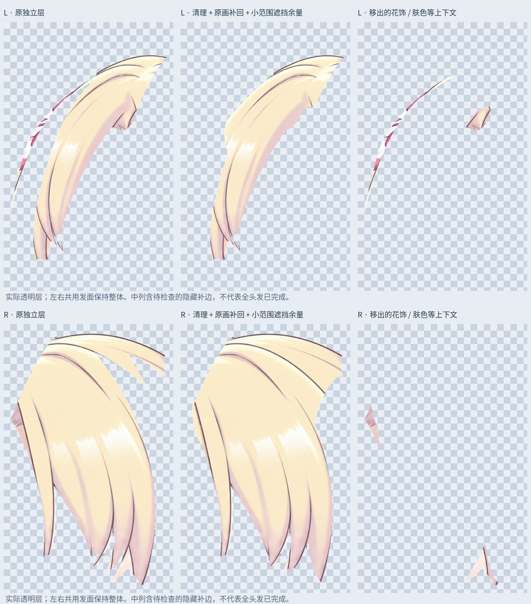

# 刘海补全第一批：恢复原画连接，清理非头发残留

当前输入是已分离完整眉毛的 71 层工作稿。左右共用刘海继续保持整块，没有采用已撤回的 C/D 细分，也没有回到机械分条方案。

## 本轮变化

- 将左侧细长花饰边缘残片、两侧混入的额头/肤色等上下文移到独立保留层。它们没有删除，原图位置仍保留；以后不应随刘海一起运动。混合边缘的最终归属仍待整体检查。
- 从当前同视角、隐藏眉毛后的原画合成图恢复能确认的头发像素，补接左右上方共用发面的连接，以及右侧部分缺失发尖。恢复像素数：左 7541，右 13098。这些属于已有原画恢复，不是新生成的发根。
- 两侧内缘另补少量遮挡余量，最大向外延伸 16 个原尺寸像素，颜色取自邻近头发内部。该补边单独保存在 `05_Fringe_ConcealedMargins_REVIEW_OFF` 组中，默认隐藏；尚未通过摆动覆盖和接缝验收，不直接作为默认显示或完整隐藏结构。
- `layers/Fringe_L_material.png` 与 `Fringe_R_material.png` 是含上述隐藏补边的独立检查素材；默认 PSD 显示原画补回后的可见层，未启用隐藏补边。

## 检查

`Rurino_Fringe_SourceRestored_v034.psd` 有 77 个像素层。原 71 层像素、偏移、透明度、混合/裁切属性保留；两个被替代的刘海层隐藏备份，已独立的眉毛不变。新层保存回读与透明 PNG 一致。

初次发尖恢复混入少量睫毛像素，闭眼状态出现明显差异，未采纳。最终恢复排除了各眼睛状态覆盖的区域，只有已确认的前景头发覆盖可例外保留，同时过滤深色睫毛/冷色眼白残留。

睁眼、半闭眼、闭眼三种状态的恢复遮罩外 RGBA 与输入完全一致；遮罩内因像素补回和透明边缘叠加有变化，各状态最大通道差分别为 3, 3, 3（0–255）。不将保存检查等同于运动或造型验收。

`qa/fringe-materials-comparison.jpg` 的三列依次为原独立层、补接后的完整检查素材、移出的上下文。每行采用相同视口和比例，全部来自透明图层；没有用合成截图代替发束轮廓。

## 仍需继续

这是当前左转视角的刘海修补阶段，不是全头发已补完。头顶共用根部、左侧下缘与鬓边的连接、其他剩余边缘仍待修整；小双马尾扎点、大双马尾被身体遮住的部分和完整隐藏面尚待制作。小范围补边不足以证明大幅转头或身体前后仰时不会露底。没有新增网格或物理。

本轮使用本地原画像素恢复和局部位图编辑，没有调用新的生成任务。没有声称 LibTV 商业限制已恢复。

## 文件

`Rurino_Fringe_Materials_v0.3.4_ADDON.zip` 包含本轮 PSD、透明层、遮罩、预览、输入 PSD/图片和必要脚本。安装 `production/requirements-materials-v034.txt` 后执行 `python production/complete_fringe_materials_v34.py` 可复现。预览字体默认 Linux Noto CJK；其他系统可修改 FONT。直接打开 PSD/PNG 无需运行脚本。

