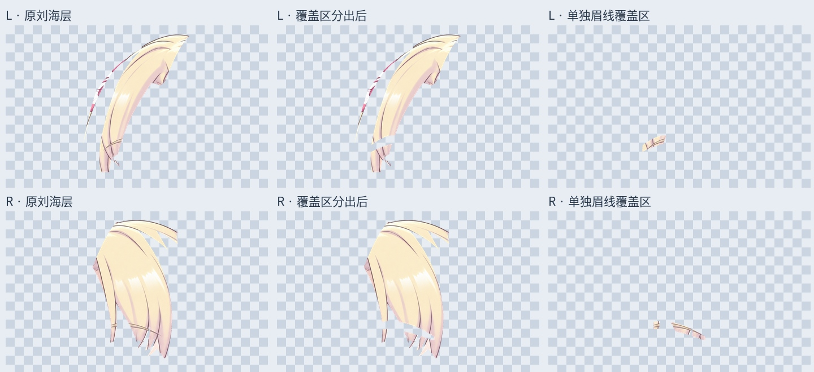
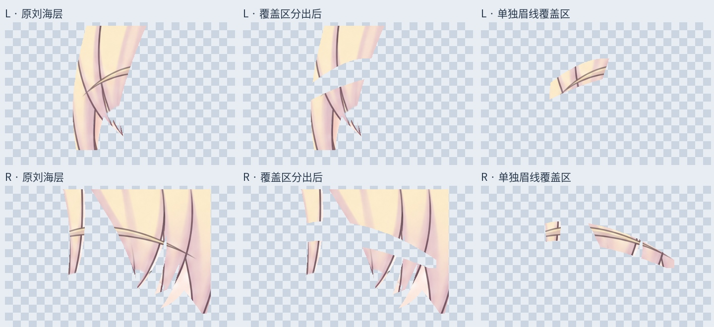

# 头顶 / 刘海：眉线覆盖区独立分层

放大原画后可见，眉线横跨在刘海前方，原左右 Bang 图层已混入这些覆盖像素。直接把深色眉线当作发束边界会造成错误拆分。因此本轮先分出明确的眉线覆盖区域，再继续辨认发束，不增加未经确认的发束数量。

## 实际变化

从左右 Bang 来源层分别提取眉线覆盖区，保留其原位置和叠放关系，添加两份去除覆盖区后的头顶/刘海共用层和两份覆盖区图层。最新 `Rurino_Crown_Fringe_Overlap_Separated_v034.psd` 为 66 个像素层；原 62 层像素及属性保留，两个被替代的 Bang 来源层隐藏备份。没有使用失败的 72 层候选。

覆盖区路径外保留 8 个原尺寸像素的边缘余量，包含邻近头发颜色和抗锯齿像素；它们不是完整眉毛图层，也不是已经去除背景的眉毛美术。当前只处理了眉线落在这两个头发来源层里的部分。

## 可视化与检查

`qa/brow-overlap-detail.jpg` 是局部放大对照；`qa/fringe-overlap-full-alpha.jpg` 展示完整独立图层；`qa/crown-fringe-landmarks.jpg` 标出本轮核对的几个可见尖端附近位置。节点不是发束数，不能将其理解为已经确认四缕刘海。

PSD 保存后回读，新增图层与导出 PNG 一致，原 62 层像素、偏移、混合和裁切属性保留。睁眼、半闭眼、闭眼三个状态的整图 RGBA 与本轮输入完全一致。这只验证分层保存和拼回，不证明内部发束结构已完成。

## 尚未完成

- 头顶与刘海连续共用发面的构造边界、各发尖与发根的对应仍待辨认，尚未拆开。
- 独立刘海层会在眉线覆盖区留下透明缺口；被眉毛遮住的头发需要最后补画，当前没有填色或拉伸掩盖。
- 贴脸、鬓边连接以及其他旧来源残留仍有待核对。
- 本轮新增确认发束数为 0。没有重绘、网格或物理，仍按先拆分、最后统一修整的顺序。

## 交付

`Rurino_Fringe_Overlap_v0.3.4_ADDON.zip` 包含本轮输出、输入的 62 层 PSD、独立图层、遮罩、预览和脚本。此前包保留历史阶段。

安装 `production/requirements-materials-v034.txt` 后执行 `python production/separate_fringe_brow_overlap_v34.py` 可复现分层；`python production/build_fringe_landmark_guide_v34.py` 可生成节点参考图。节点图使用随包提供的输入阶段 PNG。中文字体默认 Linux Noto CJK，其他系统需调整脚本字体路径。直接打开 PSD/PNG 无需运行脚本。

