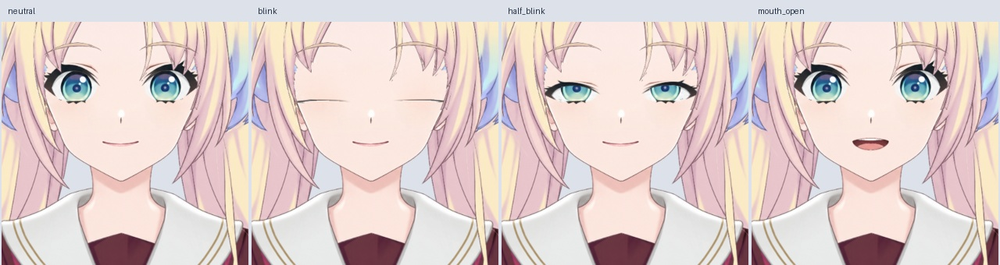

# 正脸基础动态 Live2D v0.3.4

这次把修好的正脸接入了实际 Cubism 动态。以 `front_fringe_clean` 的 33 个部件为基础，保留此前脸、头发、眉毛和独立黑线，新增 5 个口腔部件，总计 38 个绘制部件。此前的正脸修图没有废弃，旧侧视图模型另行保留。

## 直接使用

下载 `Rurino_Front_Dynamics_Runtime_v0.3.4.zip`，完整解压到一个新目录。在已有桌宠中选择 `runtime/Rurino_Front_Dynamics_v034.model3.json`。不用重新拆图，也不用先操作 Cubism。运行包包含 moc3、纹理、待机动作和两组大马尾物理，不包含桌宠程序、Ollama 或语音模型。

源工程包 `Rurino_Front_Dynamics_Source_v0.3.4.zip` 中，`Rurino_Front_Dynamics_v034.cmo3` 可以在 Cubism Editor 打开。PSD 提供原始图层；默认合成会同时显示新增口腔与静态嘴线，实际默认显隐由 cmo3 参数控制。不要把 PSD 合成效果当作模型默认姿态，也不要直接重新导入覆盖现有绑定。

## 本轮已绑定

| 参数 | 实际作用 |
| --- | --- |
| ParamEyeLOpen / ParamEyeROpen | 左右独立眨眼，眼白和上眼睑变化；虹膜保留原几何及颜色，按眼白裁切 |
| ParamMouthOpenY | 闭嘴与张嘴连续过渡，牙齿、舌头按口腔裁切 |
| ParamBodyAngleZ | 以腰部为中心的轻微左右侧摆；参数 ±10 对应实际旋转约 ±2° |
| ParamBreath | 身体衣服区域的轻微起伏，不带动脸部 |
| ParamHairSide / ParamHairBack | 两条大马尾独立变形，位移向发梢增加 |

共 7 个有效参数；其余 20 个默认参数尚未绑定。双眼闭合轮廓是基础版，仍可进一步润色。身体侧摆是整体围绕腰部旋转，不是转头或躯干三维扭转。

8 秒待机动作驱动腰部侧摆及眨眼。Cubism 在动作播放期间会抑制默认自动眨眼，所以待机动作显式包含眨眼关键帧。两组物理根据身体侧摆驱动大马尾，半径和延迟略有不同；实测待机输出约 ±0.224，使用轻摆避免大幅运动暴露遮挡接缝。发根附近受检最高网格点在手动极值下仍有约 1.8 原图像素位移，不能宣称发根每个像素完全不动。

`runtime-editor-export` 保留编辑器原始导出，供回溯和重新生成；直接运行使用 `runtime`。待机 motion3、physics3 及 EyeBlink/LipSync 分组由 `package_front_dynamics_runtime_v34.py` 添加，是随包交付的外部配置，未写入 cmo3；未提供 can3。编辑器重新导出后要重新添加这些文件和 model3 引用。在解压的源工程包根目录运行 `python production/package_front_dynamics_runtime_v34.py .`，可从 `runtime-editor-export` 重建 `runtime`。

## 验证与预览

- Cubism 5.3.04 FREE，SDK4.2 导出，38 个部件、一张 2048 纹理。
- 默认正脸实际 SDK 渲染与上一版正脸合成对比：不透明 RGB 平均差约 2.218/255，透明度平均差约 0.777/255。
- 14 个指定姿势检查无非有限顶点及新增三角形翻转。左右眨眼相互独立；呼吸只改变身体；两条大马尾分别只改变对应网格。侧摆保持脸和五官边长，误差小于 0.001 原图像素。
- 7 档口型连续检查，口腔网格开口高度递增；实际图像检查未见闭嘴线与张嘴线重叠。仅有几何与受控口型验证，未完成实时语音服务验收。
- 工程保存关闭后重新打开并导出，全部 4 个原始导出文件逐字节一致。
- 连续 20 秒实际 SDK 待机测试通过：循环继续、眼睛完整开闭、呼吸和两条大马尾有连续变化。桌宠在 Linux 隔离显示环境中的加载、透明显示、音量包络、静音、置顶、尺寸、拖动和重载检查通过。

`front-live2d-preview.mp4` 是实际 SDK 连续渲染的 12 秒预览，5–7 秒用合成音量包络演示口型，无音频。其余动作使用交付的待机和物理。没有用视频生成替代 Live2D。GIF 受调色板影响，颜色以 MP4 和 PNG 为准。

## 仍未完成

真实左右转头、抬头低头、头部倾斜、眼球跟随、身体前后仰、小马尾和逐缕刘海物理。大马尾大幅摆动时边缘及隐藏区域仍需修补，闭眼线可以进一步美化。没有用整脸拉伸冒充转头。

Windows 实机、Ollama 和已有音色的实时对话联调尚未验收。这是可以运行的正脸基础动态版，不是最终全功能模型。

[12 秒实际运行预览](preview/front-live2d-v0.3.4.mp4)
