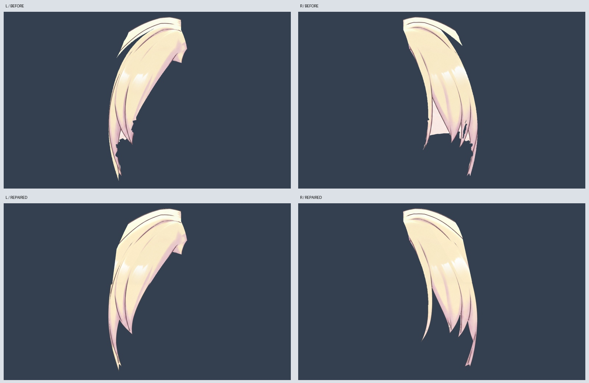
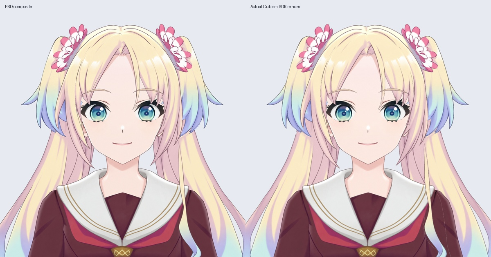

# 正脸刘海清理阶段 v0.3.4

接续小双马尾 Clean 版，修补两片正面刘海。重点是眼睛上方的缺口、右侧夹入的肤色、头顶部的分割缝，以及两侧独立轮廓。

本次按正面底稿轮廓重描刘海下缘，去除夹入的肤色区域，用相邻头发颜色修补原眼部抠图造成的缺失，补回头顶外侧接缝。新增 Ink_Bang_L/R 独立线层；共享头顶接缝不重复画黑线，以免合成时出现硬分界。贴脸发束置于两侧刘海之上，眉毛保持独立。

共 33 层，其中之前 29 个图层 PNG 逐像素保留。这里只修了两组刘海，尚未把其中每缕头发独立绑定；贴脸发束、长前发、大马尾和底部支撑层仍需清理，脸型与五官比例没有重设计。材料修复不代表全头发已经完工。

当前仍为静态正脸：27 个默认参数未绑定，未完成眨眼、嘴型、头部转向、身体动作或物理。原侧视动作工程另外保留。

制作脚本依赖工作区历史输入，随包 PSD/PNG 可直接编辑。Cubism 工程与运行验证结果见 qa-runtime；没有 Windows 实机、Ollama 或语音服务验收。运行包不含桌宠程序和语音模型。

## 文件与验证

- `Rurino_Front_Fringe_Source_v0.3.4.zip`：直接在 Cubism Editor 打开 `Rurino_Front_Fringe_v034.cmo3`。附 33 层 PSD、透明 PNG、运行模型及检查记录。
- `Rurino_Front_Fringe_Runtime_v0.3.4.zip`：完整解压到新目录，在已有桌宠中选择 `runtime/Rurino_Front_Fringe_v034.model3.json`。

Cubism 5.3.04 FREE，SDK4.2 导出，33 个绘制部件、一张 2048 纹理。刘海颜色网格重建；独立线层用包围全部透明轮廓的网格并细分。刘海颜色绘制顺序500，黑线501，贴脸发束和长前发502，花饰503，眉毛504。

实际 SDK 渲染与 PSD 对比：RGB 平均差 2.217/255、透明度平均差 0.777/255。两片刘海受检不透明内部及黑线 alpha > 60 的像素均无网格漏盖。工程保存关闭重开后，四个导出文件逐字节一致。Linux 桌宠显示、重载、拖动、尺寸、置顶、设置和静音检查通过。以上均不代表动态或 Windows 验收。

