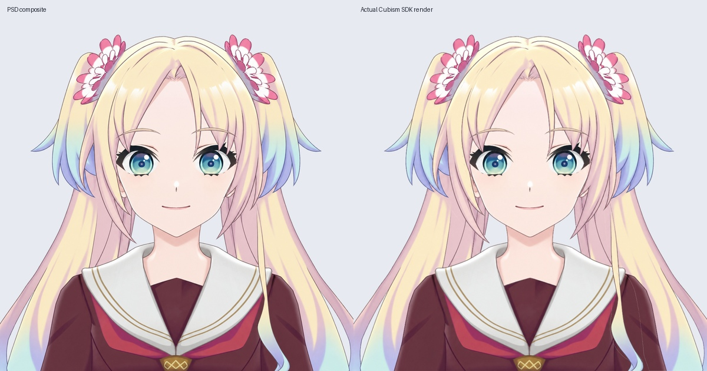

# 正脸中立底模 v0.3.4

这次把原先单独保存的正脸材料制作成可编辑 Cubism 工程和可加载模型，作为后续正面表情、转头与身体动作的起点。当前是静态半身底模，尚未绑定动作。

## 查看方式

- `Rurino_Front_Neutral_Runtime_v0.3.4.zip`：完整解压，在已有 Windows 桌宠的模型选择界面选择 `runtime/Rurino_Front_Neutral_v034.model3.json`。同目录 moc3 和纹理目录必须保留。能显示正脸，目前不会随参数眨眼、张嘴或转头。
- `Rurino_Front_Neutral_Source_v0.3.4.zip`：Cubism Editor 中打开 `Rurino_Front_Neutral_v034.cmo3`；无需重复导入 PSD。附 29 层 PSD、独立透明图层、眼睛遮罩、运行模型和检查记录。
- `qa-runtime/front-runtime.png`：实际 Cubism SDK 渲染，不是 PSD 合成图。

运行包不含桌宠程序、Python 或语音模型。已有桌宠入口仍是 `desktop/Start-Windows.cmd`。本轮未更换已有默认模型路径，需手动选择正脸模型。

## 本轮修复

以旧正脸材料为基础，重新描出左右眼开口，恢复被过大的眼白遮住的上睫毛和虹膜上缘；虹膜中心未移动，未重新调色。只在眼睛附近补回少量可从原正脸图确认的发色像素，眼部检查框外的合成图与输入稿逐像素一致。没有从侧脸移植嘴巴，也没有通过左右拉伸制造正脸。

29 个可见图层已生成网格，双眼虹膜分别显式裁切到对应眼白。衣服与右侧大马尾改用更稀疏网格并重新排布贴图，修复自动三角化失败造成的破洞和贴图错位。编辑器为 Cubism 5.3.04 FREE，导出目标 SDK4.2，一张 2048×2048 纹理。

## 验证

- 实际 SDK 加载 29 个部件，网格顶点及索引有效。衣服为 91 顶点 / 125 三角形，右大马尾为 76 / 103。
- 实际运行画面与 PSD 对照：不透明重叠区域 RGB 平均差 2.140/255，整幅透明度平均差 0.797/255；存在贴图缩放与边缘重采样差异，已目视检查。
- 工程保存、关闭、重开后重新导出，moc3、model3.json、cdi3.json 和纹理逐字节一致。
- 本地 Linux 桌宠加载、透明渲染、拖动、缩放、置顶、设置、静音与重载检查通过。没有 Windows 实机或 Ollama / 语音服务联调；音量包络检查不代表模型已有嘴型。

## 尚未完成

27 个参数只是默认参数列表，没有动作关键形绑定。连续眨眼、嘴型、眼球追踪、真实转头、抬低头、身体侧摆/前后仰和头发物理都没有接入这份正脸工程。旧侧视图工程的四马尾、腰部侧摆和物理仍单独保留，不能当作正脸已经具备的功能。

正脸头发仍是较早的分层基础，逐缕补全、独立黑线和隐藏区还需继续修；本轮也没有重新设计脸型与五官比例。新的眨眼材料须按当前眼开口重做，旧半闭眼/闭眼备选没有直接导入。

后续先校准正面脸型、发束与轮廓，再做连续眨眼及嘴型；之后结合原视频校准各转角的眼距、远侧眼宽、鼻嘴及脸颊遮挡。保留原侧视图工程作为参考与回退，不能整体拉伸正脸或贴侧脸嘴来冒充转头。

修复脚本依赖工作区历史输入，不是脱离素材即可重建的生成器；本包已附最终 PSD 和图层。运行 QA 脚本需要 live2d-py、PyQt5、Pillow、numpy 及 OpenGL。

