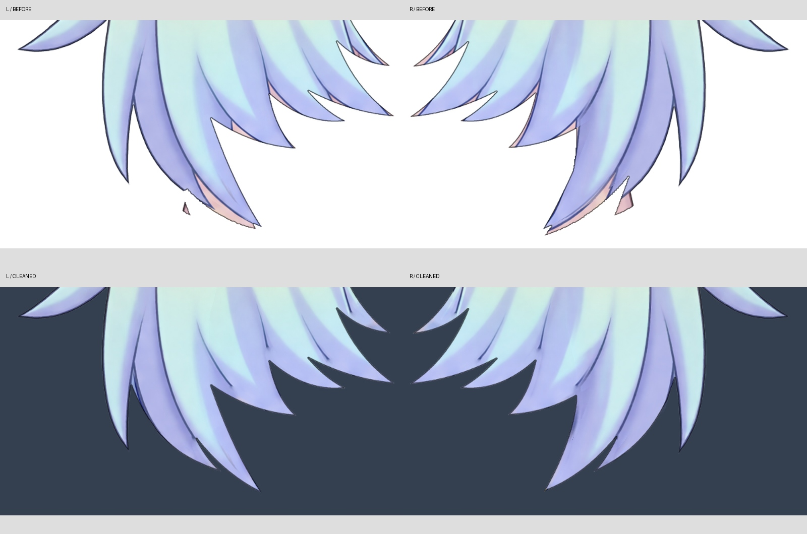
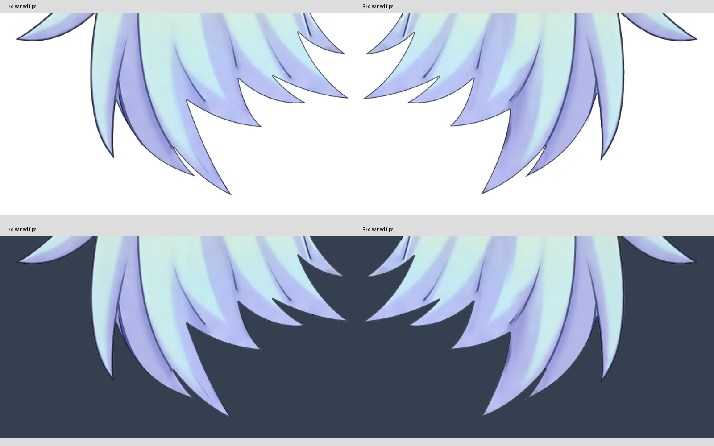

# 正脸小双马尾清理版 v0.3.4

上一版通过了网格覆盖检查，但美术清理并不完整：发根仍有花形残影，蓝色发梢间混有粉色底片，局部有游离碎片和断续轮廓。本版针对这些可见问题清理，并将新 PSD 接回实际 Cubism 工程与导出贴图。

## 使用

- `Rurino_Front_SmallTails_Clean_Source_v0.3.4.zip`：含可直接打开的 `Rurino_Front_SmallTails_v034.cmo3`、31 层 PSD、独立 PNG 图层、运行模型和验证记录。
- `Rurino_Front_SmallTails_Clean_Runtime_v0.3.4.zip`：完整解压后，在已有桌宠中选择 `runtime/Rurino_Front_SmallTails_v034.model3.json`。保持 moc3、cdi3.json 和纹理文件夹的相对位置。
- 本包不含桌宠程序或语音模型。新包名带 `Clean`，内部模型名沿用上一版；建议解压到新目录，避免混用旧贴图。

## 本次改动

清除发根旧花饰留下的轮廓残影；按两侧各自的发流修整底部开叉、粉色夹片和脱落碎片；局部补齐原有缺口并处理深色背景下的杂色边。重建两侧独立黑线，保留原网格与绘制顺序。隐藏处仍采用已配准历史底稿推定补绘，不代表恢复了原视频的真实隐藏细节。

31 层中仅修改两侧小马尾颜色及对应黑线，其他 27 层 PNG 逐像素不变。没有重设计脸型、五官、刘海、头顶或大马尾。网格数据未变，导出的纹理已更新。

## 检查结果

- PSD 重开后 31 层与对应 PNG 一致；每侧小马尾在 alpha > 30 时没有大于 8 像素的游离连通块。
- 在浅色及深色背景目视检查发根、发梢和独立轮廓。技术检查通过不等于美术已全部完成。
- 实际 SDK 渲染：31 个绘制部件，一张 2048 纹理；与 PSD 对照 RGB 平均差 2.172/255，透明度平均差 0.810/255。
- 两侧颜色层受检不透明内部及黑线 alpha > 60 像素全部被实际导出网格覆盖；仅验证静态覆盖。
- 保存工程、关闭、重新打开并再次导出，全部四个运行文件逐字节一致。
- Linux 桌宠加载、重载、透明显示、拖动、尺寸、置顶、设置及静音检查通过。未做 Windows 实机、Ollama 或语音服务联调；音量包络检查不代表嘴型已绑定。

## 未完成

当前仍是静态正脸，27 个默认参数未绑定，没有眨眼、嘴型、转头、身体动作或头发物理。刘海、头顶、贴脸发束、大马尾及脸颊/脖子/衣服轮廓仍需逐项检查，不能将本次小马尾修复视为全模型完工。原左视图动作原型另行保留。

制作脚本依赖工作区历史输入素材，独立使用请以随包 PSD、PNG、cmo3 为准。附带历史导入辅助脚本，QA 脚本依赖 live2d-py、PyQt5、Pillow、numpy、OpenCV 和 OpenGL。

