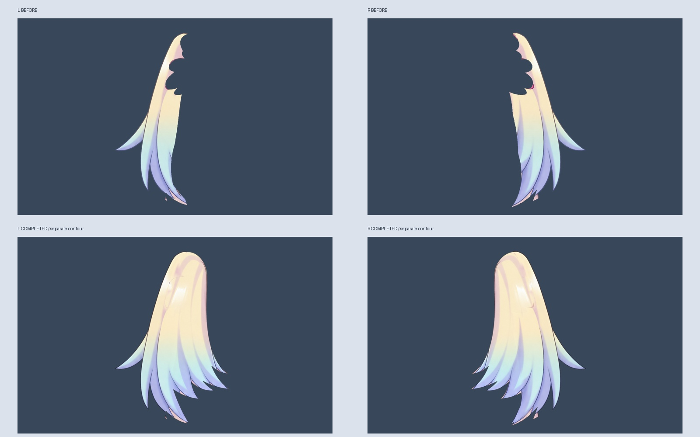
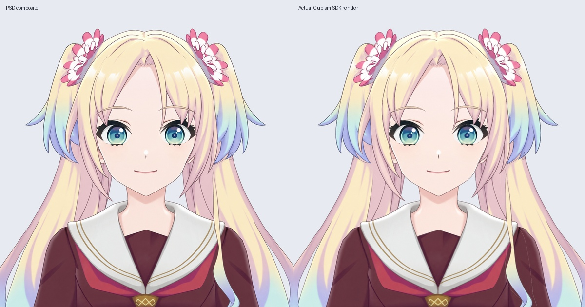

# 正脸小双马尾补全 v0.3.4

本轮在正脸中立底模上补全左右小马尾的发根和内侧缺片，加入两个独立黑色轮廓图层，并接入可编辑 Cubism 工程与运行模型。当前共 31 层，仍是静态正脸；尚未绑定眨眼、嘴型、转头、身体动作或头发物理。

## 文件与使用

- `Rurino_Front_SmallTails_Source_v0.3.4.zip`：在 Cubism Editor 中直接打开 `Rurino_Front_SmallTails_v034.cmo3`，无需重复导入 PSD。附 31 层 PSD、独立透明图层、遮罩、实际运行模型和检查记录。
- `Rurino_Front_SmallTails_Runtime_v0.3.4.zip`：完整解压，在已有 Windows 桌宠的模型选择界面选择 `runtime/Rurino_Front_SmallTails_v034.model3.json`。保留同目录 moc3、cdi3.json 和纹理文件夹。
- 运行包不包含桌宠程序或语音模型。桌宠默认模型路径本轮未更换；需要手动选择本模型。

## 改动与边界

原小马尾的发根有花饰轮廓留下的缺口，内侧也缺少完整发片。沿发流补回这些区域，保留原外侧轮廓、渐变与高光；补画采用已配准的历史生成底稿，隐藏处属于推定补绘，并非从原视频恢复出的真实细节。接缝附近做了颜色衔接，封闭内部小孔。颜色与黑线分别保留，可独立编辑。

小马尾设在脸后、大马尾前，避免补全后的内侧发梢覆盖眼睛。原有另外 27 个透明图层逐像素保留，双眼虹膜仍分别裁切到对应眼白。PSD 合成的眼部差异不超过 2/255，来自图层合成取整。本轮没有修改脸型、五官比例、刘海或大马尾；小马尾原发梢仍有少量粉色边缘细节，后续统一清线时再处理。

两侧小马尾颜色层重新生成网格；细黑线使用手工外缘网格并细分，避免自动布网漏掉狭窄线段。网格与贴图均通过真实 SDK 验证。它们还没有绑定共用变形器，未来动作必须让颜色与黑线同步。

## 验证

- Cubism 5.3.04 FREE 工程；SDK4.2 导出，31 个绘制部件，一张 2048×2048 纹理。
- 实际运行渲染与 PSD 对照：RGB 平均差 2.172/255，透明度平均差 0.813/255；已目视检查。
- 补全的两侧小马尾不透明内部，以及黑线 alpha > 60 的像素，全部被实际导出三角形覆盖。此检查是静态覆盖，不代表任意转角均不破面。
- 保存的工程重新启动打开后再次导出，moc3、model3.json、cdi3.json 与纹理逐字节一致。
- Linux 下桌宠加载/重载、透明显示、拖动、尺寸、置顶、设置与静音检查通过。没有 Windows 实机、Ollama 或语音服务联调；音量包络检查不代表已有嘴型。

## 下一步

继续检查正面刘海、头顶、贴脸发束与大马尾的隐藏区域和独立黑线，统一清线后，再绑定正面连续眨眼、嘴型与头发运动。之后按原视频校准左右转头、抬低头的眼距、远侧眼宽和脸颊遮挡，不能靠整脸拉伸替代透视。

27 个默认参数尚未绑定。原左视图四马尾/身体动作工程另外保留，其动态功能不属于这份正脸模型。制作脚本依赖工作区历史素材，最终 PSD 与透明图层已随包提供；QA 脚本需要 live2d-py、PyQt5、Pillow、numpy、OpenCV 及 OpenGL。

