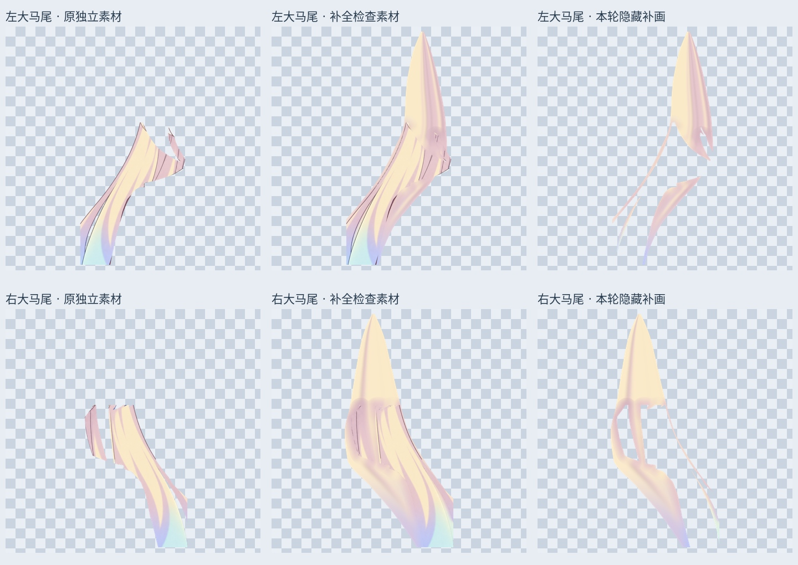
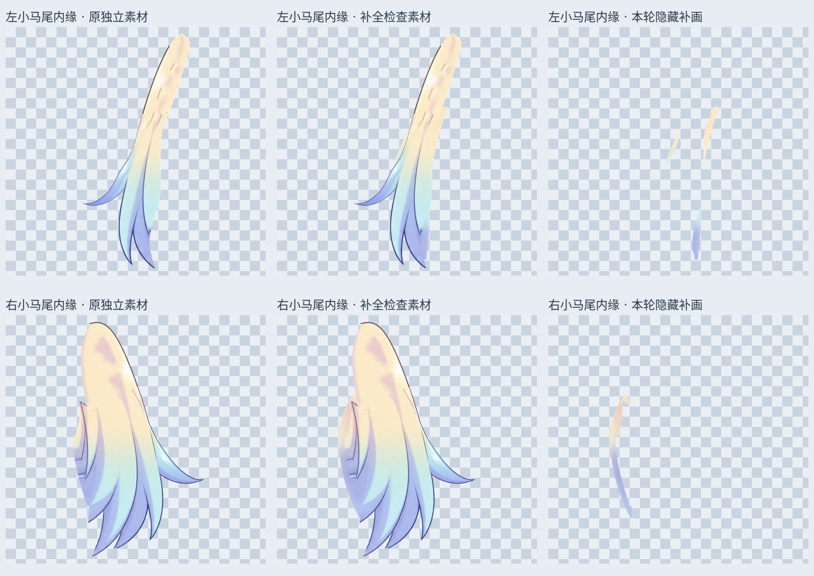
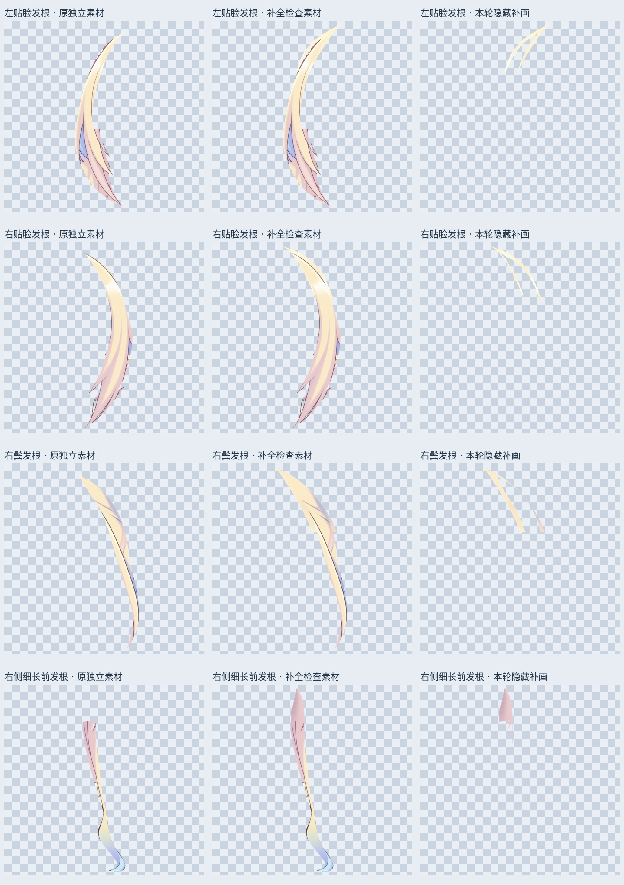

# 各组头发隐藏面补画：长马尾、短马尾内缘和前发根部

输入为 85 层小双马尾内缘工作稿。本轮补画 8 处现有头发组件的遮挡部分，未新增“八缕头发”的结构判断，也不把层数当完成度。头发结构仍是头顶、刘海、一对小双马尾、一对大双马尾；贴脸发、鬓发和细长前发的归组仍须结合运动检查。

## 具体变化

- 左右大马尾：根据花饰扎点附近到已有长发段的走向，分别重建上方发根，补肩膀、身体遮住的发面。可见原画保留；隐藏区使用各自头发的金色、粉色阴影及下部蓝色取样，平滑延续。
- 左右小马尾：继续补内缘的折口与遮挡面，原有蓝色发梢保留。
- 左右贴脸发、右鬓发、右侧细长前发：分别补上端连接；没有对整张脸做变形，也没有镜像套左右。
- 初次补画出现最近邻颜色拖影与接缝色带，已更换成平滑的本侧颜色过渡。大马尾检查稿另外修去少量位于新内部的旧遮挡切口深色/白色像素；具体区域保存在 `*_candidate_seam_repair.png`。这些修整只存在于检查稿，不覆盖原 85 层。

## 两种材料，不要混淆

`layers/*_complete.png` 是**完整轮廓检查稿**，含原部件和本轮补画；它们还没有通过运动或身份造型验收。PSD 的 `07_Full_Hair_Materials_REVIEW_OFF` 及每个子组默认关闭。检查时只打开一个对应子组，避免重叠八张素材；这组不是默认角色合成。

`layers/*_safe.png` 是把补层限制在原合成近不透明覆盖区（alpha >=250），并排除脸皮、耳朵、眉毛、颈部及全部眼睛状态范围的版本。这些单独存入 `06_Hair_Concealed_Backings_LOCAL_NOT_MOTION_APPROVED`，位于所有原画下方，默认显示。它们不会伸出原静态轮廓，但覆盖范围有限，不能直接当作转头时完整不会露底的发面。

`layers/*_backing.png` 是检查稿使用的未按当前遮挡裁掉的补画，`*_original.png` 是原独立部件。对照图三列依次为原素材、完整轮廓检查稿、本轮补画；同一行视口和比例相同，均来自实际透明素材，未用整头截图冒充分层。

| 部分 | 检查稿新增 alpha 像素 | 默认补层像素 | 当前遮挡外待检查像素 |
|---|---:|---:|---:|
| 左大马尾 | 247170 | 194115 | 23928 |
| 右大马尾 | 347188 | 312323 | 30255 |
| 左小马尾内缘 | 7366 | 6239 | 1338 |
| 右小马尾内缘 | 10464 | 10464 | 0 |
| 左贴脸发根 | 11269 | 11084 | 185 |
| 右贴脸发根 | 11354 | 11350 | 4 |
| 右鬓发根 | 11978 | 11978 | 0 |
| 右侧细长前发根 | 17182 | 10594 | 0 |

## 保存检查

输出 `Rurino_Hair_Concealed_Backings_v034.psd` 有 101 个像素层，原 85 层像素、偏移、显示状态、透明度、混合及裁切属性全部保留。补层与检查稿保存回读同各自 PNG 一致。

默认合成的睁眼、半闭眼、闭眼三种状态在补层遮罩外完全一致，没有新增像素伸出原轮廓；最大通道差分别为 5, 5, 5/255。脸皮、耳朵、颈部、眉毛及所有眼睛状态的保护范围 RGBA 完全不变，避免补层影响肤色与眼睛颜色。这是静态保存和遮挡范围检查，不是动态验收。

## 全头发进度与未完成项

| 组件 | 现在的实际状态 | 下一步 |
|---|---|---|
| 头顶 / 连续刘海 | 沿用此前原画恢复稿、眉毛已独立；本轮不改共用发面 | 继续辨认共用根部、发尖和混色边缘，不能标为全完成 |
| 左右小马尾 | 发根、内缘经过几轮清理；本轮补连续遮挡面检查稿 | 内侧短发流线、花饰连接和转动极限检查 |
| 左右大马尾 | 本轮首次补成较连续的扎点至肩后发面检查稿 | 扎点位置、接缝流线、肩后宽度和侧摆/前后仰检查 |
| 贴脸发 / 鬓发 / 细长前发 | 本轮补上端连接检查稿，原可见素材保留 | 分清相邻蓝发/花饰残片，配合头部角度确认归属 |

**大马尾底端仍被 2048×2048 原画画布裁切，本轮没有补出画布外真实发梢。** 完整头发隐藏结构、连续转头、身体侧摆/前后仰、网格、物理均未验收。旧外缘杂点及一些线条接缝也尚待修整。局部平滑补画不能替代新的角度关键形。

本轮为本地位图补画，隐藏部分属于重建，不能称为从原图恢复的真实不可见结构。没有新的 LibTV 生成任务，未声称此前 COMMERCIAL_BLOCKED 已解除。

## 文件与复现

`Rurino_Hair_Concealed_v0.3.4_ADDON.zip` 含输入/输出 PSD、透明素材、遮罩、预览和脚本。安装 requirements 后运行 `production/complete_hair_backplates_v34.py`；加 `--prepare-only` 可先输出透明素材检查图，不构建 PSD。字体默认 Linux Noto CJK，其他系统可调整 FONT。直接打开 PSD/PNG 无须执行脚本。此包不更新现有可运行 Cubism 模型。

