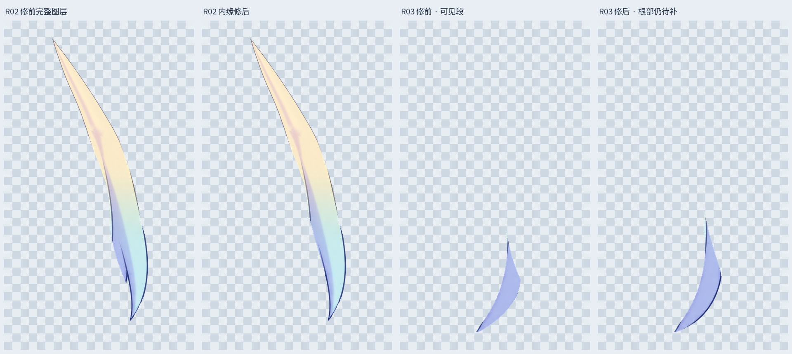
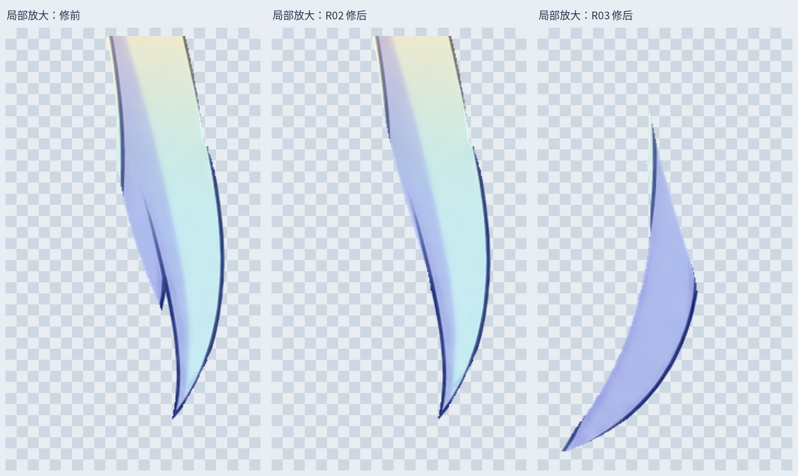

# v0.3.4 右侧短发 R02 / R03 边界修整

本轮沿原画的弯曲轮廓修正相邻发束的像素归属：R02 内侧多带出的尖边分回 R03，原待整理层中属于 R03 右侧的描边也归回该发束。保留原发色和外形，不做整头拉伸或镜像；属于本地拆层修正，没有调用新的 LibTV 生成。

## 文件与检查

最新 `Rurino_Left_Head_Hair_Edges_v034.psd` 为 54 个像素层。原 51 层像素和属性保留，3 个被替代层隐藏备份；新 R02、R03 和清理后的待整理层独立保存。4 个眼部裁切标志保留。

`qa/actual-edge-layer-comparison.jpg` 显示保存 PSD 的完整独立透明图层；`qa/edge-detail-comparison.jpg` 是标明为局部放大的边缘对照；`qa/edge-head-comparison.jpg` 是头部合成对照。各张图内使用相同视口及比例。

半透明像素只保留一个归属，避免两层叠加使描边变深。中立合成及三个眼部状态的检查结果见 `verification.json`；保存后同时核对新增层与输出 PNG，避免交付素材与 PSD 不一致。

## 未完成项

R03 当前仍是可见段，隐藏根部尚未补齐。此次未增加运动重叠余量；R03 左缘与 R04 的遮挡、其他发束、身体侧摆及前后仰下的覆盖仍待逐一处理。没有新增 Cubism 网格、头发物理或可运行模型。

下一步先为 R03 补齐隐藏根部及内侧遮挡余量，再检查 R04。完整 LibTV 重绘仍为此前 R01/L01 两缕，不能把本轮边界修整计为新增完整重绘。

## 增量交付

`Rurino_Hair_Edges_v0.3.4_ADDON.zip` 包含本次输出、输入的 51 层 PSD、脚本及依赖清单。此前各 ZIP 保留为历史阶段。

安装 `production/requirements-materials-v034.txt` 后，在解压根目录运行 `python production/refine_drop_hair_ownership_v34.py` 可复现。预览字体使用 Linux Noto CJK，其他系统需要调整 FONT。打开现成 PSD/PNG 无需执行脚本。

