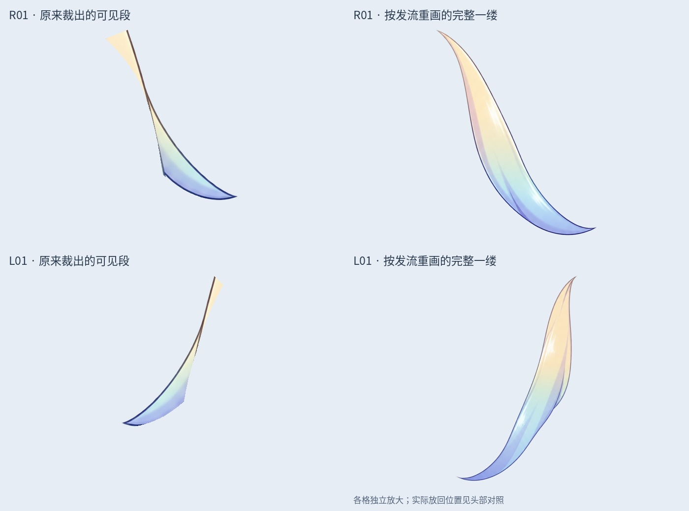
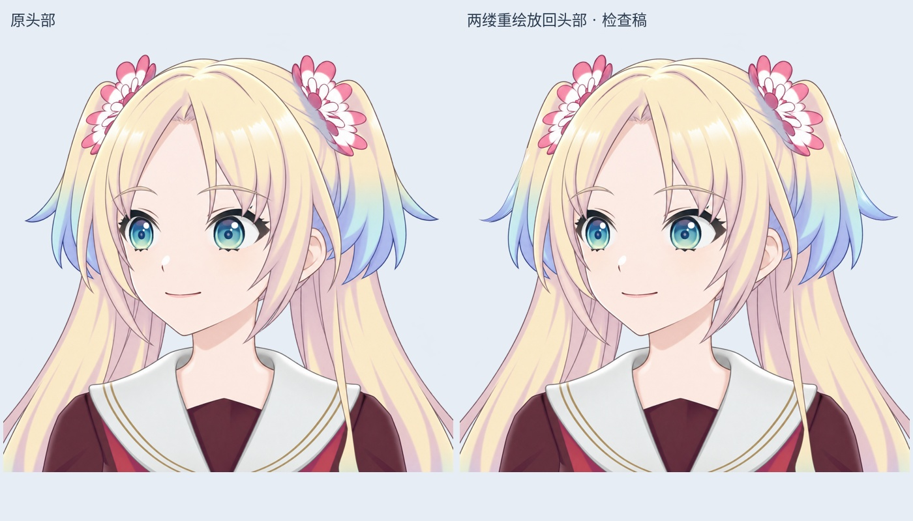

# v0.3.4 沿发流重绘：首批两缕完整发束

这是首批完整发束生成与试装记录；最新静态修整见[接缝修整记录](HAIR_JOINS_V034.md)。

按用户要求，改为沿原头发走向重新绘制每一缕，补出被遮挡的根部和连续渐变。使用 LibTV 分别生成 R01（画面右侧外翘）和 L01（画面左侧外翘）；左右没有镜像复制。角色仍是同一张左转头部。

## 本轮文件

- `layers/*_Complete_Redraw_Native.png`：两缕完整透明素材，2048×2048，保留生成的发根至单个发梢；仅清理远离主体的透明度杂点。
- `layers/*_Complete_Redraw_Placed.png`：只对新发束做等比缩放、旋转和平移，试放回原头部坐标。
- `Rurino_Left_Head_Two_Redrawn_Locks_TRIAL_v034.psd`：46 层试装稿，原 44 层像素与位置保留，仅隐藏原 R01/L01，新增两层完整重绘发束放在后方。
- `preview/cut-vs-flow-redraw-v0.3.4.jpg`：原裁切段与完整重绘对比，各格独立放大。
- `preview/head-redraw-comparison-v0.3.4.jpg`：相同视口、相同比例的原头部与试装对照。
- `sources/`：两次 LibTV 请求、任务、交付记录与原始 PNG。`verification.json` 记录文件哈希、试装矩阵和保存后检查。

## 检查与限制

回读 PSD，确认原 44 层 RGBA、位置、透明度、混合方式、裁切属性保留，原 4 个裁切标志保留。除旧 R01/L01 隐藏外，其他原层显隐不变。睁眼、部分闭眼、闭眼状态的中央不透明脸部区域（x=620…1249，y=400…1229）最大像素差均为 0；该检查不代表整张合成图不变。

**完整单缕绘画已保存，头部试装尚未验收。** R01 的旧不透明轮廓有 208/11963 像素没有被新束覆盖，L01 为 1031/7926。重绘轮廓本来可以改变，这些计数不等同于露底缺口，但提示需要检查发根与相邻层衔接。花饰附近的根部边缘、色阶、前后遮挡和运动覆盖余量仍待细修；不得据此宣布无缝或可直接物理摆动。

本轮只重绘了 8 缕已编号短发中的 **2 缕**。另 6 缕仍为之前的可见裁切段，其余刘海、贴脸发、长发仍待逐缕处理。原 44 层 PSD 未覆盖，可回退比较。没有新增 Cubism 绑定或 cmo3/moc3。

接下来先修两缕在花饰及邻接发束处的接缝与遮挡，再按 R02/L02 等编号逐缕重绘，最后结合摆动范围检查隐藏根部和覆盖余量。

