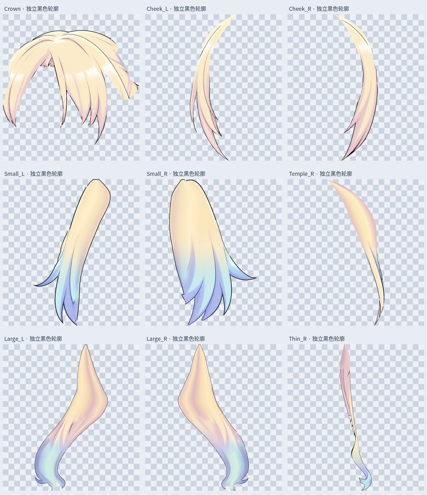
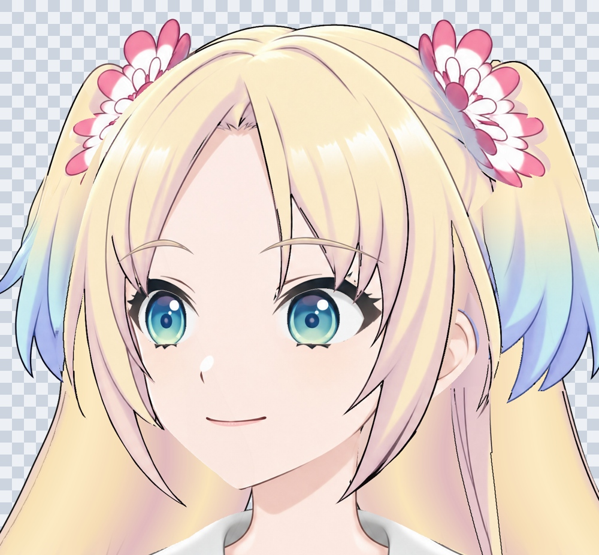
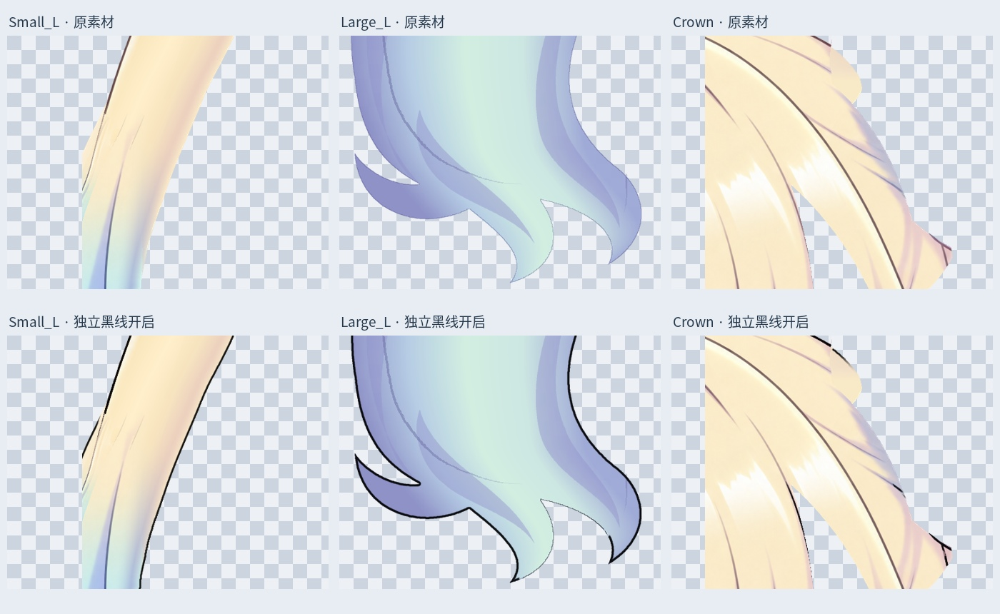

# 头发独立黑色描边

按当前头发分层范围，为 9 个主要独立发片分别添加黑色轮廓线。黑线和原颜色分层，补画发根、蓝色发梢及新补长马尾末端现在有各自的边界线。

## 主文件

`Rurino_Hair_Independent_Ink_v034.psd`，3456 × 2816，**53 个像素层**。

- 保留原 41 个颜色 / 眼型 / 眉毛 / 身体等图层。
- 新增 9 个 `Ink_部件名` 黑线层，与对应颜色层放在同名 `Colour_and_Ink` 组内。
- 新增 3 个眼前发梢补线层，继承对应头发的同一条黑线，并按原前景发片遮罩裁切，维持眼前遮挡。
- 默认开启黑线与睁眼组。关闭 `Ink_` 图层可还原上一版。切换眼型时只开启 `02_Open`、`02_Half`、`02_Closed` 中的一组。
- `colour/` 为原透明发片；`ink/` 为独立黑线；`merged-hair/` 为颜色与描边合并的透明发片，供需要单张素材的流程使用。

本次按头发范围执行：脸、衣服、花饰和眼睛没有额外套一圈黑线；它们保留原画线条。中间刘海继续连续，眉毛仍独立。

## 描线方式

- 黑线像素 RGB 为 `(0, 0, 0)`，使用抗锯齿与透明度过渡；最大 alpha 为 235。
- 以原尺寸计，细长发约 2 px，鬓发约 2.2 px，贴脸发约 2.5 px，刘海和小马尾约 2.8 px，大马尾约 3.4 px。
- 轮廓线向发片内部绘制，不扩张轮廓、不跨接发梢间隙。
- 邻近已有深色描线时沿原线加深，减少平行双线。共用上部发根的内部过渡使用淡出，不将旧构造切口封成横跨额头 / 贴脸发的黑线。
- 这不是按矩形框描边，也没有新增随意分块；每个现有主要发片都有独立、可调透明度的黑线层。

## 检查

- 原 41 层 RGBA、偏移、可见性、透明度、混合与虹膜剪贴属性保持一致。
- 新增 12 个黑线层保存回读与透明 PNG 一致。
- 关闭全部新增黑线后，整头默认合成与上一版逐像素一致。
- 保存后默认合成与合并预览一致；已分别渲染并查看睁眼、半闭眼、闭眼。
- 9 个主要发片的黑线不超出其原有 alpha 轮廓。

本版仍是左视图静态材料。未新增 Cubism 网格、转头 / 抬低头 / 身体侧摆或头发物理；原身体仍为半身裁切。原始头发隐藏面与画布外末端含前一版的本地推断补画，本轮不改变该来源说明。

输入 SHA256：`fa43637c492dbb42c2efebe45d82459f1394523d5f5e9d0bf119c845e85fa11d`

输出 SHA256：`c65494958a7b3059252d5d530547fb040e2c3d1a58fd69d6a73dc06c1253a65c`

## 重建

打开 PSD 不需要脚本。包内提供输入 PSD 和脚本；安装 `production/requirements-materials-v034.txt` 后运行 `python production/outline_hair_layers_v34.py`。默认预览字体为 Linux Noto CJK，其他系统可修改 `FONT`。本轮是现有 PSD 的本地描边编辑，未调用生成式图像服务。

