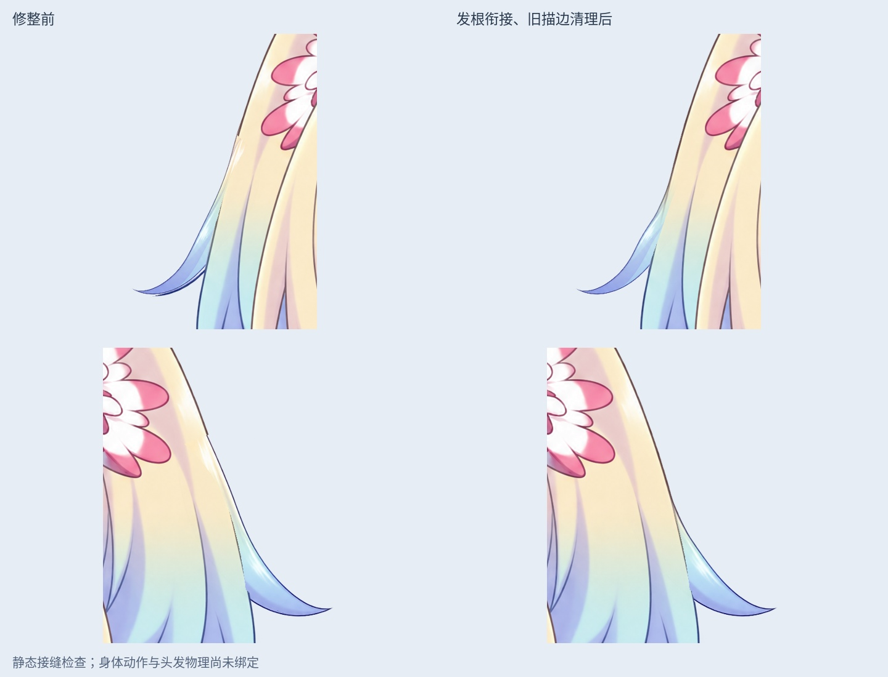
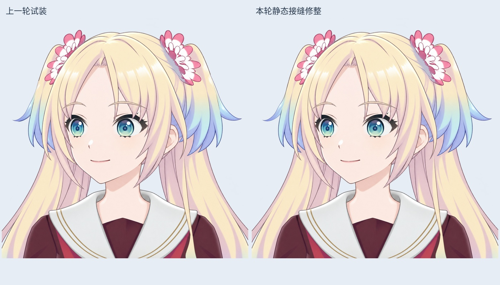

# v0.3.4 两缕头发：静态接缝修整

本轮继续修整此前 LibTV 绘制的 R01/L01 完整发束，未增加完整重绘发束数量。

## 修整内容

- 清理旧待整理层里属于外翘发束的残留轮廓：左侧 3091 像素、右侧 881 像素。左侧发尖的双重描边因此消除。
- 新发束上段按原头部外轮廓轻微弯曲，每行只做水平位移，最大约 6.88 / 11.20 像素（2048 画布）；不改变头部或五官。将原来的上段发色接入新发束，在 y=500…659 逐渐过渡到重绘下段，减轻花饰下方的高光断层。
- 邻接 L02 可见层有一小段旧描边毛刺，局部修整 33 像素的透明度。它仍是可见裁切段，不能算作一缕完整重绘。

## 文件

`Rurino_Left_Head_Hair_Joins_STATIC_v034.psd` 为 49 层静态检查稿。原 44 个来源像素层完整保留，5 个被替代层隐藏备份；另加 2 个修整发束、2 个清理后的待整理层和 1 个 L02 边缘修整层。4 个原眼部裁切标志保留。

`layers/` 是工作透明图层；`masks/` 标明实际清理范围；`qa/hair-join-before-after.jpg` 是相同视口、相同放大比例的局部对照；`qa/head-join-comparison.jpg` 是完整头部对照。所有预览来自保存后重新读取的 PSD。来源记录与 R02 请求回执位于 `sources/`。

## 验证边界

保存后回读，确认原 44 层 RGBA、偏移、透明度、混合方式、裁切标志保留，仅指定的 5 层隐藏。睁眼、部分闭眼、闭眼的中央不透明脸部（x=620…1249，y=400…1229）RGBA 最大差为 0。

两个发根检查区域内，原不透明轮廓向内排除 3 像素的边缘后，新增 alpha<200 的像素均为 0。检查区域：L01=(350,400,520,620)，R01=(1550,380,1760,620)。这是中立姿态的局部透明缺口检查，不代表整个头发、所有边缘或运动过程无露底。

尚未验证发束弯曲摆动时的层间覆盖、花饰遮挡和长发穿肩问题。没有新 Cubism 网格/物理或身体动作；不把静态修整标成流畅动画已完成。

## 新发束生成受阻

R02 的参考与提示词已保存在原 LibTV 画布，节点 `i-UcpjWnGYq3`。服务返回 `generation_rejected / COMMERCIAL_BLOCKED`，`task_id=null`；回读节点确认没有图片或资源绑定。具体商业限制原因未返回，不能自行认定余额不足。未重复提交，L02 的新重绘也尚未发起。

后续恢复生成时先检查账户/服务状态及该现有节点，不因节点存在就认为生成已受理。继续沿实际发流逐缕重绘，并按身体侧摆、前后仰的目标准备隐藏根部和运动覆盖余量。

## 交付方式

`Rurino_Hair_Joins_v0.3.4_ADDON.zip` 是本轮增量包，含上述输出及本次脚本所需的输入文件。原完整源码 ZIP 保留前一阶段内容；本次未将它标成已经包含本轮。原 44 层稿和上一轮 46 层试装稿均保留。

