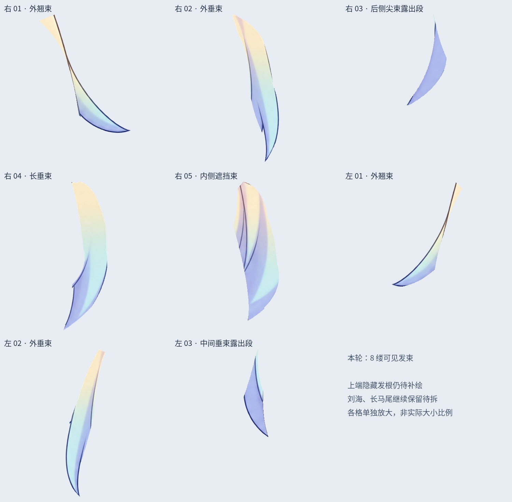
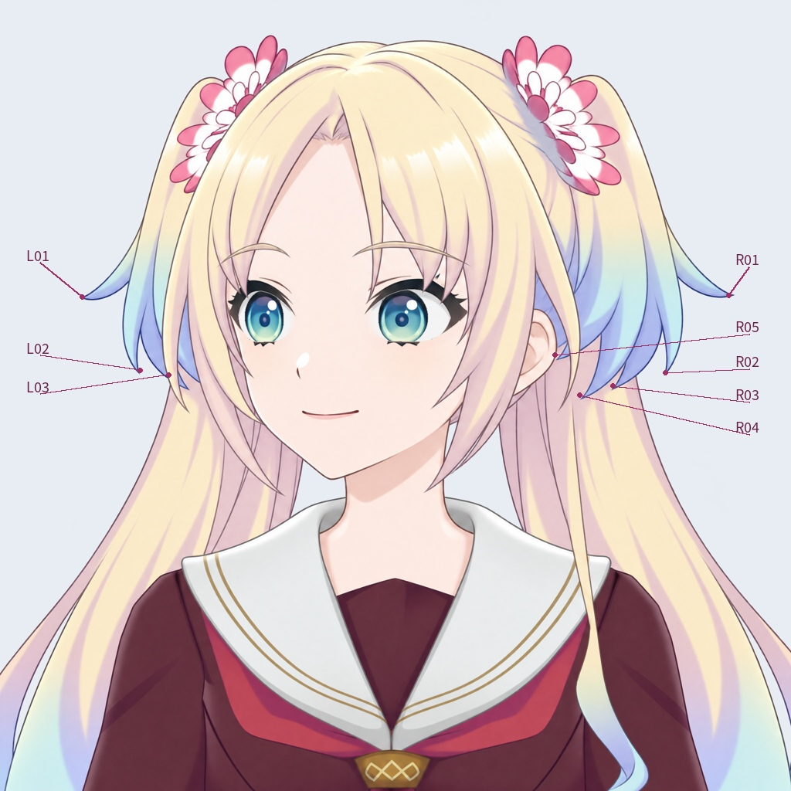

# v0.3.4 左转头部：逐缕拆分短发（第一批）

这是可见段裁切的历史阶段；最新沿发流重绘进度见[完整发束重绘](HAIR_FLOW_REDRAW_V034.md)。

用户要求按一缕一缕拆分。本轮从前一阶段的两大块短后发中，沿可辨认的发梢、轮廓和遮挡边界，提取 **8 缕可见发束**，每缕独立 PNG/PSD 层及固定编号。没有把宽度均分成直条，也不把每一条绘制纹理都当成一缕头发。

文件：`Rurino_Left_Head_Hair_Strands_v034.psd`。这是完整头部的 **44 层工作 PSD**，源于旧 36 层稿；可直接打开检查。源码包路径为 `rebuild_v3_4/turn_redraw/left_hair_strands/`。

## 本批编号

左右均指画面左右；角色仍是同一张左转头部。

| 编号 | 位置 | 已拆的可见部分 |
| --- | --- | --- |
| R01 | 画面右侧 | 最外侧上翘发束 |
| R02 | 画面右侧 | 外侧下垂发束 |
| R03 | 画面右侧 | 后层尖束露出的蓝色段 |
| R04 | 画面右侧 | 较长的前层下垂发束 |
| R05 | 画面右侧 | 被额侧发遮挡的内侧发束 |
| L01 | 画面左侧 | 最外侧上翘发束 |
| L02 | 画面左侧 | 外侧下垂发束 |
| L03 | 画面左侧 | 中间后层露出的蓝色段 |

R03、L03 的上段被前层头发挡住，当前没有凭空延长或切走前层颜色来凑完整发根。原粗切层中混入蓝色发尖下方的粉色马尾像素留回待整理层。更内侧被贴脸发遮住的小段没有硬归入本批。

## 文件检查

保存后重新打开 PSD 检查：44 个像素层、4 个原裁切标志；除两大块短发被细分外，另外 34 层的 RGBA、位置、显隐、透明度、混合方式与裁切标志保持一致。两个来源短发层的所有可见像素恰好归属一个新层，透明度完整保留。

睁眼、部分闭眼、闭眼三种合成状态与上一版逐像素相同。逐一隐藏 8 个发束层时，变化只发生在对应层原本有像素的地方，不影响眼睛、脸型或另一缕头发。详见 `qa/saved-psd-verification.json`。

## 保留的未完成部分

- 每侧一个 `RootBoundary_PENDING` 层保留未细分的上端发根、花饰交界及余下可见像素，默认可见；不能直接删除。
- 本批只有可见段，隐藏发根、层间覆盖余量、细边去底色仍待逐缕处理。当前不做摆动演示，不宣称物理或连续动作验收。
- 刘海里还有跨在头发上的眉毛，须先独立眉毛并补齐发色，再按发束拆。贴脸发、长前发及长马尾仍保留前一阶段的粗分层。
- 上轮 LibTV 皮肤/后发候选继续保留供后续局部补画，本轮未采用整张候选替换形象。
- 尚未新增 Cubism 网格、变形器、物理或 cmo3/moc3。

下一步按编号逐缕补齐发根和遮挡余量，再沿实际轮廓拆贴脸发与刘海；不能以图层数量代替切线质量。

