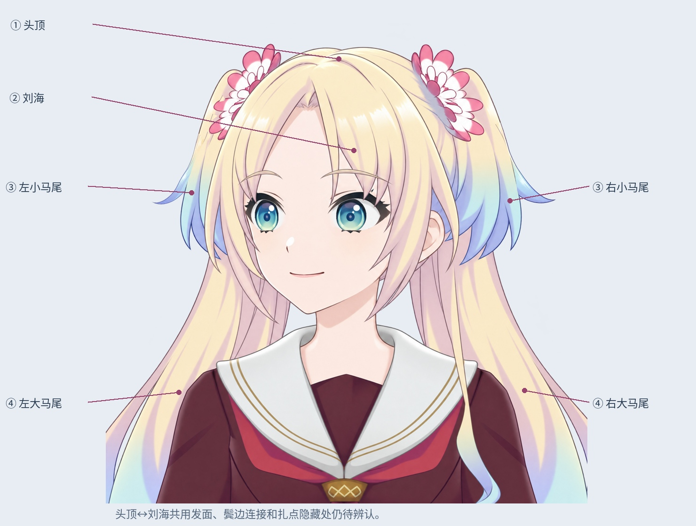
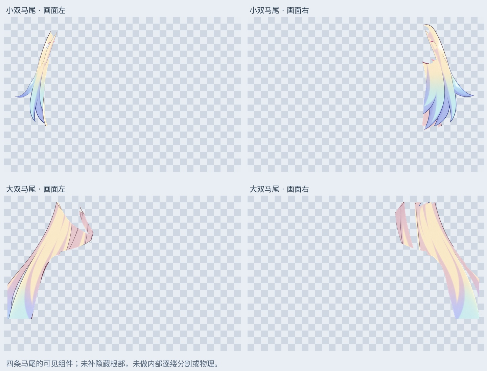

# 四类头发结构整理：马尾可见组件

按用户确认的结构：头顶、刘海、一对小双马尾、一对大双马尾。本轮从此前 54 层来源重新整理，没有使用被否决的 72 层候选。

## 本次实际工作

- 将现有左右短发来源分别合并整理为两条小双马尾可见组件，不预设内部发束数量。旧独立发束和补根试验层保留隐藏备份。
- 将左右长发来源整理为两条大双马尾可见组件。可见组件与边界待核对层分开；原颈部、衣领等区域和疑似非本组件像素保留待核对，不删除。
- 头顶与刘海的共用发面仍未正确分离，明确放在 `01_02_CrownFringe_*_SHARED_PENDING`。贴脸、鬓边和胸前细长束的连接归属也保留待定。

最新 `Rurino_Hair_Structure_Assembly_v034.psd` 为 62 个像素层。原 54 层像素和属性保留，来源被替代时仅隐藏。4 个主体 PNG 和各自待核对图层均有独立文件。

这是结构整理和可见范围候选，不是四类头发已经全部拆好。左右小马尾会继承此前补根试验，扎点和隐藏根部尚未按解剖结构验证。大马尾是画幅内可见段，发梢延伸到原图之外。

## 验证

PSD 保存后回读，新图层与 PNG 一致，原图层像素、偏移、混合方式和眼部裁切属性保留。三个眼部状态的整图 RGBA 最大差为 1/255，差异仅在小马尾合并时的 8 位透明叠加舍入区域；其他区域完全一致。没有新增外轮廓像素；部分原 alpha=255 的像素合并后为 254，属于同一量级的舍入，未产生 alpha 下降超过 1 的像素。

这些验证证明保存和合成范围，不证明组件边界已通过美术验收。小马尾内缘遮挡、扎点附近与发饰的归属、右大马尾衣服残留候选仍需对照原画复核；右大马尾暗色衣服候选目前用受限颜色条件转入待核对层，不能当作最终头发轮廓。

## 预览与下一步

`qa/four-part-structure-guide.jpg` 是四类结构指示图，不是切割遮罩。`qa/four-ponytail-components.jpg` 是实际组件透明轮廓，左右同类组件使用相同尺度和视口。

继续先拆分、后统一修整：下一步辨认头顶和刘海共用区、逐个发尖与根部连接；无法确认的部分留待定。补根、接缝绘画、形状修整、网格和物理在后面。本轮未新增 LibTV 生成或可运行模型。

## 文件

增量包 `Rurino_Hair_Structure_v0.3.4_ADDON.zip` 包含输入的 54 层 PSD、当前输出、脚本、预览与验证。历史包保留，尤其 72 层候选仍未采纳。

安装 `production/requirements-materials-v034.txt` 后运行 `python production/assemble_hair_structure_v34.py`。中文预览字体默认 Linux Noto CJK；其他系统需调整 FONT。现成 PSD/PNG 可直接打开。

