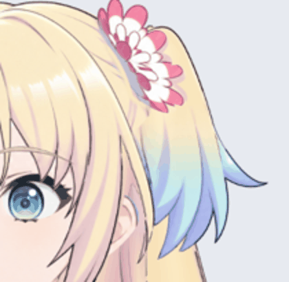

# 右侧小马尾 Cubism 试绑定 v0.3.4

2026-10-29：使用已修好的 55 层左视图 PSD，在 Cubism Editor 5.3.04 FREE 中重新建网格，完成右侧小马尾双向弯曲的第一组试绑定。导出 SDK4.2 格式 `.moc3`，并在 Python live2d / Cubism Core 6.0.1 中实际加载渲染。

## 文件与操作

- `Rurino_HairSmallR_Trial_v034.cmo3`：可编辑工程，来自导出完成后的 03:42 自动保存检查点，包含贴图图集。未在本次重启后再次打开回读，保留原自动保存来源记录。
- `runtime/Rurino_Hair_Trial_v034.model3.json`：运行模型入口，需连同同目录 moc3、cdi3.json 及纹理文件夹使用。
- `qa/hair-runtime-closeup.gif`：右侧小马尾局部摆动；`qa/hair-runtime-sway.gif`：半身预览。均由实际运行模型逐帧渲染。
- 在 Cubism 中选 `HairSmallR_Bend`，拖动 `Hair Small R` / `ParamHairSmallR`，范围 -1 到 1，中立值 0。底色 `Small_R` 与独立黑线 `Ink_Small_R` 共用变形器。

## 已验证

- 参数 -1、-0.75、-0.5、-0.25、0、0.25、0.5、0.75、1 共 9 个位置。
- 45 个导出图形中，仅上述两个发片图形发生位移；脸、眼睛、身体及其他头发在这条参数下没有被带动。
- 检查全部活动网格三角形，相对中立形没有新增翻面。
- 底色和黑线的 41 个共有顶点，运动位移差均为 0。
- 发梢最大位移约 47.5 / 48.7 个原图像素；网格上部 10% 的最大位移约 3.7 / 4.9 像素。根部运动已缩小，但没有宣称完全锁死。
- 一张 2048×2048 图集，完整源画布 3456×2816。图集缩放会损失细节，全分辨率原 PSD 保留不变。

以上是抽样几何检查与预览目视检查，不能证明所有后续组合动作均无穿插。

## 当前边界与下一步

这只是右侧小马尾的手动摆动试绑，尚未加入头发物理、左侧小马尾、大马尾、刘海联动、头部转向、抬低头或身体侧摆/前后仰。预览由正弦参数驱动，未验证物理惯性。当前仍是左视图、腰部裁切半身。

导出时未包含隐藏眼型组，此包不能眨眼、张嘴或实时对话，不应替换现有桌宠的默认模型。旧 v0.3.3 的有缺陷脸部变形没有复用。

下一步制作左侧小马尾，检查两侧根部和花饰的遮挡，再分组推进大马尾与刘海，最后加入安全范围内的物理跟随。

## 复验

依赖 PyQt5、live2d-py、Pillow、numpy 和可用 OpenGL 显示。运行：

```sh
python production/check_hair_trial_v34.py runtime/Rurino_Hair_Trial_v034.model3.json
```

具体测量见 `qa/hair-runtime-report.json`。原始美术材料仍以三处头发修正 PSD 为准，不修改材料版本指向。


