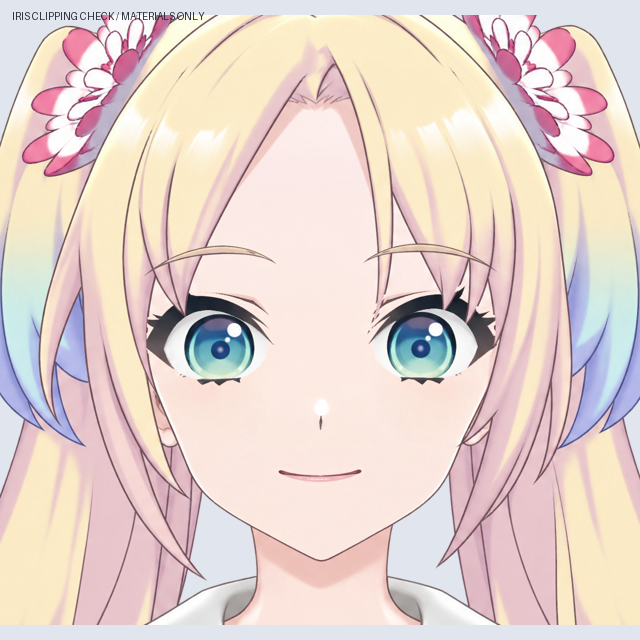
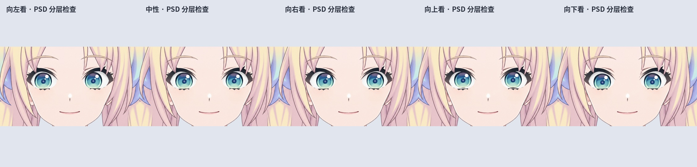

# v0.3.4 面部素材工作稿：新增嘴角表情与转头重绘参考，尚未绑定

最新进度：新增[左右转头眼部局部修订与原视频对照](TURN_EYES_V034.md)，侧向部件尚待拆层和绑定。完整目标与顺序见[当前制作记录](CURRENT_WORK.md)。[76 层嘴角表情素材](EXPRESSION_MATERIALS_V034.md)及[独立转头重绘参考](TURN_REDRAW_V034.md)。已撤回正面图整体变形的转头方案，改为分别重绘左右视角；侧向图尚未拆层、配准或绑定。此前[54 层眼嘴素材](MOUTH_MATERIALS_V034.md)、[39 层眨眼记录](BLINK_MATERIALS_V034.md)保留。下文为更早的 29 层拆分阶段历史记录。

本轮从前一阶段的 18 层头部工作稿继续，完成独立眉毛、眼白、虹膜、上下眼睑和中性正面嘴线的素材拆分，并用 LibTV 补齐眉线下方发丝、眼白和五官下方皮肤。

当前文件：`Rurino_Head_Facial_Materials_v034.psd`。这是可编辑 PSD 素材，不含新的 `.cmo3`、`.moc3` 或桌宠运行包。

## 本轮实际完成

- 两条眉毛独立成层，去掉边缘附带的细碎发丝。眉线下的刘海和皮肤已局部修复，旧皮肤底层的重复眉毛已移除。
- 双眼分别拆成眼白、虹膜、上眼睑（含上睫毛/眼褶）、下眼睑（含下睫毛）。虹膜在 PSD 中裁切到对应眼白。
- 清理旧分层留在脸皮和头发中的眼睛像素，修正眼前刘海的遮挡归属；虹膜移动测试不再出现原位置的虹膜残影。
- 中性正面嘴线独立，保留原位置与笑容。没有把它纵向拉伸冒充张嘴。
- 原有左右分缝、脸型外轮廓及身体素材保持中性位置。未镜像发型，也未使用 Epsilon 的美术覆盖角色。

## 已保存 PSD 的检查

[保存文件检查报告](metadata/head-materials-checks-v0.3.4.json) 是重新读取保存文件后得到的结果，不仅是内存合成检查：

- 实际图层树 29 个像素层、唯一名称；两只虹膜的裁切标志均保留。
- 实际移动 PSD 中的虹膜层进行左/中/右/上/下五姿态检查。眼白开口之外的像素变化为 0，整图透明度变化为 0。
- 对比拆眼睛之前，左右瞳孔和嘴的模板匹配最佳位移均为 (0,0)，相关系数均大于 0.999。此项证明本轮拆分没有移动这些特征，不是官方形象相似度评分。
- 中性图的 alpha>127 外轮廓与上一阶段相同。
- 隐藏眼睛后的两个虹膜检查区域中，残留蓝色眼睛像素为 0。
- 独立合成器与 PSD 渲染的 alpha 最大差 1，RGB 最大差 6，差异来自细小半透明/裁切边缘；没有将其描述为逐像素完全相同。

预览：`qa/psd-gaze-verification.jpg`（实际 PSD 五姿态）；`qa/gaze-material-check.gif`（连续素材位移演示）；`qa/facial-layer-sheet.jpg`（拆层概览）；`qa/features-hidden.png`（检查底图残留）。

## 视线预览跳色修复

旧 GIF 逐帧生成调色板，导致青蓝虹膜随帧跳色；检查中有 37,410 个原本静止的像素也发生了颜色变化。此问题发生在预览编码环节。

- 新 GIF 使用整段共用的 256 色调色板并关闭误差扩散；原本静止的像素闪色数量降为 0。GIF 仍有颜色量化损失。
- 新增 `qa/gaze-material-check.png`，这是 36 帧无损 APNG。以它作为颜色验收预览，解码后与渲染帧的 RGB 最大差为 0。
- 连续跟踪左眼 13,891、右眼 13,851 个无遮挡的虹膜像素，36 帧内 RGB 最大差均为 0。中性合成与原保存 PNG 完全一致。
- 此次只修复预览导出，没有修改 PSD、眼球贴图或绑定。眼发交界收整与完整眨眼仍待制作。

详细检查：[颜色检查报告](metadata/gaze-colour-checks-v0.3.4.json)；前后对比：[颜色对照图](preview/gaze-colour-comparison-v0.3.4.png)。可单独运行 `python production/export_gaze_v34.py` 从现有 PNG 重导出并检查，无需重建 PSD。

## 仍需制作，当前不能称为成品

1. 刘海尖端与眼睑交界处还有细小边缘需要收整；完整闭眼前必须再次检查遮挡和线条，不应只看睁眼合成。
2. 上下眼睑的闭眼关键形、眼白收拢/遮罩，以及虹膜在眨眼过程中的遮挡尚未绑定。现有 GIF 只演示视线移动，不能当作眨眼或 Live2D 运行证明。
3. 只有中性嘴线。口腔、上下唇及张嘴/微笑关键形尚未制作，语音口型尚未接入本稿。
4. 头部 X/Y/斜向透视关键形仍未重做，因此还没有新的“脸型与五官动作幅度协调”运行验收。
5. 共享后发支持层仍需拆成后脑、侧发根与双马尾根的独立遮挡结构，并映射父变形器。
6. 新头肩素材还没有与原全身立绘结合、导入 Cubism 网格或导出运行文件，也未做 Windows 桌宠验证。

后续顺序：先收整眼发交界并制作完整闭眼，再完成口腔与唇形，随后整合全身、重绑头部透视及头发物理。v0.3.3 仍是已有公开运行稿。

源码包保存为 GitHub 草稿附件，登录仓库拥有者账号后可在 Releases 中查看；未发布新的运行模型。

复现请使用草稿中的源码 ZIP，里面含脚本所需的母图与 LibTV 补画输入；Git 仓库保存制作脚本、预览和检查记录。源码包内 README 列出按顺序运行的构建命令。
