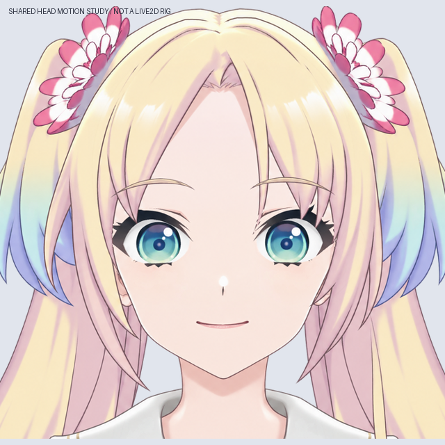

# v0.3.4 小角度头部变形研究（非 Live2D 运行模型）

本轮针对“脸型和五官动作幅度不一致”的问题，制作共享坐标变形草稿，作为后续 Cubism 参数设置的参考。对照原视频中克制的头部动作，先限制在代理角度 X ±8°、Y ±5°；这些数字是近似投影的控制值，不是从视频测出的真实头部角度。

## 输出

- `qa/head-motion-check.png`：无损 APNG，左右与上下小幅动作叠加轻微嘴角变化，无声音。
- `qa/head-keyforms.jpg`：X/Y 九宫格对照。
- `keyforms/`：九张 2048×2048 透明合成 PNG。
- `meshes/`：各关键位置的 65×65 控制网格 JSON，仅用于复现和绑定参考，不是可直接导入 Cubism 的变形器。
- `binding-reference.json`：76 层图层清单、现有裁切目标、拟用参数范围及绑定注意事项。此文件不是完成绑定的证明。

## 变形原则

对现有素材的合成图使用同一个连续的近似深度投影，脸型、眼睛、鼻子、嘴巴、发根不单独缩放或漂移。嘴角表情在头部变形前应用，因此嘴部仍沿用同一头部坐标。

原图 y≤1280 区域使用完整头部变形，1280～1480 逐渐过渡到固定区域，y≥1480 的肩部、衣服及下段发梢逐像素保持不动。上段领口处于过渡区，不能声称整个身体完全静止。头发暂时随头部整体运动，没有独立马尾物理。

## 检查结果

- X/Y 范围内检查 231 个参数组合；所有控制网格三角形保持正向，最小有向面积比约 0.863，没有翻折。
- 用此前测得的双眼中心和脸颊边界检查，眼距/脸宽比例相对变化最大约 0.0454%，未出现两个部位使用不同放大幅度的问题。此数值只检验该近似模型的比例稳定性，不代表官方形象相似度评分或 Cubism 实机验收。
- 零角度合成与输入逐像素一致；y≥1480 的输出像素完全不变。
- APNG 按帧时长解码，与渲染序列逐像素一致，避免 GIF 调色板跳色。
- 原始嘴角表情 PSD 已单独重开验证，详见 `../expression_refinement/qa/checks.json`。

## 尚未解决

这是基于正面素材的 2.5D 近似投影，尚未重绘转头后露出的侧脸、耳朵、后脑或头发内部，也没有改变遮挡顺序。不能扩大角度当作完整转头模型。本轮转头 PNG 为合成参考，76 层主 PSD 仍是正面素材稿。

后续需要在 Cubism 中建立共同的头部父变形器，加入透视关键形并检查遮挡；然后接入 MouthOpenY/MouthForm、眨眼、语音驱动与头发物理。没有新增 cmo3/moc3 或 Windows 运行包。

复现：完成表情素材后运行 `python production/build_head_motion_study_v34.py`。全部从已有本地素材计算，不再次调用 LibTV。

完整 PSD、PNG 与控制网格在 v0.3.4 GitHub 草稿源码 ZIP 内。
