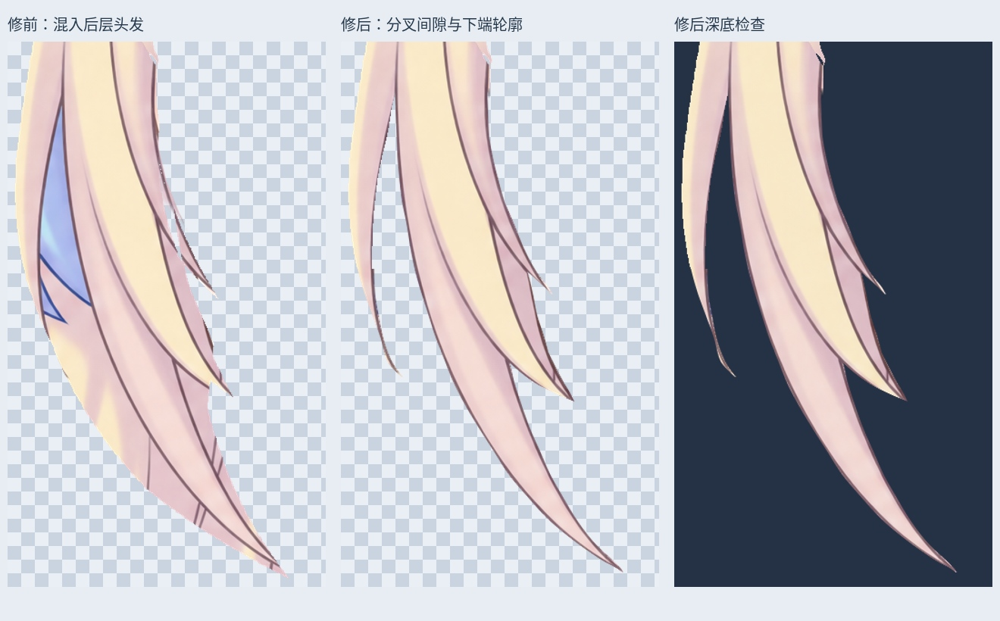
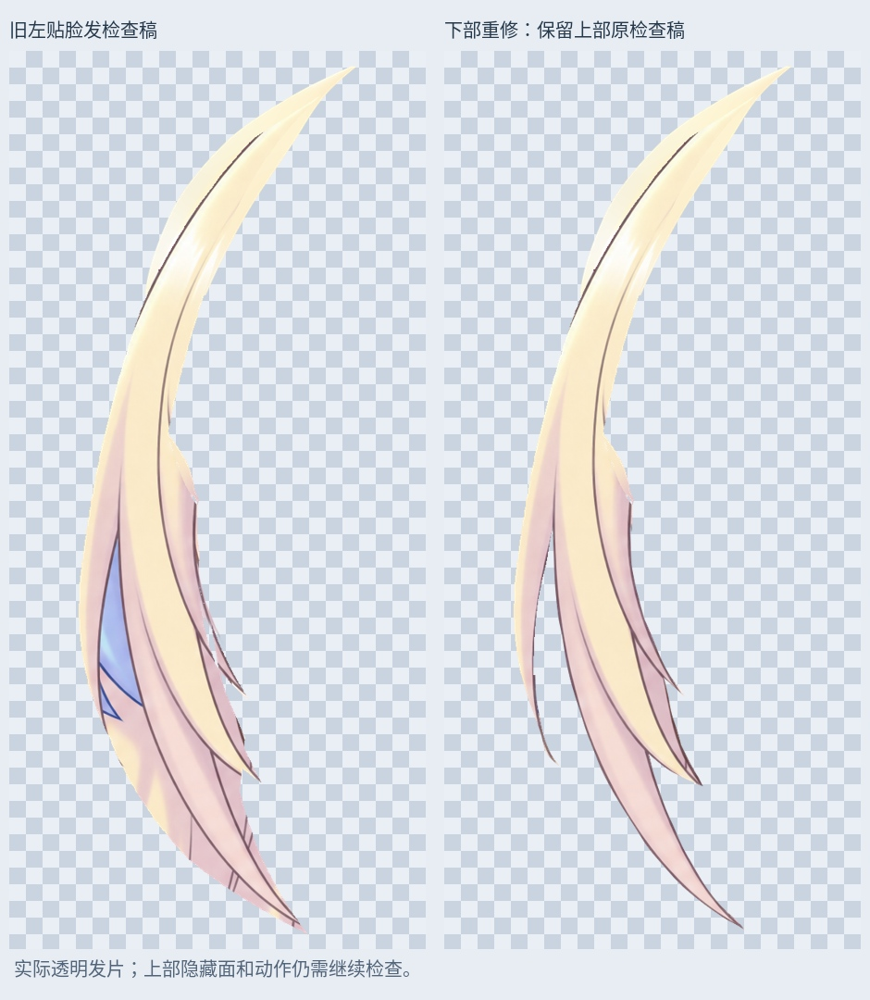

# 左贴脸发：分叉间隙和下端轮廓修整

从右贴脸发重修后的 132 层 PSD 继续，处理左侧发片下半段。旧稿将两缕前发之间的蓝色后发、下端后方发丝线条也包含在同一透明素材中，靠脸的小发尖还存在缺边。

- 按原画的长短分叉重描下部轮廓，打开外侧细发束与主发束之间的间隙，移出其中的蓝色后发和其他后层内容。
- 保留短金色发尖、长粉色发束及外侧细发束；沿各自原画边缘裁去下端混入的后层交叉线，补齐靠脸发尖的破口。
- 颜色只从固定参考图中描定的头发范围内取样；半透明边缘和少量来源缺损使用相同发束内部的邻近色补足。未镜像或拉伸整张头部。
- 检查稿有 61991 个 RGBA 像素改变；新增 1570 个覆盖位置，去除 22943 个旧覆盖位置。用于边缘或缺损补色的位置为 1397 个。
- 按 alpha > 127、八邻域检查，整片为一个连通部件；修整区域 y≥750 内部透明孔洞为 0。上部原检查稿 y<750 逐像素保留，其原有 39 个孔洞像素也保留，尚未修整，不能称全片已经完整。

## PSD 与检查稿

`Rurino_Left_Cheek_Lower_Contour_v034.psd` 共 133 个像素层。最新左贴脸发为默认隐藏的 `14_LeftCheek_LowerContour_REVIEW_OFF` 中的 `Cheek_L_LowerContour_LOCAL_REVIEW`，替代旧 `10` 组里的左贴脸发候选。请不要叠加历史候选。

原 132 个像素层的像素、偏移、可见性和混合属性完整保留；本轮去除的后层内容仍可在历史原图层中找到，并非从项目删除。右贴脸发继续使用 `Cheek_R_ContinuousContour_LOCAL_REVIEW`，连续头顶/刘海继续使用 `CrownFringe_RightTipsRecovered_LOCAL_REVIEW`。

新候选保存回读与 PNG 一致。睁眼、半闭眼、闭眼默认合成均 0 像素变化，说明新增隐藏候选未破坏旧显示；这不能替代新候选的装配与动作验收。

## 后续

左侧上部 y<750 的旧补片仍有接缝、突起和少量孔洞，下一步应整理它与刘海/眉毛遮挡交接的隐藏面。本轮仅修下部，没有补完所有隐藏面。其余大马尾肩后连接、画布外末端、转头、身体动作和头发物理尚未完成，未更新 v0.3.3 Cubism 运行模型。

输入 SHA256：`1e06d6af7b88ad319b1bea29399f146a8ee674bae13217af8c585ada8720c117`

输出 SHA256：`9d77e093666dc708a125afdb1f308ff97f4457bec0dd4d2c85386c62223322f0`

参考合成 PNG SHA256：`e87feb4c5e49a7e581f01e8593e548adfc612c514edc2f54898424aa1e7ae9da`

增量包含输入/输出 PSD、固定参考 PNG、透明素材、遮罩、预览、验证和脚本依赖。安装 `production/requirements-materials-v034.txt` 后运行 `production/rework_left_cheek_lower_v34.py`；`--prepare-only` 只生成素材。默认字体为 Linux Noto CJK，可调整；打开 PSD 不需要脚本。没有新增 LibTV 生成。

