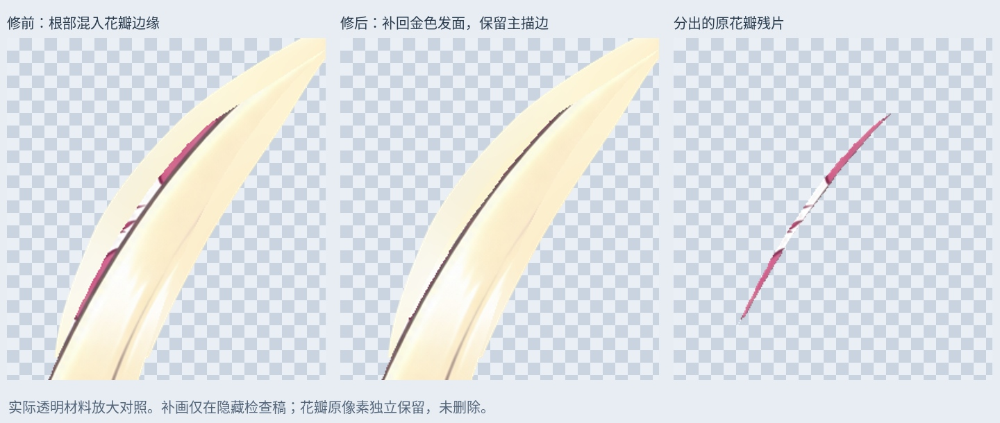
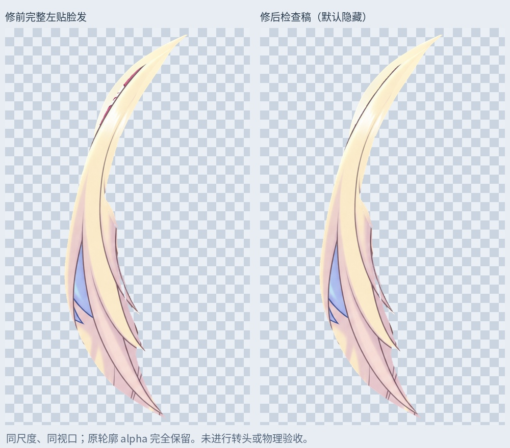

# 左贴脸发根：移出花瓣残色，补回遮挡发面

从 114 层接缝修正稿继续。左贴脸发上端的红色、白色条带来自花饰边缘，原拆层把它们一起带进了头发。完整材料补根后，它们成为发面内部的杂色。本轮只处理这处已确认的归属问题。

- 沿头发主描边分出 1030 个原花瓣/边缘像素，包括红白条带和花瓣转折处的小尖角。保留在独立上下文层，未删除原像素。
- 检查稿在同一区域补回金色发面。颜色取自曲线右侧 9～23 像素的同一缕头发，并沿发流平滑过渡；主描边保留。没有将两侧镜像、没有拉伸头部。
- 完整检查稿的 alpha 轮廓与上一版完全一致，修整遮罩外 RGBA 完全一致。改变的范围为 1030 个像素。

## PSD 与真实透明素材

`Rurino_Left_Cheek_RootClean_v034.psd` 有 117 个像素层。原 114 层的像素、偏移、透明度、混合与裁切属性保留。旧 `CheekLock_ImageLeft` 关闭，由原位置的 `Cheek_L_FlowerClean_SOURCE` 和 `Cheek_L_FlowerContext_SOURCE` 替代。这两层不重叠，拼回原图完全一致。既有眉毛、眼睛和前景头发层保留。

新的 `10_LeftCheek_RootClean_REVIEW_OFF` 默认关闭，其中 `Cheek_L_RootClean_LOCAL_REVIEW` 是本轮修好的完整贴脸发检查稿，替代旧 `09` 检查组里对应的左贴脸发版本。检查时单独显示它，避免同旧素材叠加。它包含前几轮已补的根部和接缝，但不等于动作已经验收。

`layers/Cheek_L_RootClean_REVIEW.png` 是修后完整透明材料；`Cheek_L_concealed_repaint.png` 只包含本轮补画；`Cheek_L_FlowerContext_SOURCE.png` 是分出的原花瓣残片。近景三列依次为修前、修后、分出的原画；完整图使用同一视口与比例。图片均来自实际透明素材。

## 保存验证与未完成项

PSD 保存回读，新图层与 PNG 一致。默认睁眼、半闭眼、闭眼三个状态均与输入稿 RGBA 逐像素相同，变化像素为 0。新增金色补画只在隐藏检查稿里，尚未接入运行模型。

右侧刘海前景发尖、其他根部、贴脸发下方蓝色区域的归属、旧边缘杂色，以及大马尾肩后接缝和画布外发梢仍待检查。没有新增 Cubism 网格、角度参数、身体侧摆/前后仰或物理。静态相同不代表拆层和动态遮挡全部正确。

本轮为本地原画重分配与有限位图补画；没有新的 LibTV 任务。

输入 SHA256：`c908e790f0fe4be4da0ac122edac76f010c7804c37067e25d5ed390dc62c741d`

输出 SHA256：`00f7430b6484b2d3c675e8953380677dbdf8e9870e75bb85078332bfa3b19129`

`Rurino_Left_Cheek_RootClean_v0.3.4_ADDON.zip` 含输入/输出 PSD、透明 PNG、遮罩、预览、验证及脚本依赖。安装 `production/requirements-materials-v034.txt` 后运行 `production/clean_left_cheek_root_v34.py`；可加 `--prepare-only` 先检查 PNG。字体默认 Linux Noto CJK，其他系统可调整。直接打开 PSD 无需执行脚本；本包不更新现有可运行模型。

