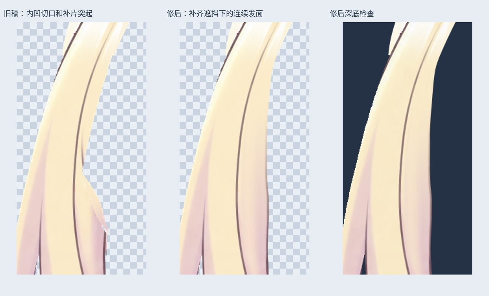
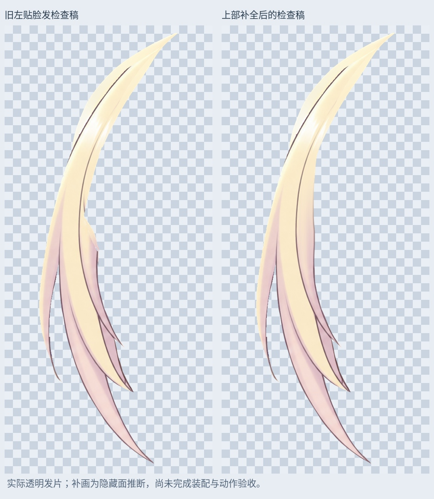

# 左贴脸发：上部隐藏发面补全

上一检查稿在中上部有内凹切口、向外突出的补片和细小透明孔洞。本轮沿已有发丝方向补全这一段，连接至上一阶段修好的下部。

- 重新连接上部局部轮廓，填平旧内凹切口和补片接缝，清掉其中残留的细线。
- 由同一发束上段金色、下段粉色的横向颜色样本推断局部隐藏面，保留内部主描边。补画没有取用眼睛、眉毛或皮肤颜色；属于局部推断重绘，并非找回原画里原本存在的隐藏像素。
- 原 39 个内部孔洞像素补齐。按 alpha > 127、八邻域检查，新检查稿为一个连通部件，内部孔洞为 0。
- 共改变 11159 个 RGBA 像素，新增 4043 个覆盖位置、去除 124 个旧覆盖位置。局部修整遮罩之外逐像素不变；y<450 的上端和 y≥770 的下部均完全保留。

## PSD 与使用

`Rurino_Left_Cheek_Upper_Surface_v034.psd` 共 134 个像素层。最新左贴脸发为默认隐藏的 `15_LeftCheek_UpperSurface_REVIEW_OFF` 中的 `Cheek_L_UpperSurface_LOCAL_REVIEW`，替代旧 `14` 组里的左侧候选。不要叠加历史候选。

右贴脸发继续使用 `Cheek_R_ContinuousContour_LOCAL_REVIEW`，连续头顶/刘海继续使用 `CrownFringe_RightTipsRecovered_LOCAL_REVIEW`。原 133 层像素、偏移、混合、可见性全部保留。新图层保存回读与透明 PNG 一致，默认睁眼、半闭眼、闭眼合成均 0 像素变化。

## 仍需验收

局部隐藏面由邻近颜色推断，尚未证明所有转头角度和遮挡关系正确。需要将最新发片装回头部，检查与刘海、眉毛及相邻发片的重叠；旧上端 y<450 的边缘也需结合装配检查。本轮未新增转头角度图、Cubism 网格和参数、身体动作或物理，未替换旧 v0.3.3 运行模型。

输入 SHA256：`9d77e093666dc708a125afdb1f308ff97f4457bec0dd4d2c85386c62223322f0`

输出 SHA256：`af90791a4abf86fd286668dffc6727dd1278acc9a6f2324d1b5af0570048b882`

增量包包含输入/输出 PSD、透明素材、遮罩、预览、验证与脚本依赖。安装 `production/requirements-materials-v034.txt` 后运行 `production/complete_left_cheek_upper_v34.py`；`--prepare-only` 只生成素材。脚本从输入 PSD 获取颜色，无额外参考 PNG 依赖。默认字体为 Linux Noto CJK，可调整。打开 PSD 不需脚本；未调用 LibTV 生成。

