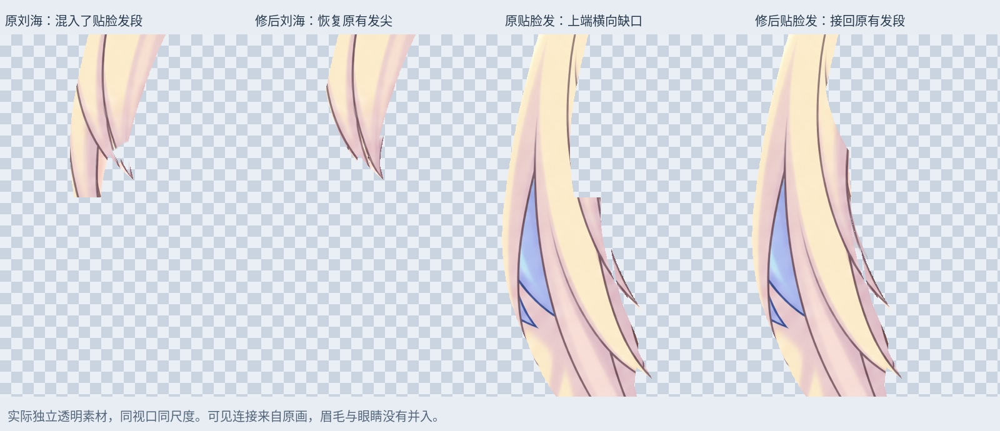
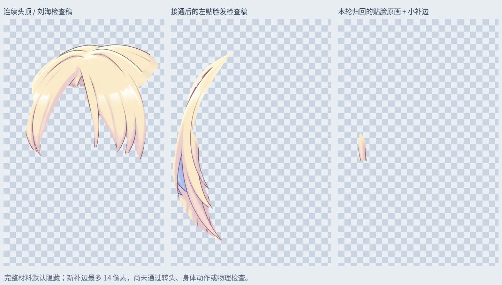

# 左刘海与贴脸发：修正横切口，接回原发段与前景发尖

上一版左刘海独立素材在 y≈801 处平切，贴脸发在同一高度有缺口。核对原画描边后确认，这一段实际属于延续到下方的贴脸发；继续给刘海补尖会制造错误发束。本轮从 106 层头顶根部稿继续，修正两者的材料归属。

## 本轮修改

- 沿原发束描边归回 5425 个贴脸发原画像素，连接上下原有材料，修去这处错误横切口。
- 将夹在两束头发之间的 419 个肤色像素独立保留为上下文，不带入完整头发检查稿。
- 从原有 `Foreground_Hair_Overlap` 提取左刘海 1616 个、左贴脸发 2552 个前景头发像素。此前这些发尖/描边单独盖在眼睛上方，独立材料缺少它们；本轮纳入检查素材。没有从眼睫或眼球图层取样。
- 沿左贴脸发与刘海相交处补 869 个隐藏余量像素，最大宽度 14 原生像素。使用本侧发色平滑延续，默认隐藏，不能据此声称转头不露底。
- 重新输出连续头顶 / 刘海与左贴脸发两份完整材料检查稿。中间刘海仍连续，既有眉毛独立分层保留。

## PSD 图层与显示

输出 `Rurino_Left_Fringe_Cheek_v034.psd` 有 114 个像素层。原 106 层的像素、偏移、透明度、混合与裁切属性保留；被替换的旧 `Fringe_L_SourceRestored_WHOLE` 和 `Foreground_Hair_Overlap` 关闭，其他旧层显示状态不变。

默认合成使用不重叠的来源分配层：`Fringe_L_ContourCorrected_SOURCE`、`Cheek_L_UpperJunction_SOURCE`、`Left_FringeCheek_SkinContext_SOURCE`，以及三份前景覆盖来源层。它们保留各自原始绘制顺序，确保眼睛上方的头发继续正确遮挡。用于后续绑定的完整材料在单独检查组中，默认来源层尚未转换为 Cubism 的最终部件结构。

`09_LeftFringeCheek_Connected_REVIEW_OFF` 及其两个子组均默认关闭。检查时只打开需要的一个子组并单独显示：`CrownFringe_ContourCorrected_LOCAL_REVIEW` 或 `Cheek_L_Connected_LOCAL_REVIEW`。旧 `08` 组和旧 `Cheek_L_FullMaterial_LOCAL_REVIEW` 是历史材料，仍保留关闭；本轮对应检查稿取代它们的左侧接缝内容。

透明 PNG：`Fringe_L_visible_complete.png` 与 `Cheek_L_visible_connected.png` 为原画像素接通后的可见材料；`Crown_continuous_REVIEW.png`、`Cheek_L_complete_REVIEW.png` 含此前根部补画及本轮有限补边。`Cheek_L_concealed_underlap.png` 仅为这次新补边。近景四列依次为原刘海、修后刘海、原贴脸发、修后贴脸发；均为真实独立透明素材的相同视口与尺度。

## 验证与边界

两份来源层均按互不重叠的遮罩拆开，逐像素拼回一致。PSD 保存回读后，各新图层与交付 PNG 一致；默认睁眼、半闭眼、闭眼三个状态与输入稿 RGBA 完全相同，变化像素均为 0。因此没有通过这轮重组改变脸色、眼色或眉毛。

这是静态材料归属修正，不是动作验收。现有边缘的细小半透明缺口、旧色边仍需精修；左贴脸发上端还可见花饰残色，需下一步核对并归出。其他头顶/鬓发的归属、长马尾肩后接缝与画布外发梢仍待处理。没有新增 Cubism 网格、转头参数、身体侧摆/前后仰、物理或运行版导出。

输入 SHA256：`ba361d17da06a852c50dd55dc7fc83277c7cef7136ef56381fe4441a910ae356`

输出 SHA256：`c908e790f0fe4be4da0ac122edac76f010c7804c37067e25d5ed390dc62c741d`

本轮为本地原画重分配与有限位图补边，没有新的 LibTV 生成任务。

## 文件与复现

`Rurino_Left_Fringe_Cheek_v0.3.4_ADDON.zip` 包含输入/输出 PSD、透明素材、遮罩、预览、验证和脚本依赖。安装 `production/requirements-materials-v034.txt` 后运行 `production/refine_left_fringe_cheek_v34.py`；`--prepare-only` 仅制作 PNG 检查图。默认 Noto CJK 字体路径可按系统调整。直接打开 PSD 无需运行脚本；本包不改变桌宠现有运行模型。

