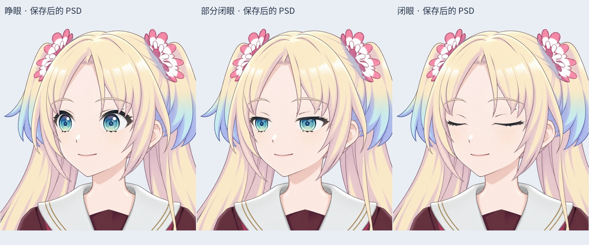
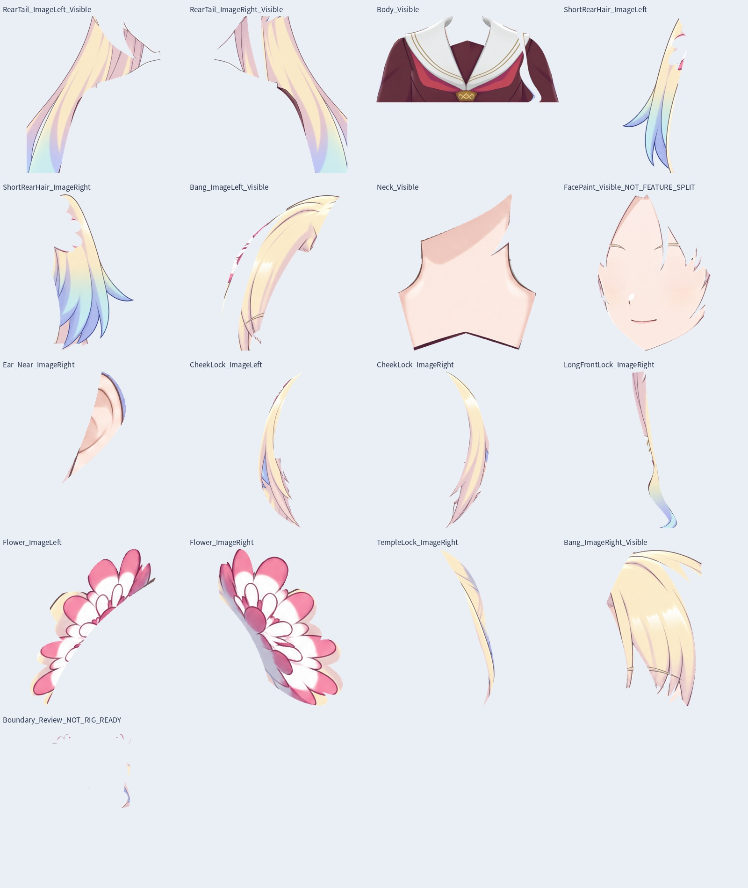

# v0.3.4 左侧头部可见区域拆层初稿

当前新增：[逐缕短发拆分第一批](HAIR_STRANDS_V034.md)，8 缕可见发束，完整头部 PSD 为 44 层；发根补绘与后续头发仍待制作。以下保留旧阶段记录。

这是拆层工作文件，不是已经能做转头的模型。PSD 名称：`Rurino_Left_Head_Visible_Parts_v034.psd`，位于源码包 `rebuild_v3_4/turn_redraw/left_head_parts/`。

本轮保存 36 个像素层：16 个可见部件、1 个待复核边缘层、19 个原有眼部/局部刘海遮挡层。拆出两侧马尾、短后发、左右刘海、两侧贴脸发束、右侧太阳穴发束、长前发束、花饰、可见耳朵、脸部、颈部和身体。保留不对称发型；没有镜像、拉伸或重新生成已确认的可见脸。

先修正了初次路径中的长发束/衣领交界、额侧发束与后发归属，并收集零散像素。`Boundary_Review_NOT_RIG_READY` 中保留 29,064 个像素，默认可见，用于保持原图重构；不能删除或直接当成一个可运动的零件。身体和马尾被前发遮挡形成的合理断开区域仍属于原部件。

## 实际回读检查

- 重新打开保存后的 PSD：36 层、4 个裁切标志。
- 原有 19 个眼部与局部刘海层的 RGBA、位置、显隐、透明度、混合方式及裁切标志均与来源一致。
- 睁眼、部分闭眼、闭眼三个状态与原侧向眨眼 PSD 合成对比，所有可见 RGB 和整图 alpha 的最大差均为 0。
- 每个可见背景像素恰好归属于一个拆分层；保存后的可见 RGBA 与完整 alpha 无损。裁去图层透明外框时，不要求保留 alpha=0 区域无显示意义的 RGB。
- 这些检查只证明拆分没有丢画或改动原有眼睛，不证明切线已适合运动。

## LibTV 隐藏补画

已制作皮肤与后发两张 2048×2048 候选，保留提示词、成功任务记录、资源 ID、下载大小和本地 SHA256。鼻嘴等局部模板匹配的最佳位移约为 0～2 原图像素；这不是精确解剖配准证明。候选改变了额头发型/花饰，因此本轮**不采用整张候选替换脸，也未加入 PSD 合成**。后续只可取经过对齐的局部隐藏皮肤与发根，避免重复五官。

## 尚未完成

- 花饰周围仍夹带少量底发，发束交界仍有细边需要人工精描。当前可见归属拆层不是可直接物理摆动的最终切层。
- 眉毛跨在头发和脸皮上，尚未完整独立；鼻子、嘴仍在脸部层中。
- 耳根、刘海后的完整额头、各独立发根尚未采用补画；远耳被遮住，不凭空编造。
- 左右/上下/四角部件尚未一一对应，完整头部尺度、颈部转轴、网格和组合绑定未完成。
- 没有新增 cmo3/moc3 或 Windows 运行版。

下一步先精描花饰/发束边界、分出眉鼻嘴并补齐隐藏区域，再推进其余方向的部件对应及 Cubism 参数。历史来源是 20 层侧向眨眼 PSD，保留原文件不覆盖。

