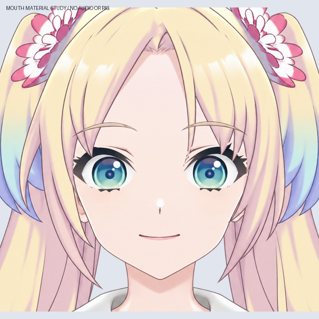

# v0.3.4 正面嘴部素材（54 层眼嘴合并稿，尚未绑定）

主文件：`Rurino_Head_Eyes_and_Mouth_Materials_v034.psd`。在已检查的 39 层眨眼稿上增加小张嘴、半张嘴、张嘴三个分组，每组含口腔、牙齿、舌头、上唇、下唇，共 54 个独立命名像素层。

## 本轮完成

- 使用 LibTV Lib Image 2.5 Pro 补画正面自然张嘴，仅提取嘴部，不替换整张脸。原图、提示词、模型参数、任务和交付记录保存在 `sources/`。
- 对齐原嘴角的横向位置（2048 原图 x=937、1102），去除轻微倾斜；生成嘴高度缩至约 73%，形成克制的正面张嘴幅度。闭嘴仍使用此前批准的原始笑容。
- 口腔、牙齿和舌头保持位置与贴图尺寸，由唇线和口腔开口逐步露出；牙齿、舌头通过 PSD 裁切层限制在口腔内部。
- 保存五种开合度全尺寸 PNG，PSD 保留闭嘴、小张嘴、半张嘴和张嘴四组可切换素材。低开合度动图在皮肤上做短暂闭合过渡，避免双重透明唇线叠黑。
- 对齐独立预览和 PSD 裁切层的半透明合成方式，消除两种预览在牙齿边缘的差异。开口起点限制在完整口腔范围，避免嘴角单个边缘像素在张嘴时反向变淡。

## 查看方法

`qa/mouth-material-check.png` 是无损 APNG 动图；`qa/mouth-keyforms.jpg` 为静态口型对照。动图没有声音，也不是语音驱动的实机运行。

PSD 默认显示原闭嘴组 `05_Neutral_Mouth`。查看张嘴时先隐藏它，再显示 `05_Mouth_Small_…`、`05_Mouth_Half_…`、`05_Mouth_Open_…` 之一。嘴部组每次只开一个；眼睛组同样每次只开一个。

## 验证

- 重开保存的 PSD，检查四种嘴部状态；可见 RGB 与独立合成最大误差为 1～2，alpha 最大误差 1。图层总数 54，名称唯一，10 个裁切标志保留（4 个虹膜、6 个牙齿/舌头）。详细数据见 `qa/checks.json`。
- 五种关键形中，嘴部检查区域外像素完全不变，alpha>127 的头部外轮廓完全一致。原闭嘴与此前 PSD 最大 RGB 差 1，来自合成舍入。
- 检查 101 个开合位置，口腔逐像素单调扩大，牙齿和舌头贴图及坐标不变，裁切后口腔外没有牙齿或舌头。见 `qa/dense-transition-checks.json`。
- APNG 按帧时长解码，与生成的渲染帧逐像素一致；未使用逐帧 GIF 调色板。

复现：完成源码包 README 中的此前步骤，再运行 `python production/build_mouth_materials_v34.py` 和 `python production/check_mouth_transition_v34.py`。只使用已保存本地素材，不重新调用 LibTV。

## 当前限制与后续

这是一个正面开合口型系列，不是 A/I/U/E/O 五种发音口型。没有 Cubism 网格、MouthOpenY/MouthForm 参数绑定、语音对齐、新的 cmo3/moc3 或 Windows 运行包。

下一步需要制作嘴角/微笑变化与头部透视关键形，检查五官和脸型同步运动，再进入 Cubism 参数绑定与语音驱动验证。此前全身整合、发根结构和头发物理工作仍待完成。

完整 PSD、来源图片与关键形 PNG 在现有 v0.3.4 GitHub 草稿源码 ZIP 内。
