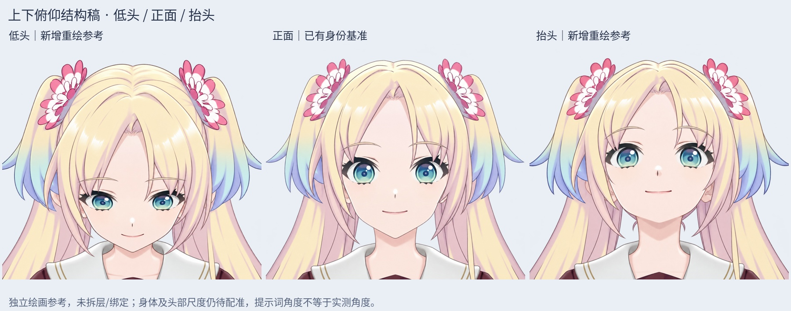
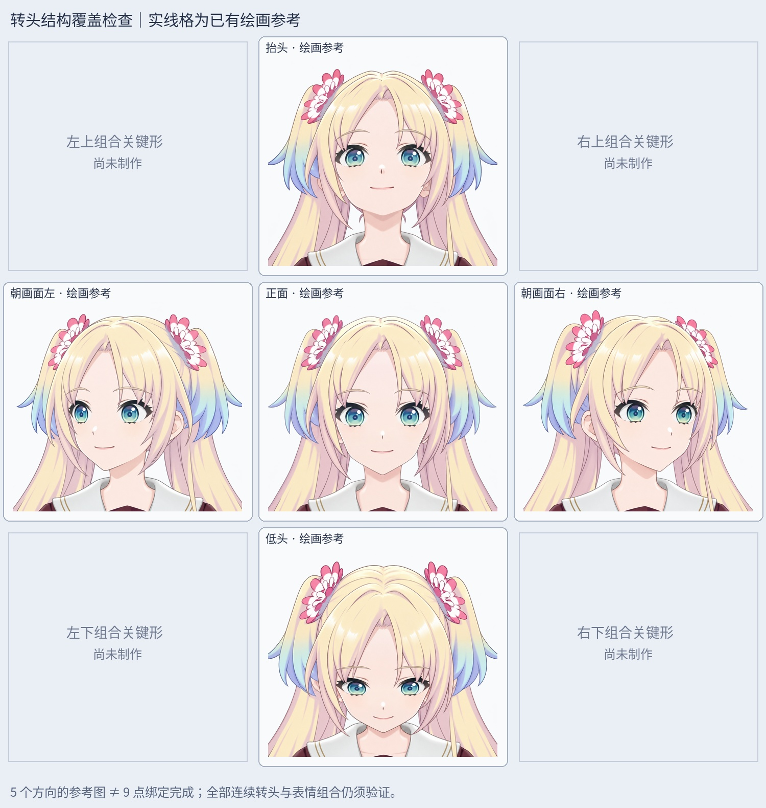

# v0.3.4 上下俯仰结构参考（未拆层、未绑定）

最新阶段：[四角组合视角与九方向参考](CORNER_MATERIALS_V034.md)。四角绘画已补齐，完整拆层、配准和新绑定尚未完成；下文保留本阶段历史记录。

此前只制作了左转、正面、右转素材，上下俯仰尚未制作。本轮将制作重点转回整体转头结构，在 LibTV 用已确认的正面母图独立补画低头、抬头；后续先检查方向覆盖和结构，再进入局部精修。

## 当前文件

- 低头：`rebuild_v3_4/turn_redraw/pitch_redraw/sources/pitch-down-source.png`
- 抬头：`rebuild_v3_4/turn_redraw/pitch_redraw/sources/pitch-up-v2-source.png`
- 上下对照：`rebuild_v3_4/turn_redraw/pitch_redraw/qa/pitch-three-view-review.jpg`
- 方向覆盖：`rebuild_v3_4/turn_redraw/pitch_redraw/qa/head-direction-coverage.jpg`

两张选用图均为 2048×2048 透明 PNG。第一版抬头有嘴角变平、下半脸偏长的问题，已保留为未采纳候选；第二版恢复小闭嘴微笑，作为初步抬头结构参考。完整提示词、模型参数、任务、资源与下载记录都在 `sources/`；使用 Lib Image 2.5 Pro，每次生成 1 张。选用低头 1 张、抬头 1 张，总共生成 3 张（包含被替换的第一版抬头）。

## 结构审阅

低头图增加头顶部可见面积，眼鼻嘴和下巴随俯仰下移，下半脸有缩短，刘海与眼部遮挡发生变化。抬头图可见鼻底与下巴/颈部关系变化、耳朵相对眼线降低，眼鼻嘴随头颅上转；不是单独移动虹膜。

这些是独立绘画候选，不是对正面整图压扁、拉长、镜像、切换截图或交叉淡化。预览对全部方向使用相同裁切范围及等比显示缩放，没有通过变形掩盖生成差异。提示词要求的 12°/15°只是创作目标，实际角度未标定。头部尺度、颈根和身体位置并非已精确对齐，后续仍需配准。

同时复查原视频 39 秒、42 秒、107 秒的头部裁切，保存于 `reference/`。这些帧存在表情和视线差异，只用来观察形象与俯仰关系，不作为精确角度或尺寸标定。

## 验证与未完成项

三次生成均回读到成功终态，逐个核对实际资源 ID、下载字节数、2048×2048 PNG 解码和 SHA256；见 `qa/source-verification.json`。构建脚本再次核对五个方向输入的尺寸和透明度，输出来源哈希与选用记录。静态绘画审阅不代表运行模型通过。

|方向|绘画参考|完整部件拆分|新模型绑定|
|---|---|---|---|
|正面|已有|已有正面分层|尚未完成|
|朝画面左/右|已有|仅眼部已拆|尚未完成|
|抬头/低头|本轮新增|尚未完成|尚未完成|
|左上/右上/左下/右下|尚未制作|尚未完成|尚未完成|

下一步先统一五方向身份、脸型体积与颈部位置，补齐四角组合关键形，再拆完整脸皮、耳朵、刘海和后发并补遮挡内部；随后做 Cubism 各部件网格和转头×眨眼×视线×张嘴组合检查。不能将这些整图直接切换冒充完成的 Live2D。

本轮没有新增 cmo3/moc3、上下运动动画或 Windows 运行模型；继续保存到 v0.3.4 草稿。此前 119 层眼部组装、正面 76 层和左右各 20 层 PSD 保留。

