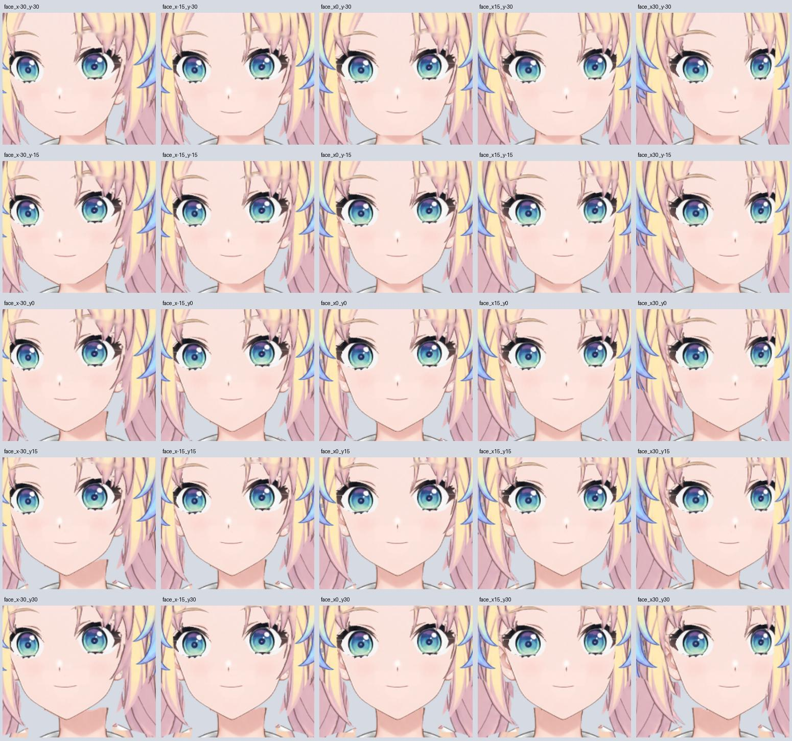

# 瑠璃乃 Live2D 桌宠模型

已完成真正的 Cubism 绑定初稿，能加载、眨眼、张嘴和小幅转头。头发边缘、闭眼过渡和部分变形仍需精修。

[下载 v0.3.3 模型与工程](https://github.com/taninettty/rurino_ai/releases/tag/live2d-rig-v0.3.3) · [使用方法、验证结果与剩余问题](RIG_DRAFT.md) · [桌宠与本地对话程序](../desktop/README.md)

**新的素材重建进度：** [v0.3.4 独立眉毛与口眼素材工作稿（尚未绑定）](HEAD_MATERIALS_V034.md)。

v0.3.3 提供 `.model3.json`、`.moc3`、纹理和 `.cmo3` 工程。使用者在已有桌宠中加载 `runtime/Rurino.model3.json` 即可，无需自行绑定。

旧版 [v0.2 素材交接包](https://github.com/taninettty/rurino_ai/releases/tag/live2d-prep-v0.2) 与 [历史制作说明](HANDOFF.md) 保留用于追溯，现有运行工程仍见 [v0.3.3 工程说明](RIG_DRAFT.md)，新头部素材制作见 [v0.3.4 工作稿记录](HEAD_MATERIALS_V034.md)。

本作品的角色在运用株式会社Live2D的著作物素材样本时依据了株式会社Live2D规定的协议。本作品完全根据制作者的自我裁量制作而成。
