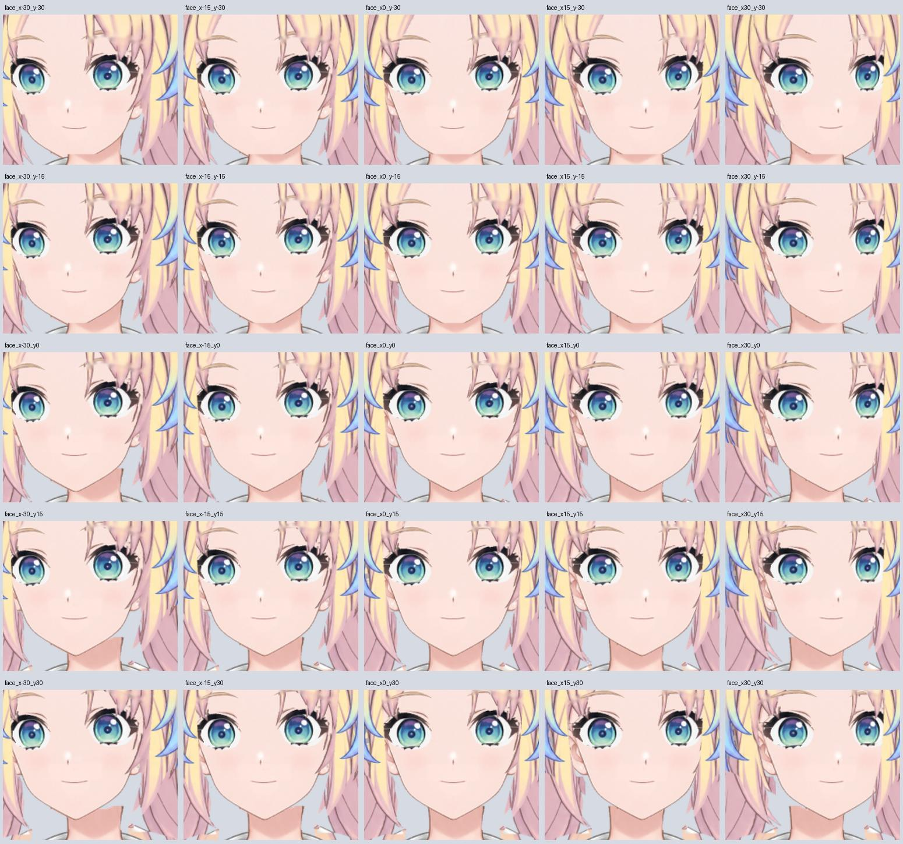

# 瑠璃乃 Live2D 桌宠模型

当前入口：[Windows AI 交接说明](WINDOWS_HANDOFF_2026-11-01.md) · [2026-11-01交接下载](https://github.com/taninettty/rurino_ai/releases/tag/windows-handoff-2026-11-01)。最新已验证源工程是右发修复 v4，另有待绑定的完整四马尾 v5 PSD。请以交接说明为准。

以下为历史 v0.3.3 资料，不代表最新正面模型的能力；不要以此覆盖 v4 工程。

v0.3.3 提供 `.model3.json`、`.moc3`、纹理和 `.cmo3` 工程。使用者在已有桌宠中加载 `runtime/Rurino.model3.json` 即可，无需自行绑定。

旧版 [v0.2 素材交接包](https://github.com/taninettty/rurino_ai/releases/tag/live2d-prep-v0.2) 与 [历史制作说明](HANDOFF.md) 保留用于追溯，现有运行工程仍见 [v0.3.3 工程说明](RIG_DRAFT.md)，新头部素材制作见 [v0.3.4 工作稿记录](HEAD_MATERIALS_V034.md)。

本作品的角色在运用株式会社Live2D的著作物素材样本时依据了株式会社Live2D规定的协议。本作品完全根据制作者的自我裁量制作而成。
