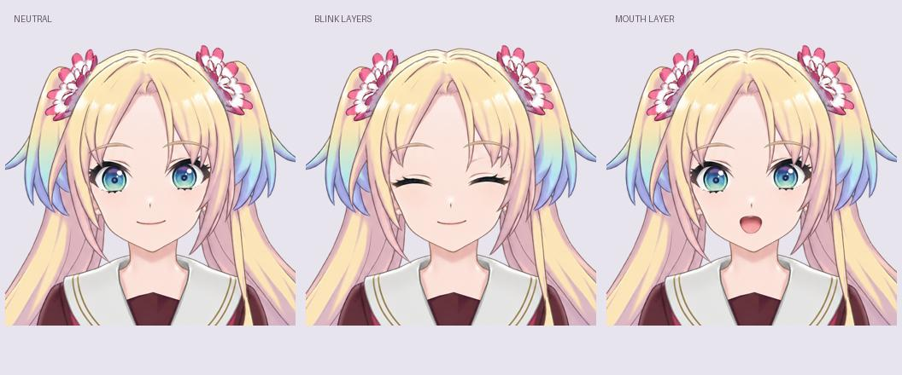

# 瑠璃乃 Live2D 制作交接

目标是在 Windows 制作大沢瑠璃乃的 Live2D 桌宠，保留用户确认的脸型、金色双马尾、蓝紫渐变发梢、双花饰和酒红制服。待机应为双手自然放下，使用小幅呼吸、眨眼、歪头和自然问候。

## 当前完成程度

- 用户已确认这版自然站姿。
- 已通过 LibTV 生成正常立绘及身体、脸部、后发和表情补画。
- 已生成可编辑 PSD、独立 PNG 部件，并检查默认合成与确认稿的一致性。
- 第二版加入脸部底层、衣料遮挡补画、眼白补全、手腕余量和后发内侧填充。仍是待检查的制作稿，不是绑定完成的模型。
- 用户提供的语音模型位于本仓库既有目录；交接素材包内另带一条已生成的日语问候 WAV。

**尚未完成：Cubism 中的网格、变形器、参数关键形、物理、`.cmo3` 工程、`.moc3` 导出，以及最终桌宠。**

不要把 PNG 晃动、透明视频或序列帧桌宠称作完成的 Live2D。用户已明确拒绝那个方案。

## 下载素材

[下载完整交接包（PSD、PNG、语音）](https://github.com/taninettty/rurino_ai/releases/download/live2d-prep-v0.2/Rurino-Live2D-Handoff.zip) · [Release 页面与校验值](https://github.com/taninettty/rurino_ai/releases/tag/live2d-prep-v0.2)

## 给下一位 AI

桌宠接入代码位于 [desktop/](../desktop/README.md)，已准备真实模型加载与问候语音联动。瑠璃乃模型仍需按下方说明完成 Cubism 绑定。

先阅读 [HANDOFF.md](HANDOFF.md)。源脚本在 `production/`，检查结果在 `metadata/`。较大的 PSD、PNG 原件和音频由配套 Release 素材包提供，不把语音权重或 Python 环境重复上传。

上图是表情素材叠合检查，不是已导出的 Live2D 模型。
