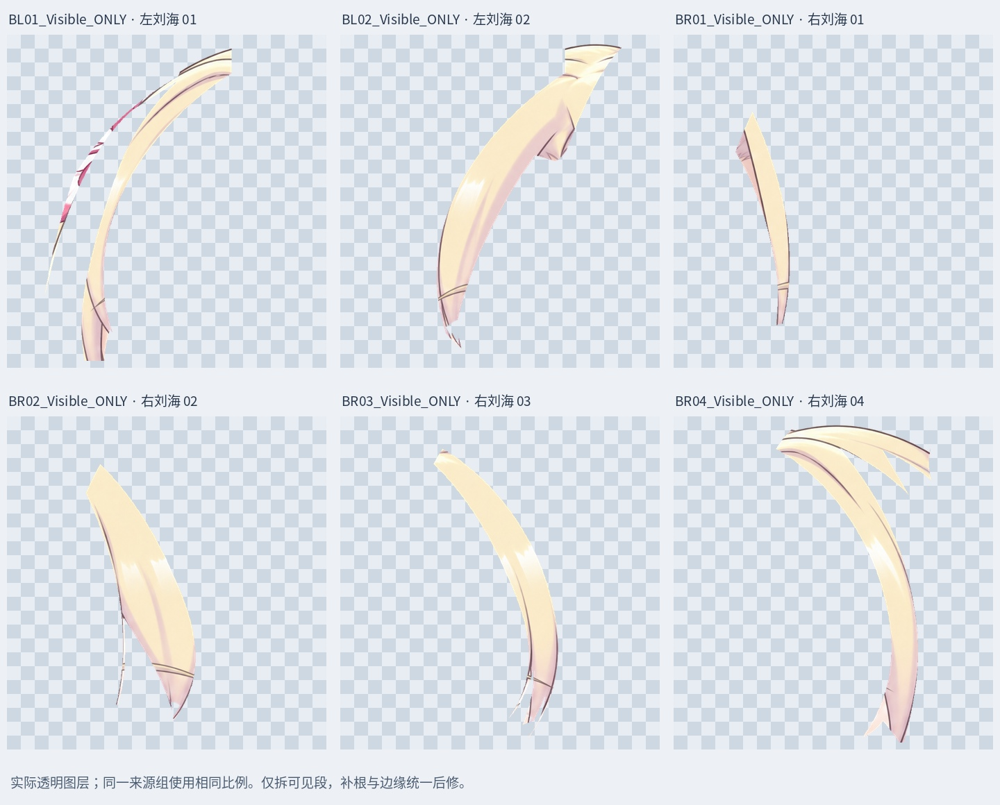
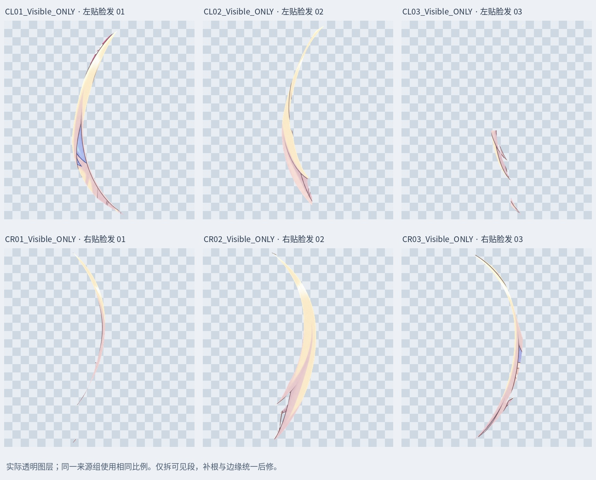
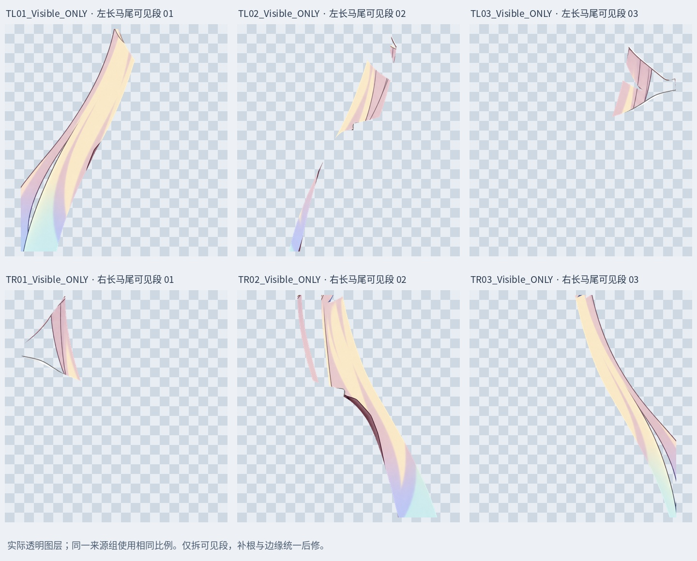

# v0.3.4 其他头发拆分候选：视觉复核未通过

**此批分区不予采纳。18 是输出分区数，并非已确认发束数；72 层 PSD 留作失败候选。问题及后续方法见 [视觉复核](REMAINING_HAIR_VISUAL_REVIEW_V034.md)。下文保留原始制作记录，重构检查不代表分界正确。**

按用户最新要求：**先拆其他头发，最后统一修整**。本轮暂缓逐缕补根和接缝精修，先拆左右刘海、左右贴脸发和左右长马尾 6 个原图层。

## 本次拆分

6 个来源图层划分为 18 个可见部件：左刘海 BL01–02、右刘海 BR01–04、左贴脸发 CL01–03、右贴脸发 CR01–03、左马尾 TL01–03、右马尾 TR01–03。路径沿纵向发流弯曲划分，不是等宽网格或矩形切块；需要统一精修的边界先记录下来。

最新检查稿：`Rurino_Left_Head_Remaining_Hair_Split_v034.psd`，72 个像素层。原 54 层全部保留；本轮 6 个来源层隐藏备份，新分层放在原父组和叠放位置。此前短发、鬓边单束和胸前细长单束继续保留，没有再次切碎已经独立的单束。

## 实际图层预览

- `qa/bangs-alpha.jpg`：左右刘海独立透明图层。
- `qa/cheeks-alpha.jpg`：左右贴脸发独立透明图层。
- `qa/tails-alpha.jpg`：两侧长马尾可见段。
- `qa/hair-split-location.jpg`：在原位置叠加颜色的归属图，便于查看分界，颜色不写入素材。

每组来源内部使用相同显示比例，预览不把合成图的矩形视口当作发束边界。

## 保存与重构检查

新部件的可见 RGBA 和 alpha 可无损拼回各来源图层。新增透明区的隐藏 RGB 归零，原来源层字节仍保留备份。保存 PSD 后核对新增层与 PNG 一致，原 54 层像素、偏移、透明度、混合方式和裁切标志保持；仅 6 个指定来源层隐藏。

睁眼、半闭眼、闭眼三个状态的**整张合成 RGBA 最大差均为 0**。这是拆分保存检查，不是动态绑定验收。

## 最后统一修整的清单

1. 审核各发束分界与尖端归属，处理原粗拆层继承的眉线、花饰、皮肤/衣领边界及其他残留。
2. 补齐共用根部、被遮住的内侧及各层运动覆盖余量；当前全部是可见段拆分初稿。
3. 统一线条、颜色衔接和整体发型，再检查与脸、耳、肩颈及衣服的遮挡。
4. 长马尾在原画底边被画幅截断，不能当作已经具备完整发梢的素材。
5. 此后才进入网格、参数与物理，检查头部及身体侧摆、前后仰的组合。

本轮没有新增 LibTV 图片、补根绘画、Cubism 网格或物理。不能将新增 18 个拆分部件称为 18 缕完整重绘。

## 增量包

`Rurino_Remaining_Hair_Split_v0.3.4_ADDON.zip` 包含本轮 PSD、独立 PNG、路径遮罩、预览、验证记录、输入的 54 层 PSD 和复现脚本。此前 ZIP 保留历史内容。

安装 `production/requirements-materials-v034.txt`，在解压根目录运行 `python production/split_remaining_hair_v34.py`。脚本预览字体采用 Linux Noto CJK，其他系统需修改 FONT。直接打开 PSD/PNG 不需要运行脚本。

