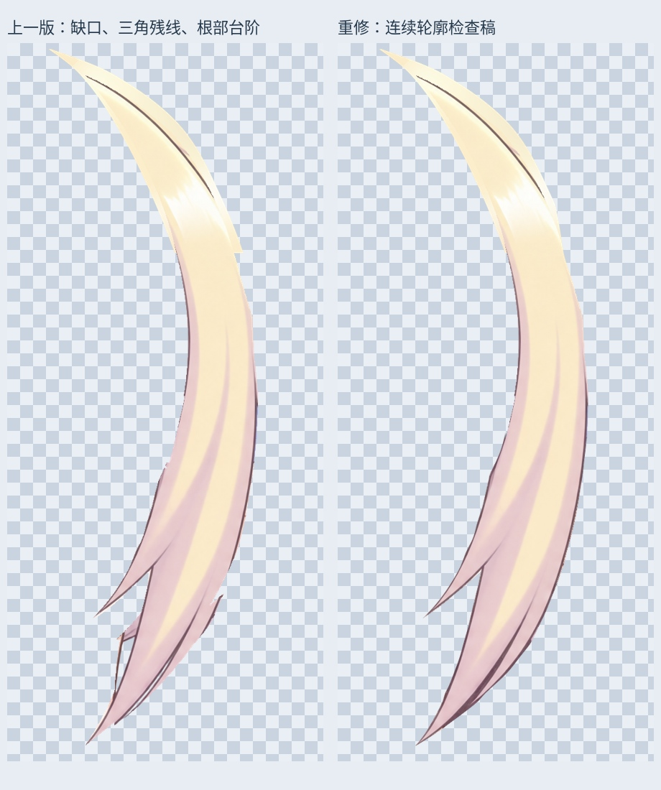
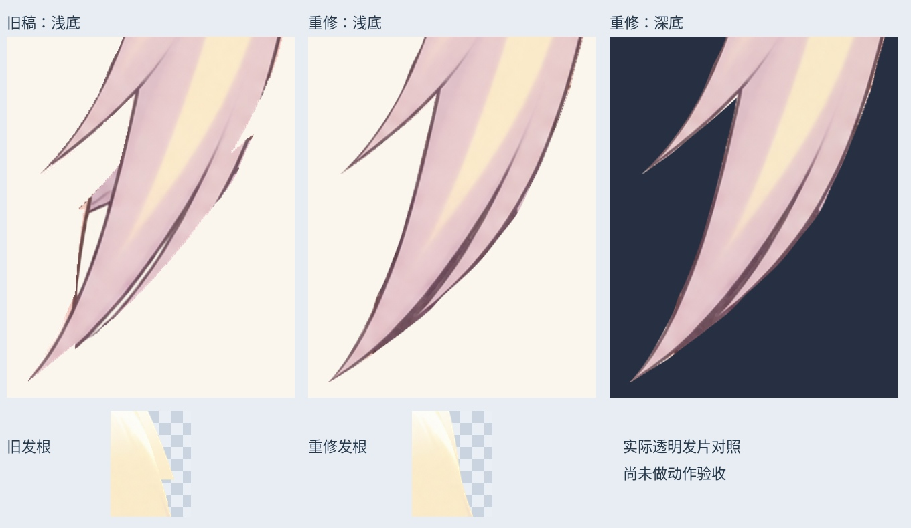

# 右贴脸发：连续轮廓重修

上一版独立发片仍有发根台阶、下半段三角形残线和外侧缺口。本轮直接修正透明发片的轮廓与缺损颜色。

- 沿原画描边重新描出主发束与尖分叉，去掉夹带的三角形轮廓，补齐右侧缺口和断续边缘。
- 收顺发根延伸片的台阶；根部保留区域原 RGB 不变，只修透明度轮廓。
- 下部颜色取自参考合成图中限定在头发轮廓内的像素；部分边缘和缺损位置由同一发束内部最近像素补色，不取轮廓外皮肤，不拉伸整张头部。
- 相比上一候选，共 33459 个 RGBA 像素改变，新增 2479 个有色覆盖位置，去除 2992 个旧覆盖位置。边缘/来源缺损中 2081 个位置采用内部补色。并非全部都是新画的头发。
- 以 alpha > 127、八邻域检查，发片为一个连续部件，内部透明孔洞为 0。浅色、深色、棋盘底预览均为真实透明发片。

## PSD 与检查稿

`Rurino_Right_Cheek_Contour_Rework_v034.psd` 共 132 个像素层。最新右贴脸发在默认隐藏的 `13_RightCheek_ContinuousContour_REVIEW_OFF` 组中，图层名 `Cheek_R_ContinuousContour_LOCAL_REVIEW`。它替代旧 `12` 组中的候选，检查时不要叠加历史候选。

原 131 个像素层的像素、偏移、可见性及混合属性完整保留。新候选保存回读与 PNG 一致。默认三种眼睛状态合成未变；这说明旧默认显示没有受损，不代表新候选已经完成装配或动态验收。

最新连续头顶/刘海仍为 `CrownFringe_RightTipsRecovered_LOCAL_REVIEW`，左贴脸发仍为 `Cheek_L_RootClean_LOCAL_REVIEW`。本轮没有改眼睛、脸型或眉毛素材。

## 尚未完成

这是当前左侧视角的材料检查稿。根部遮挡、与相邻发片的接缝及运动中显露的隐藏面仍需装配检验；不代表所有隐藏面已重绘。大马尾末端、转头、身体动作和头发物理未完成，未替换旧 v0.3.3 运行模型。

输入 SHA256：`58a2af8a2350b2ef6c50785ff93e83c69526082a160dc693815290e1d3fbbb80`

输出 SHA256：`1e06d6af7b88ad319b1bea29399f146a8ee674bae13217af8c585ada8720c117`

参考合成 PNG SHA256：`e87feb4c5e49a7e581f01e8593e548adfc612c514edc2f54898424aa1e7ae9da`

增量包包含输入/输出 PSD、固定参考 PNG、透明素材、遮罩、预览、验证与脚本依赖。安装 `production/requirements-materials-v034.txt` 后运行 `production/rework_right_cheek_contour_v34.py`；`--prepare-only` 只生成素材。默认字体为 Linux Noto CJK，可调整。打开 PSD 不需要脚本。本轮未调用 LibTV 生成。

