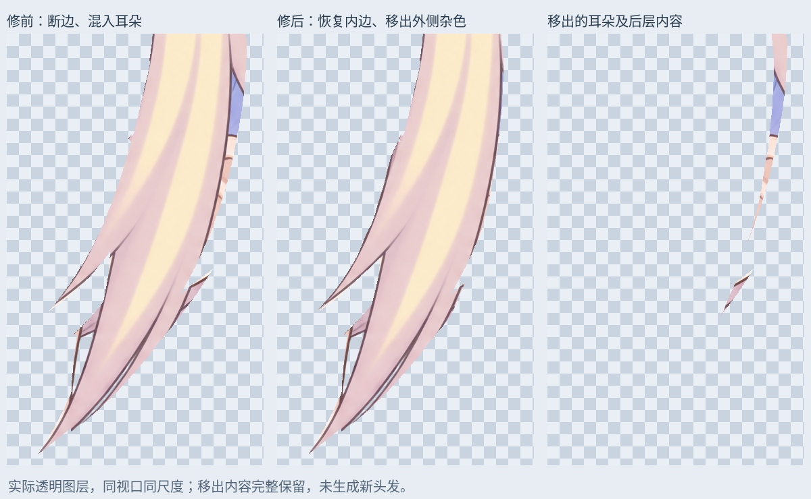
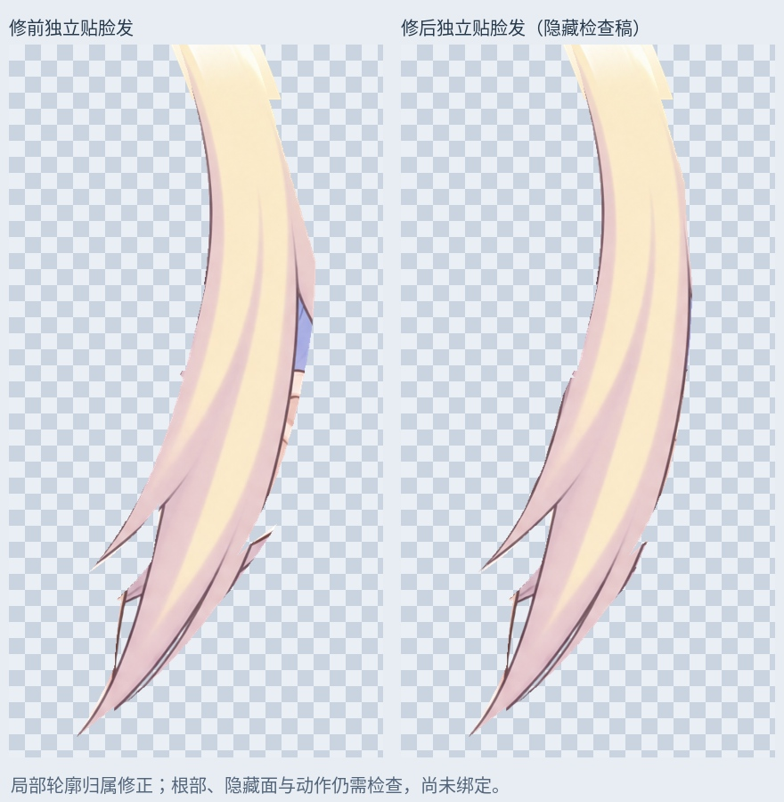

# 右贴脸发：内侧描边恢复与耳后内容分离

从 126 层右刘海发尖恢复稿继续，修正右贴脸发的局部材料归属。

- 从脸层取回 1216 个原头发像素，接回内侧描边与分叉。采用保守轮廓，仍有少量抗锯齿混边需要后续检查。
- 将右贴脸发外侧的 5233 个耳朵、后层蓝发和相邻根部碎片移到独立上下文层。沿原画纵向边界分离；这些像素全部保留，没有擦掉耳朵，也没有生成新发丝。
- `Rurino_Right_Cheek_Ownership_v034.psd` 共 131 个像素层。原 126 层像素与偏移、混合属性保留，两份旧来源层关闭；替代来源留在原绘制位置，且拆分互不重叠、拼回完全一致。
- 睁眼、半闭眼、闭眼默认合成 RGBA 与输入完全一致，均 0 像素变化；新图层保存回读与 PNG 一致。眉毛、眼睛和连续中间刘海不变。

## 使用

最新右贴脸发检查稿为 `12_RightCheek_OwnershipClean_REVIEW_OFF` 中的 `Cheek_R_OwnershipClean_LOCAL_REVIEW`。该组默认隐藏，替代旧 `11` 组里的右贴脸发候选；不要将历史候选叠加显示。最新连续头顶/刘海仍是 `CrownFringe_RightTipsRecovered_LOCAL_REVIEW`，左贴脸发仍是 `Cheek_L_RootClean_LOCAL_REVIEW`。

`layers/` 保存实际透明素材。两张预览都使用独立图层及相同视口比例，不是从完整人像截图代替素材。`Cheek_R_EarRearContext_SOURCE` 保留移出的内容，尚不是完整独立耳朵。

## 边界与后续

本轮只修局部轮廓归属，仍是原左侧视角的材料准备，不是新 Live2D 运行模型。根部有待整理、少量皮肤/头发混边和隐藏面仍不完整；大马尾肩后连接、画布外末端、转头与身体前后左右动作、头发物理还未完成。静态像素一致不能证明动作已经合格。完整候选保持隐藏，未覆盖旧 v0.3.3 运行模型。

输入 SHA256：`641f28657af37ad86404be2f9fc3a5d9ad1523cf59bd339cbf7b432541bc89a2`

输出 SHA256：`58a2af8a2350b2ef6c50785ff93e83c69526082a160dc693815290e1d3fbbb80`

增量包含输入/输出 PSD、透明 PNG、遮罩、预览、校验和脚本依赖。安装 `production/requirements-materials-v034.txt` 后运行 `production/repair_right_cheek_ownership_v34.py`；`--prepare-only` 仅输出素材。字体默认 Linux Noto CJK，可调整；直接打开 PSD 不需要运行脚本。本轮没有新增 LibTV 生成。

