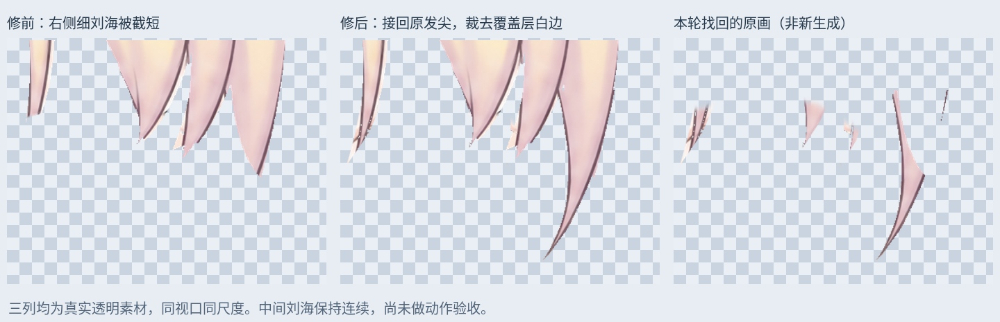
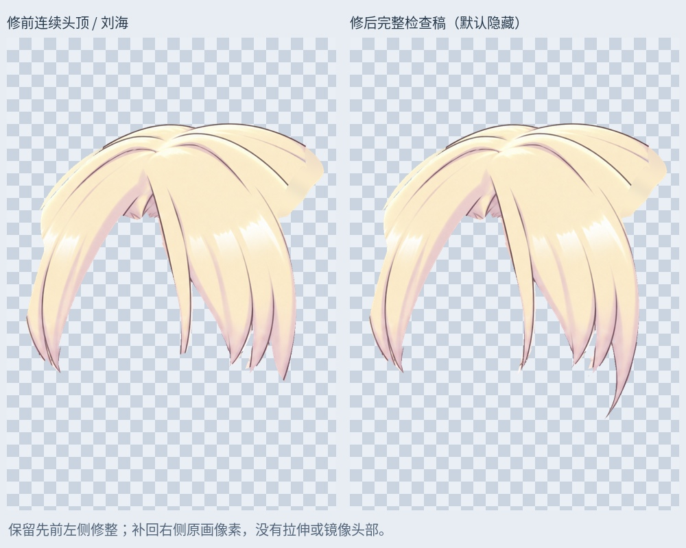

# 右侧刘海：接回眼尾细长发尖与前景原画

从 117 层左贴脸发根清理稿继续。检查右侧独立刘海时发现，眼尾外侧的细长发尖被截短，下半段仍在脸部、贴脸发和上下文层里。头部默认合成有这些像素，独立头发材料却不完整。本轮按原画两条描边重新辨认归属，并接回原有发尖。

## 已修的内容

- 从脸部层取回 1399 个原头发像素，从右贴脸发层取回 55 个，从右刘海上下文取回 1017 个。它们属于眼尾附近原有的细长刘海，没有重新生成或拉长整张图。
- 纳入独立前景头发层的 4267 个像素，补齐右侧/中间刘海的前景发尖。没有从任何眼球或眼睫状态图层取样。
- 旧前景覆盖层在细长发尖外侧带有浅色羽化，检查稿裁去真实轮廓外的 442 个覆盖像素；默认来源层完整保留。
- 更新连续头顶 / 刘海检查稿，保留此前左侧修整和连续中间刘海。右贴脸发检查稿同步移出属于刘海的少量像素，避免后续同时启用两个部件时重复。

## PSD 与素材

`Rurino_Right_Fringe_Tips_v034.psd` 有 126 个像素层。原 117 层像素、偏移、透明度、混合和裁切属性全部保留；四份被替换的来源层关闭。新来源层保留原绘制位置与顺序。脸部剩余内容及单独取回的头发互不重叠，拼回来源完全一致。眉毛和三种眼睛状态的图层不改。

`11_RightFringe_CompleteTips_REVIEW_OFF` 及其两个子组默认关闭。最新连续刘海为 `CrownFringe_RightTipsRecovered_LOCAL_REVIEW`，替代旧 `09` 检查组中的连续刘海；另一层 `Cheek_R_FringeRemoved_LOCAL_REVIEW` 是配套的右贴脸发检查稿。检查时只单独显示需要的一组，避免叠加历史候选。左贴脸发仍采用此前 `10` 检查组的根部清理版本。

`layers/RightFringe_complete_REVIEW.png` 是修后的右侧独立刘海；`Crown_continuous_REVIEW.png` 是完整连续头顶 / 刘海；`RightFringe_recovered_original.png` 是本轮重新分配的原画；`RightFringe_overlay_review.png` 是裁去外侧浅边后的前景覆盖检查副本。细节图三列为修前、修后、本轮找回原画，使用相同视口与比例，来自实际透明材料。

## 检查与未完成项

新图层保存回读同 PNG 一致。睁眼、半闭眼、闭眼默认合成与输入 PSD 的 RGBA 完全一致，变化像素均为 0。既有脸色、眼色、眉毛及前景遮挡顺序未因这次重分配改变。完整候选仍默认隐藏，尚未接入运行版模型。

这仍是当前左侧视角的原画材料，并非新的正面或其他角度。少量旧半透明边缘和肤色混边仍需精修；右贴脸发/鬓发完整隐藏面、大马尾肩后接缝与画布外末端仍未完成。没有新增 Cubism 网格、转头参数、身体动作或头发物理。静态一致不能替代动作与遮挡验收。

本轮为本地原画像素恢复，没有新增生成图或新 LibTV 任务。

输入 SHA256：`00f7430b6484b2d3c675e8953380677dbdf8e9870e75bb85078332bfa3b19129`

输出 SHA256：`641f28657af37ad86404be2f9fc3a5d9ad1523cf59bd339cbf7b432541bc89a2`

`Rurino_Right_Fringe_Tips_v0.3.4_ADDON.zip` 含输入/输出 PSD、透明 PNG、遮罩、预览、验证与脚本依赖。安装 `production/requirements-materials-v034.txt`，运行 `production/recover_right_fringe_tips_v34.py`；`--prepare-only` 只输出 PNG。字体默认 Linux Noto CJK，其他系统可调整。直接打开 PSD 无须运行脚本；本包不更新现有运行模型。

