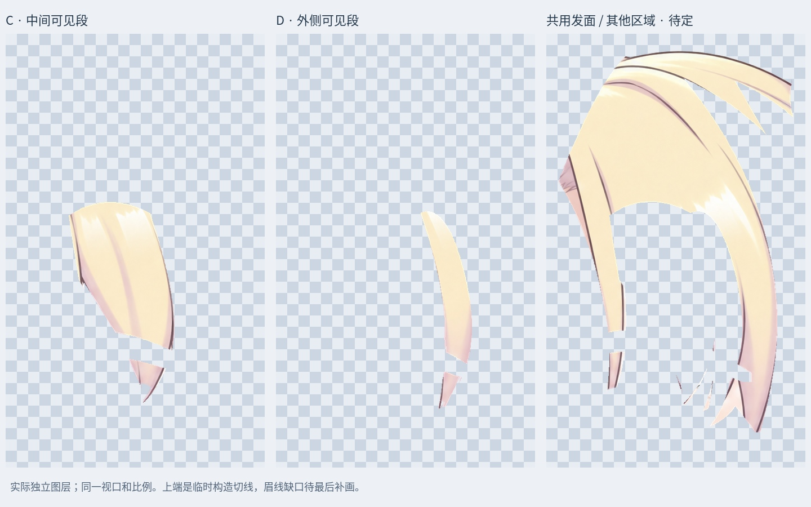
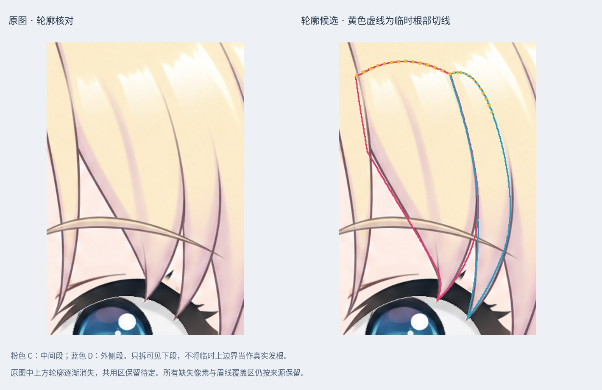

# 右侧刘海：两段可见分叉候选

本轮沿原图中右侧刘海的中间宽段 C、外侧窄段 D 向上追踪轮廓，只拆出可见下段。上方线条逐渐消失在共用发面中，因此上端闭合线是临时构造切线，预览用黄色虚线标出；不能将它当作原画中的真实发根边界。

## 工作稿

`Rurino_Right_Fringe_Visible_Split_v034.psd` 共 69 个像素层。输入为上一阶段 66 层 PSD，新增 C、D 和共用余区三个图层，原右侧来源层隐藏备份。没有采用被否决的 72 层机械拆分候选。

两段上方相邻边使用同一条曲线，避免重复切线之间留下额外窄条；可见轮廓依据局部放大图人工追踪，仍属于拆分检查稿。保留原始位置、色彩和透明度，没有重画发丝或调整脸部。

## 检查与边界

- 保存后回读，原 66 层像素、偏移、混合、裁切和透明度保留；仅替代来源层改为隐藏。
- 新图层与对应 PNG 一致；睁眼、半闭眼、闭眼的整图 RGBA 与本轮输入完全一致。拼回检查不能证明发束结构正确。
- `qa/right-fringe-full-alpha.jpg` 展示三份实际独立图层，采用共同视口和比例，视口包含来源层全部非透明像素。没有用合成图裁切代替独立图层。
- `qa/right-fringe-contour-review.jpg` 显示原图与轮廓候选，黄色虚线为临时上端闭合线。
- 眉毛覆盖区仍留下缺口，轮廓边缘的细屑、原始混入的肤色及尚未确认的连接留在共用待定层；描边归属未最终验收。
- 本轮完整发根到发尖的可绑定发束数为 0。头顶与刘海尚未完整分开，左侧刘海和其余连接待继续辨认。
- 按用户要求先拆其他部分，之后统一补画眉下缺口、隐藏根部与边缘。未制作网格、物理或新的运行模型。

## 文件

`Rurino_Right_Fringe_Visible_v0.3.4_ADDON.zip` 包含本轮 PSD、上一阶段输入 PSD、独立透明 PNG、遮罩、预览、核验记录及必要脚本。此前各阶段包仅作为历史保留。

安装 `production/requirements-materials-v034.txt` 后执行 `python production/split_right_fringe_visible_v34.py` 可复现；中文预览默认使用 Linux Noto CJK 字体，其他系统需修改字体路径。直接打开 PSD/PNG 无需运行脚本。

