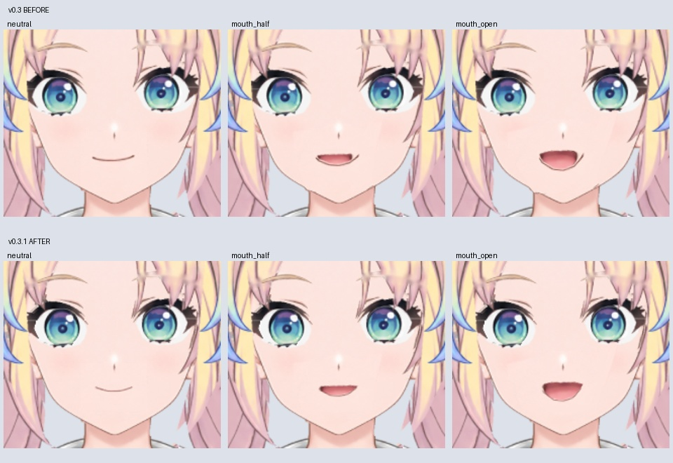
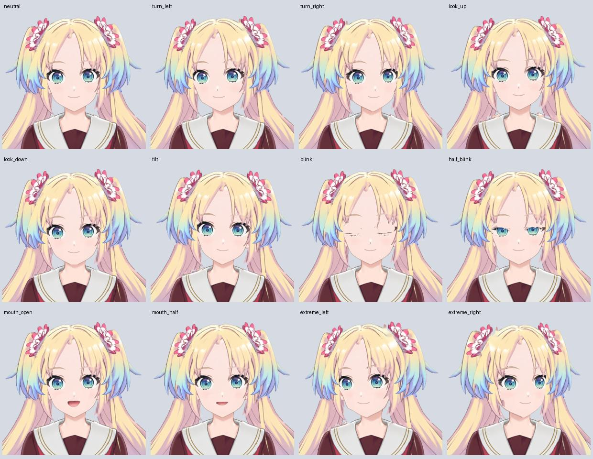

# 瑠璃乃 Live2D 可运行绑定测试稿 v0.3.1

更新：2026-10-27。已在真正的 Cubism Editor 中应用 Epsilon FREE 模板、校正对应部件、保存工程并导出运行模型。它是可运行的绑定初稿，画面精修尚未完成。

[下载模型与工程](https://github.com/taninettty/rurino_ai/releases/tag/live2d-rig-v0.3.1) · [桌宠程序](../desktop/README.md)

## Windows 直接使用

1. 使用已有的 [desktop-chat-v0.2.1 桌宠程序](https://github.com/taninettty/rurino_ai/releases/tag/desktop-chat-v0.2.1)。
2. 完整解压 `Rurino-Live2D-Runtime-v0.3.1.zip` 到固定目录，例如 `C:\Models\Rurino`。
3. 启动桌宠，选择包内 `runtime/Rurino.model3.json`。保留同目录的 `.moc3`、纹理、物理文件等，不能单独移动 JSON。
4. 此模型包不含语音权重或聊天服务；继续使用已有 Ollama、Whisper 和用户训练的日语音色配置。

运行模型不需要安装 Cubism Editor，也不需要重新拆分图片或绑定。`Rurino-Live2D-Source-v0.3.1.zip` 是继续编辑用的工程包，普通使用者不必下载。

## v0.3.1 面部修正

- 重画左右对称的闭合嘴线，缩短过宽嘴角；清除张嘴时右侧残留嘴线与下唇遮盖层中的下巴轮廓。
- 对称化口腔素材并校正它在实际网格中的水平偏移。张嘴颜色区域相对鼻部参考线的偏移由约 3.4 px 降至约 1.0 px（768×1024 渲染，仅作近似检查）。
- 两侧眼白、瞳孔与上下睫毛作为完整部件组各向内移动 2 px；眼白素材横向收至 94%。这些是素材调整量，实际网格渲染位移不一定完全相同。
- 按官方 PSD 再导入流程保留图层名称、顺序及对应关系，在已有绑定中替换素材，更新纹理并重新导出。没有要求使用者手动重新绑定。

对照图：上排 v0.3，下排 v0.3.1；依次为闭嘴、半张嘴、张嘴。眼距为小幅调整，头部角度与裁切相同。

## 已有绑定与本版保留

- 33 个 ArtMesh、26 个有效参数、1 张 2048×2048 纹理；真实 `.moc3`，按 SDK 4.2 格式导出。
- 对照官方 Epsilon 手动修正脸、鼻子、眼睛、嘴、头发、手臂的模板映射。
- 瞳孔分别裁剪到眼白；闭眼关键形压合眼白并在完全闭合时隐藏眼白，修正上睫毛尖角。中间过渡仍需精修。
- 三层嘴型可张合；修正脖子盖住下巴的问题，头部 X 轴三个关键形的脖子绘制顺序都设为 490。
- 参数转换为标准 `Param*` 名称，导出 `EyeBlink` 和 `LipSync` 分组。
- 源工程由 Cubism Editor 5.3.04 FREE 保存，日志确认 `Verify after save : SUCCESS`。制作环境为 Linux / Wine，模型格式面向 Cubism 与 Windows 播放器。

## 已验证与实际限制

2026-10-27 在 Linux Xvfb / Mesa、live2d-py 1.0.0 上重新加载导出文件：

- 12 张受控姿态截图，包括完全闭眼、半闭眼、两种嘴型、左右转头、上下视角和极限 X 角度。
- 96 帧动态预览来自实际 SDK 渲染，展示小幅转头、闭眼和测试口型；无音频，不是实时对话演示，也不是模型内置 Idle 动作。
- 桌宠集成测试通过：透明像素、口型控制与静音归零、置顶、缩放、拖动、设置保存、模型重载及清理。

仍待完成：头发边缘及肩侧缺口补画、闭眼睫毛线条清理和半闭眼色泽、较大转头的脸发衔接、头部 Z 轴歪头效果与头发物理的专项验收、自然手臂动作。现阶段适合小幅转头与口型测试，不能当作精修完成的模型。Windows 实机的透明窗口、麦克风、Ollama 与语音整链路尚未验收。

## 接着制作

本次最终导入素材为 t032，已写入工程与运行模型。

从工程包的 `Rurino_Template_Rig_Draft.cmo3` 继续，不必从旧版 v0.2 PSD 重绑。`Rurino_Face_Corrected_t032.psd` 是此次实际导入的 33 层素材；`required_mapping.json` 记录语义部件与模板 ID。左右语义名称按观看者视角；模板 `ParamEyeL/ROpen` 按角色视角。

当前修正已写入工程及运行文件。不要重新自动匹配后覆盖手动校正；即使 PSD 名称相同，Cubism 自动对应也曾把眼部和嘴部匹配错误。下一步优先精修闭眼睫毛线条与头发边缘，每次重新导出后运行 `production/check_rig.py` 和桌宠 `tests/smoke_live2d.py` 并检查截图。

## 来源

角色形象为大沢瑠璃乃的非官方同人制作，使用本项目已有 LibTV 立绘与补画；不表示获得 Love Live! 官方授权。模板结构来自 Live2D 的 Epsilon FREE，原始建模作者为 Live2D，保留该素材适用的原始许可；本包未附官方样本原包、音频或编辑器。

本作品的角色在运用株式会社Live2D的著作物素材样本时依据了株式会社Live2D规定的协议。本作品完全根据制作者的自我裁量制作而成。

- [Epsilon 样本](https://www.live2d.com/zh-CHS/learn/sample/epsilon/)
- [素材使用条件](https://www.live2d.com/zh-CHS/learn/sample/model-terms/)
- [无偿提供素材使用许可](https://www.live2d.com/eula/live2d-free-material-license-agreement_cn.html)

PSD 更新参考：[官方再导入流程](https://docs.live2d.com/en/cubism-editor-manual/psd-re-import/)。
