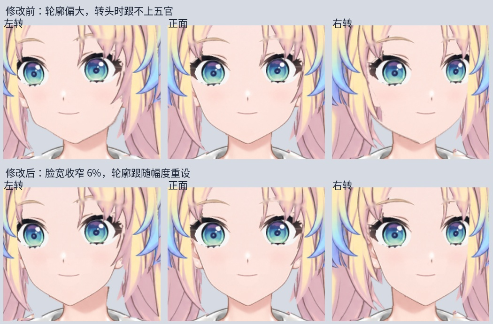
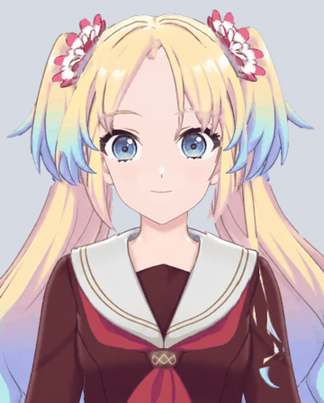

# 瑠璃乃 Live2D v0.3.3：脸型与五官动作协调修正

本版针对脸型偏大、五官转动但下巴跟不上而显得脸肿的问题，提供可直接加载的运行模型和可编辑工程。仍是精修中的测试稿。

## Windows 使用

1. 完整解压 `Rurino-Live2D-Runtime-v0.3.3.zip`。
2. 在已有 [desktop-chat-v0.2.1 桌宠](https://github.com/taninettty/rurino_ai/releases/tag/desktop-chat-v0.2.1) 中选择包内 `runtime/Rurino.model3.json`。不要单独移动 JSON。
3. 不需要 Cubism Editor 或自行绑定。继续编辑才需要 Source 包。

此模型包不含语音权重或聊天服务，继续沿用已有 Ollama 和语音配置。

## 本版修改

- 脸部素材横向收窄 6%，眼睛、鼻子与嘴巴素材不随之缩放。
- 重建脸部 X/Y 共九个关键形。旧模型 X=-30 时脸部网格额外变宽约 5%，下巴只移动约 6 px；新版轮廓横移约 20 px，接近嘴巴约 21 px 的幅度，并去掉额外撑宽。
- 抬头、低头时脸部纵向移动约 12 px，接近眼睛、嘴巴幅度。上述数据以 768×1024 SDK 渲染尺度计。
- 补足脖子顶部原有 V 形缺口，避免抬头露缝；保留脖子原网格与衣领位置。
- 包含此前尚未发布的正面嘴型重画：三个嘴部网格的张合关键形重建，下唇覆盖层通过移动张合，修正旧侧脸嘴线、半开残影与下巴露边。当前仅一种微笑张合，旧 MouthForm 表情绑定已移除。

对照图上排是上一轮 v0.3.2 候选版，下排是本版；两排用相同角度、缩放和裁切。

## 验证与限制

2026-10-27：实际导出模型包含 26 个参数 ID、33 个 ArtMesh、1 张 2048 纹理，SDK 4.2 格式。Cubism Editor 保存日志确认成功。已检查 25 个 X/Y 姿态、15 个嘴型组合及 96 帧动态预览。

Linux Xvfb / Mesa 的桌宠集成测试通过：加载、透明渲染、口型控制、静音归零、置顶、缩放、拖动、设置保存、重载与清理。动态 GIF 无音频，是参数测试，不是实时对话演示。

此版脸型采用幅度协调的平移修正，仍需进一步雕刻大角度透视。头发边缘、肩侧缺口、闭眼睫毛、极限转头的脸发和脖子衔接仍需精修。Windows 实机和麦克风—Ollama—语音整链路尚未验收。

## 继续编辑

使用 `Rurino_Coordinated_Face.cmo3` 与实际导入的 `Rurino_Coordinated_Face_t052.psd`，不要回到旧素材重新自动匹配。`required_mapping.json` 保留语义部件对应。production 中的修复脚本记录制作步骤；其中素材脚本需要其注明的历史中间 PSD，运行模型和编辑 CMO 不依赖这些脚本。

## 来源

瑠璃乃非官方同人制作，沿用本项目 LibTV 立绘与补画。绑定结构参考 Epsilon FREE，原始模板作者 Live2D；包内不附官方样本原包、编辑器或音频。

本作品的角色在运用株式会社Live2D的著作物素材样本时依据了株式会社Live2D规定的协议。本作品完全根据制作者的自我裁量制作而成。

- [Epsilon 样本](https://www.live2d.com/zh-CHS/learn/sample/epsilon/)
- [素材使用条件](https://www.live2d.com/zh-CHS/learn/sample/model-terms/)
- [无偿提供素材使用许可](https://www.live2d.com/eula/live2d-free-material-license-agreement_cn.html)
