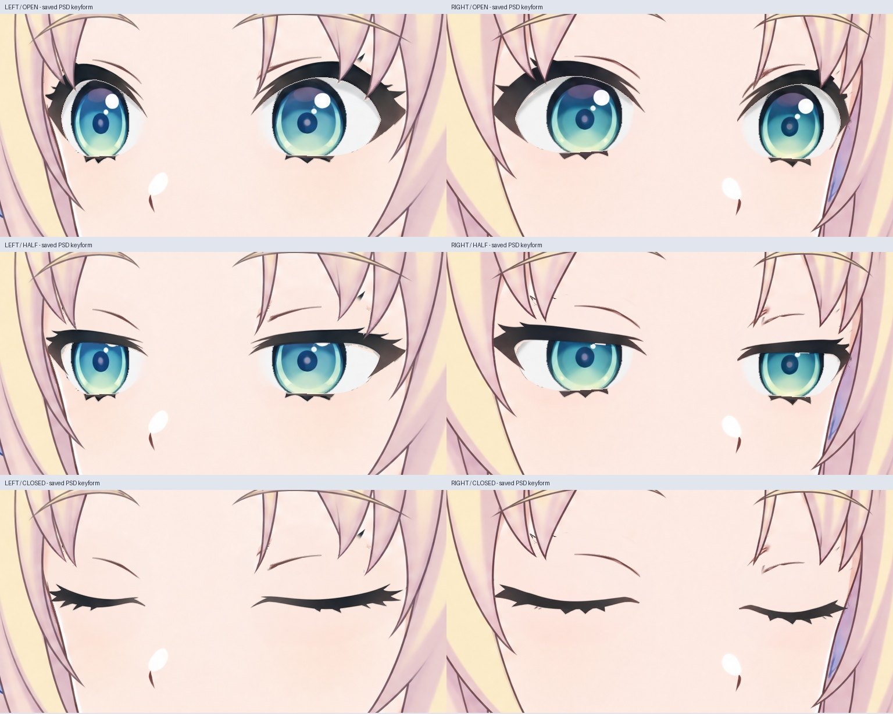
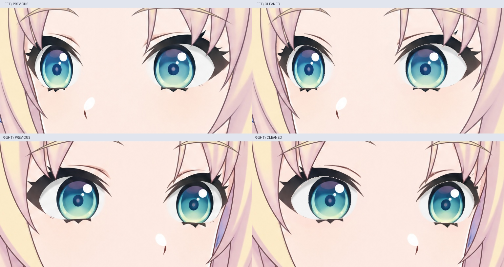

# 侧向眼部清边与眨眼关键形（未绑定）

本轮在上一轮侧向眼部分层上继续，新增两份 **2048×2048、各 20 个像素层、4 个虹膜裁切关系**的 PSD：

- `left/Rurino_Turn_Left_Blink_Materials_v034.psd`
- `right/Rurino_Turn_Right_Blink_Materials_v034.psd`

每份保存 `02_Open`（睁眼）、`02_Half`（半闭眼）、`02_Closed`（闭眼）三组关键形。默认只显示 Open；手工查看时每次只显示一组。Half 是美术中间关键形，不是经过测量的精确 50% 眼高。Closed 只有眼睑，没有隐藏在底图里的虹膜或眼白。其余两层是整图皮肤参考和局部刘海遮挡，**还不是完整拆分的头部模型**。

## 本轮处理

- 清理虹膜遮罩中混入的眼白边缘，保留原图可见虹膜内部纹理，隐藏边缘用邻近原始虹膜像素补足。没有缩放、压扁或重着色虹膜纹理。
- 重新划分眼睑与刘海的归属，去除皮肤碎片和明显的睫毛残影。被刘海分成数段的上睫毛不能当作眼褶移动；本轮对此单独划分眼褶区域。
- LibTV 分别补画左右侧向半闭眼、闭眼，共四张源图。只提取局部眼睑线条，统一输出分辨率，不把生成图整张覆盖到角色脸上。
- Open 和 Half 复用同一虹膜纹理及坐标；半闭眼由眼睑与眼白遮罩改变可见范围。局部眼褶随眼睑移动，脸型、鼻嘴和整头没有做几何拉伸。
- 补画的原始提示词、模型参数、任务/节点、交付回执、文件尺寸与 SHA256 均保存在 `sources/`。前一阶段 10 层 PSD 与正面 76 层 PSD 保留。

## 检查方法

`qa/side-blink-keyforms.jpg` 直接由重新打开的 PSD 渲染，逐一查看左右共六个关键形。`qa/side-eye-cleanup-comparison.jpg` 是旧工作稿与新默认状态的同尺寸对照。没有把完整图片切换或淡化冒充连续 Live2D 动画。

`qa/saved-psd-verification.json` 检查：唯一图层名与裁切关系、三组可见状态、Open/Half 虹膜纹理和坐标一致、闭眼无蓝绿色虹膜残留、睁眼及半闭眼各四个小幅视线位置的裁切范围、保护区域在关键形切换时保持不变。PSD 与本地合成的抗锯齿边缘误差单独记录；实际交付预览使用 PSD 渲染。完全透明像素的隐藏 RGB 会被 PSD 渲染器规范化，不把它当成可见画面改变。

PNG 图层位于各方向的 `layers/`。除整图参考外均为 768×384 的眼部带坐标，放置偏移见 `manifest.json`；PSD 已按全画布坐标放置。导入 Cubism 后仍需显式设置虹膜裁切到对应眼白。

## 尚未完成

这是可编辑的眨眼**素材关键形**，还没有连续眨眼网格、转头参数、组合参数或新的 cmo3/moc3。眼角抗锯齿、眼褶与细刘海接触处仍需在连续变形中细修；本轮没有宣称这些边缘已经达到成品标准。新增半闭眼/闭眼不等于连续动作已验收。

下一步将左右关键形与正面眼部的部件、眼角位置和遮挡对应起来，补足网格运动所需的隐藏眼睑；继续完整脸皮、耳朵和头发拆分，再做 Cubism 绑定。没有修改现有公开运行版，也未增加本轮 Windows 实机、实时对话或语音口型验收。

上文路径均为源码 ZIP 内 `rebuild_v3_4/turn_redraw/side_blink_refinement/` 下路径。

