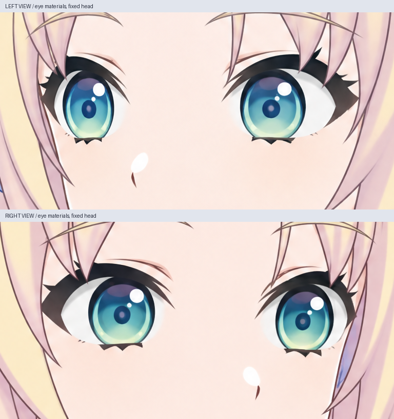
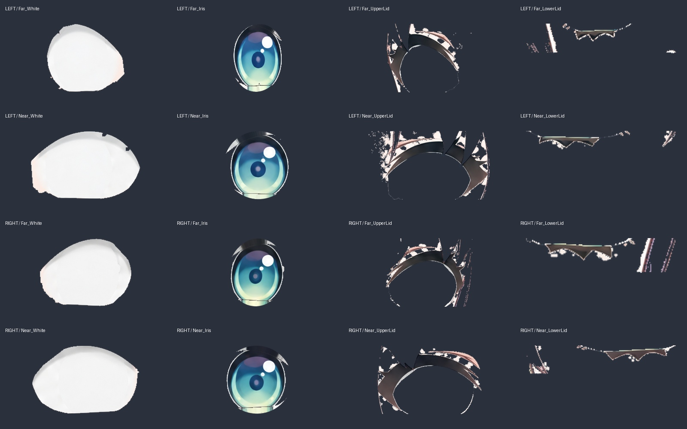
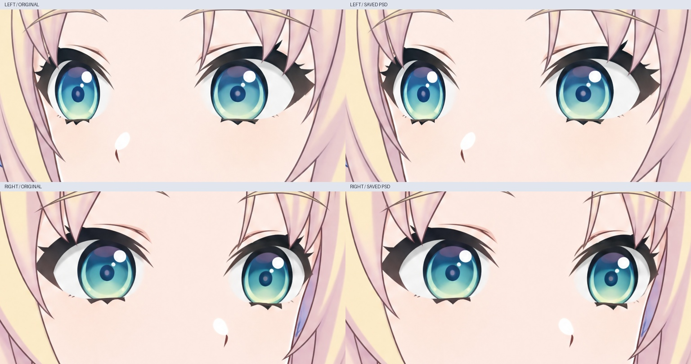

# 左右转头眼部分层工作稿

后续进度：已新增[侧向清边与三组眨眼关键形](SIDE_BLINK_MATERIALS_V034.md)。下文保留此前 10 层检查点记录。

本轮新增两份 2048×2048 PSD，每份 10 个像素图层、2 个虹膜裁切关系：

- `left/Rurino_Turn_Left_Eye_Materials_v034.psd`
- `right/Rurino_Turn_Right_Eye_Materials_v034.psd`

每份包含近侧、远侧两只眼睛；每只分为眼白、虹膜、上眼睑和下眼睑。其余两层是补好眼部皮肤的整图参考，以及眼睛附近原始刘海的局部前景遮挡。**整图参考尚未拆成脸皮、耳朵、头发、身体等完整模型部件。** 正面 76 层 PSD 仍是独立文件，没有被替换或合并。

## 制作与使用

以已经校正过眼部透视的左右转头图为源图，保持各自的画法与原坐标。LibTV 分别生成去虹膜的眼白底图和去眼部的皮肤底图，共四张补画。只有需要填补的区域使用补画；可见虹膜、眼睑线条及前景发丝取自原稿。右侧皮肤补画中残留的眼睑线经过局部清理，误当作眼睑的细刘海轮廓恢复为原始前景。

PSD 的 `Far` / `Near` 是远侧/近侧眼，不是角色的生理左眼/右眼。虹膜作为眼白的裁切层；导入 Cubism 后仍须显式设置虹膜对眼白的裁切对象，不能仅依赖 Photoshop 裁切标记。PNG 位于各方向的 `layers/`，除整图参考外均为 768×384 眼部带局部坐标；完整画布偏移写在 `manifest.json`，PSD 已按全局坐标摆放。

保留虹膜原始颜色和高光，不缩放或拉伸眼球纹理。眼睑遮住的少量虹膜边缘，用最近的原始可见像素补出余量，仅用于本轮的小幅视线检查；它不是完整的大角度眼球重绘。闭眼、半闭眼及大角度下的隐藏眼睑/头发结构仍须继续画。

## 目视复核与尚待收整

默认合成保持原稿形象；小幅视线移动时，虹膜边缘仍有细小浅色残边，独立眼睑层也带有局部皮肤/发丝边缘碎片。当前眼睑只用于固定开口遮挡，不能直接移动这些层来制作眨眼。下一轮先清理边缘与遮挡归属，再补完整半闭眼和闭眼关键形；数值检查通过不等于拆层美术已经完成。

## 已做验证

- 两份 PSD 重新打开后均为 10 个唯一像素层，2 个虹膜裁切层。
- 默认本地合成相对原图，RGB 最大误差为 1；保存后的 PSD 相对本地合成，RGB 和 alpha 最大误差各为 1。眼部带以外保持原始 RGBA 像素。
- 对四只眼分别检查居中、左右各 6 像素、上下各 4 像素的视线位置。可见虹膜内部原始 RGB 在本地合成中保持不变，保存后的 PSD 也验证了裁切和眼白开口外画面不变。
- 眼白层中没有检测到残留蓝绿色虹膜像素。隐藏虹膜、隐藏整个眼部的结果均重新通过 PSD 验证。
- PSD 与本地预览的透明边缘合成算法略有不同：少数视线状态中，每帧最多 2 个抗锯齿边缘像素出现超过 2 级的 RGB 差，最大 8；不透明开口内最大差为 1。交付动图直接使用重新打开的 PSD 渲染。
- 原源图的皮肤 alpha 接近不透明。叠加独立眼部图层后，眼部带内部少量 alpha 提高数级；这项变化单独记录，没有声称整个图像的 alpha 完全不变。

检查结果：`checks.json`、`qa/saved-psd-verification.json`。生成提示词、任务和节点记录、原始补画、下载校验值均在 `sources/`。

## 查看成果

- `qa/side-eye-neutral-comparison.jpg`：原图与实际保存 PSD 的默认状态。
- `qa/side-eye-layer-sheet.jpg`：四只眼的眼白、虹膜、上下眼睑分层。
- `qa/side-eye-gaze-check.png`：无损 APNG，两个视角分别做小幅眼球移动；头部和眼睑固定。
- 各方向 `qa/psd-iris-hidden.png` 与 `qa/psd-eyes-hidden.png`：检查眼白补画与眼后皮肤。

这不是转头动画或侧向眨眼验收。没有新增 cmo3/moc3、语音口型或 Windows 运行包。下一步补画侧向半闭眼、闭眼关键形与被刘海遮住的眼睑，继续拆分脸皮、耳朵和头发并与正面配准，之后再做 Cubism 绑定和运行验证。

上文文件路径均为源码 ZIP 内 `rebuild_v3_4/turn_redraw/eye_layers/` 下路径。源码包在 v0.3.4 GitHub 草稿附件。

