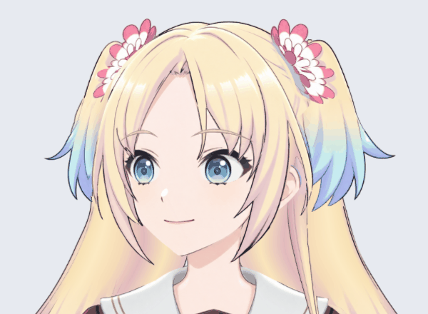

# 左右小马尾 Cubism 试绑定 v0.3.4

2026-10-29：在右侧小马尾试绑的基础上，为左侧小马尾新增独立变形器和 -1 / 0 / 1 三个关键形。当前两侧均可独立弯曲；左侧保持更多发根区不动，摆幅稍小，避免从花饰后滑脱。源 PSD 未改动。

## 打开与操作

- Cubism 工程：`Rurino_SmallTails_Trial_v034.cmo3`。使用 Cubism Editor 5.3.04 FREE 手动保存，并已关闭后重新打开检查。
- 运行入口：`runtime-smalltails/Rurino_SmallTails_Trial_v034.model3.json`。需保留同目录 `.moc3`、显示信息和 `.2048` 纹理文件夹。
- 左侧参数 `ParamHairSmallL` / Hair Small L，右侧参数 `ParamHairSmallR` / Hair Small R，范围均为 -1 到 1，中立为 0。
- `HairSmallL_Bend`、`HairSmallR_Bend` 分别包住本侧的底色与 `Ink_` 黑线，黑线仍可单独编辑。
- `qa-smalltails/smalltails-runtime-sway.gif` 是实际运行模型渲染出的双侧预览，`smalltails-runtime-poses.jpg` 是端点对照。

## 验证结果

- SDK4.2 格式导出，在 Python live2d / Cubism Core 6.0.1 中加载。
- 33 组单侧及双侧组合参数检查通过；只有被驱动的小马尾底色和黑线移动，脸、眼睛、身体及其他头发保持不动。
- 全部抽样位置没有新增三角形翻面；每侧 41 个底色/黑线共有顶点的运动位移差为 0。
- 左侧发梢最大位移约 31.9 原图像素，上部 10% 的位移小于 0.001 像素，接近浮点计算误差。
- 右侧沿用上一轮动作，发梢最大位移约 47.5–48.7 像素，上部 10% 仍有 3.7–4.9 像素位移，尚未完全锁住。
- 新旧中立图在同样灰底上比较，只有 13 个像素的通道差超过 1/255，最大约 2.25/255，差异集中在新增左侧变形器的渲染区域。
- 手动保存工程后关闭并重新打开，再次导出的 moc3、model3.json、cdi3.json、纹理文件与本次检测版本逐字节一致。详情见 `source-roundtrip.json`。
- 图集沿用一张 2048×2048，源画布为 3456×2816。原始高分辨率材料仍保留。

## 仍未完成

这不是完整桌宠模型更新。大马尾、头顶/刘海联动、转头、抬低头、身体侧摆及前后仰仍待绑定，未加入新头发物理。两侧预览用相位略错开的正弦参数演示，不代表已验证惯性或身体驱动。

当前仍是左视图、腰部裁切半身；隐藏眼型组未导出，不能把本试验包当作眨眼、说话或实时对话成品。不要替换原桌宠默认模型。下一步先收稳右侧小马尾根部，再推进大马尾的分段弯曲与肩部遮挡。

抽样几何检查和可见姿态检查不等于所有组合动作验收。正式接入物理前，需要再次检查换向、停止、极端姿态及长发遮挡。

## 复验

安装 PyQt5、live2d-py、Pillow、numpy，使用支持 OpenGL 的显示环境运行：

```sh
python production/check_smalltails_v34.py runtime-smalltails/Rurino_SmallTails_Trial_v034.model3.json
```

输出到 `qa-smalltails/`。源码工程的再导出比对记录是本轮人工操作检查结果，不由该运行脚本重建。


