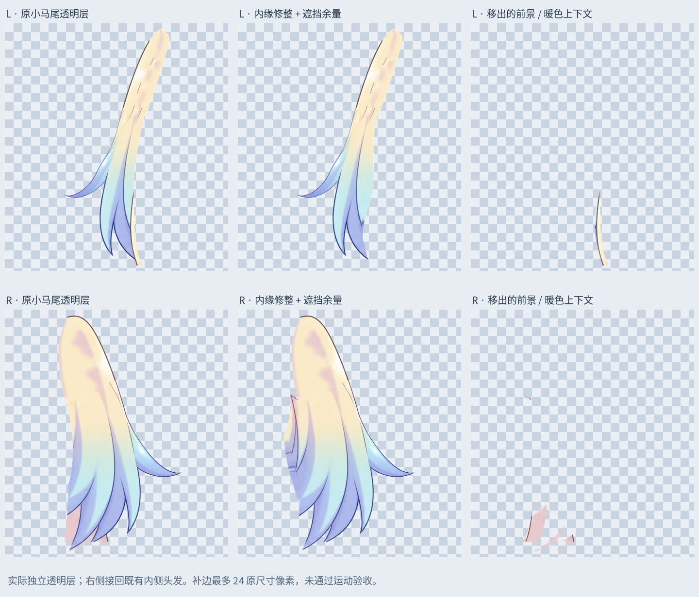

# 小双马尾内缘：归属修整与有限补边

输入为上一轮 81 层小双马尾补根稿。按原有头发走向逐处处理，没有切成矩形条，也没有采用镜像。独立眉毛、中间连续刘海和上轮发根工作保留。

## 修整

- 左侧：从小马尾里分出误混的前景金色发束。按实际棕色遮挡边界描线，包含半透明混色边缘；初次仅按颜色筛选留下的碎点未采用。
- 右侧：将发梢间的暖色上下文分出，保留蓝色发梢及深蓝描边；从原待定边界层接回 14049 个既有内侧头发像素，不将其称为新增重绘。
- 两侧分别沿清理后的内缘补有限遮挡余量，最大 24 个原尺寸像素；仅在原前层素材覆盖的范围内补画，颜色来自本侧头发内部。左 5061 像素，右 4905 像素。这不足以证明大幅摆动或转头不会露底。
- 移出的前景/暖色上下文保存在 `ForegroundContext_PRESERVED` 层，静态仍显示，后续应按真实归属绑定，不能随小马尾一起运动。旧层隐藏留档；左侧历史待定上下文层本轮继续保留。

## 验证

保存后的 `Rurino_SmallTwinTail_Inner_v034.psd` 为 85 个像素层。原 81 层像素、偏移、透明度、混合与裁切属性保留。新层回读与透明 PNG 一致。

睁眼、半闭眼、闭眼三种状态在本轮编辑遮罩外逐像素一致，没有新增像素伸出原轮廓；最大通道差分别为 2, 2, 2/255。差异来自有限补边与 8 位透明度合成，不能把此项检查当作造型或运动验收。

对照图每行以相同视口和比例展示真实透明层：左列原层，中列修整和补边后，右列移出的上下文。右侧中列含接回的既有内侧头发。

## 范围

仍是当前视角的局部素材修整。小马尾内侧边界及完整隐藏面未全部完成，部分混色边缘仍待精修；扎点、网格、转头与身体摆动、物理未验收。大双马尾和旧外缘杂点另待处理。

本轮为本地原画像素归属修整及位图补边，没有新的 LibTV 生成任务，也未声称先前 COMMERCIAL_BLOCKED 已解除。

## 使用

`Rurino_SmallTwinTail_Inner_v0.3.4_ADDON.zip` 包含输入 PSD、输出 PSD、透明层、遮罩、检查记录和复现脚本。安装 `production/requirements-materials-v034.txt` 后运行 `production/refine_smalltail_inner_v34.py`；预览使用 Linux Noto CJK 字体，Windows 复现可调整 FONT。直接打开 PSD/PNG 不必执行脚本。此包不更新现有 Cubism 运行模型。

