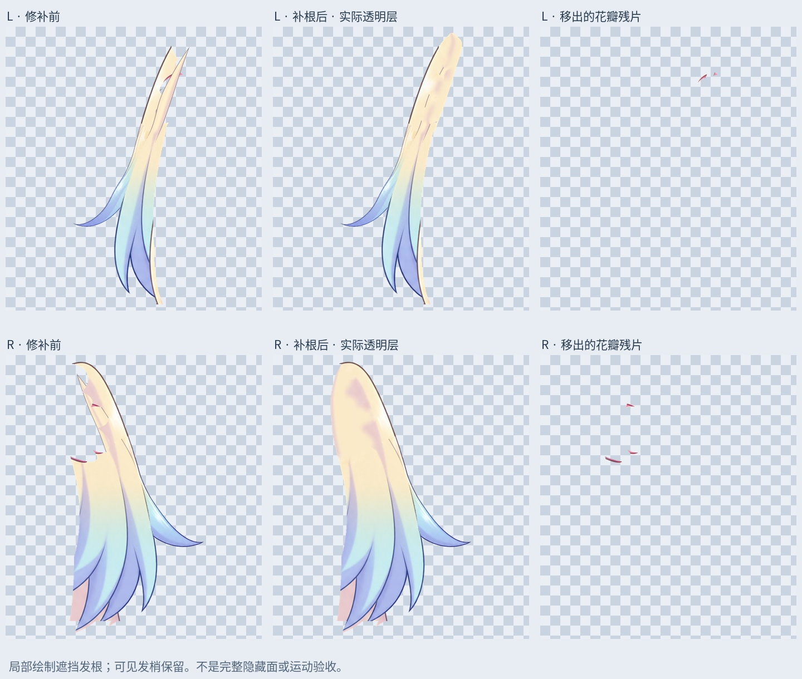

# 小双马尾：花饰遮挡发根补画

输入为上一轮 77 层刘海修补稿。仍按头顶、刘海、左右小双马尾、左右大双马尾制作；眉毛独立，中间刘海不再细拆。

## 本轮

- 分别沿左右小马尾的原有走向补花饰下的发根连接。颜色从各自金色发段采样，本地位图绘制，不是恢复不可见的原画像素，也没有镜像或变形整张脸。
- 混入发根的饱和粉色花瓣残片移入独立 `FlowerContext_PRESERVED` 层，静态仍显示，不能随发束运动；原层隐藏留档。
- 新绘区域只进入已有前层素材覆盖的地方或移出花瓣后的原覆盖范围。注意原图大量实心区域的 alpha 实际为 252–253/255，因此遮挡识别使用 >=250；合成透明度可能小幅变化。
- 左侧新增透明区覆盖 8005 像素，右侧 23337 像素。原尺寸第 591 行以后的可见发段和发梢逐像素保留。

## 保存与检查

新 PSD 有 81 个像素层，保留原 77 层像素、位置及混合/裁切属性，只关闭两张被替代的小马尾层。新层保存后回读与透明 PNG 相同。眉毛及上一轮刘海修补保留。

睁眼、半闭眼、闭眼三种状态在编辑遮罩外完全一致，没有新增像素伸出原头部范围。各状态最大通道差为 5, 5, 5/255。

预览每行以同一视口、同一比例展示原始透明层、修补透明层、移出的上下文；不是从整头截图中截取的假独立层。

第一版自由补边有部分伸出原轮廓，已弃用。最终补画限定在前层覆盖区。以上验证仅针对静态素材，不代表转头、侧摆或前后仰已经通过。

## 尚未完成

这些是当前视角的小马尾局部发根素材，不能称为完整小马尾或全部隐藏面。内侧发面和边界仍有缺口，扎点运动范围、逐缕网格、物理未完成；大双马尾及旧边界杂点也待修。补画不会自动进入现有运行模型。

LibTV 此前生成被 COMMERCIAL_BLOCKED 拒绝，本轮未重复提交，也没有声称它已恢复。使用本地位图处理。

## 文件

`Rurino_SmallTwinTail_Roots_v034.psd` 为当前工作稿；`Rurino_SmallTwinTail_Roots_v0.3.4_ADDON.zip` 含输入 PSD、输出 PSD、透明 PNG、遮罩、检查图和复现脚本。安装 requirements 后运行 `production/complete_smalltail_roots_v34.py`。这是制作素材包，不是新的 Cubism 运行模型。

